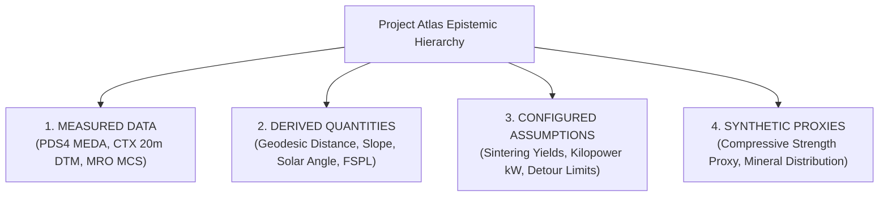

# Project Atlas — Milestone 13AA: Limitations & Evidence Boundaries
## Mandatory Epistemic Boundaries, Disclaimers, Non-Flight-Certification & Operational Assumptions

**Document Version:** 1.0.0  
**Classification:** Scientific Integrity & Boundary Disclosure Document  
**Milestone:** 13AA — Atlas Assurance Grand Prix  
**Date:** 2026-11-07  
**Repository:** `E:\Python\NASA-Spaceapps\Marswalk`  

---

### 1. Mandatory Scientific & Operational Disclaimers

In strict adherence to Project Atlas scientific rules:
1. **NO NASA AFFILIATION OR ENDORSEMENT**: Project Atlas was developed as a research and educational prototype for the NASA Space Apps Challenge. It is **not developed by, endorsed by, certified by, or officially affiliated with NASA, JPL, ESA, or any space agency**.
2. **NO OPERATIONAL FLIGHT READINESS**: Simulated rover sorties, rotorcraft flight profiles, orbital communication links, life-support models, and autonomous construction schedules are computational models only. **No modeled route or structure is certified as operationally safe for human astronauts**.
3. **NO TERRA-TWIN OR PHYSICAL HARDWARE DEPENDENCY**: All simulation results represent software execution within Python. No physical hardware testbeds, physical actuators, or hardware-in-the-loop (HIL) dynamometers were utilized.

---

### 2. Epistemic Provenance Hierarchy

Every data field, constant, and output within Project Atlas is classified according to its empirical basis:

1. **Measured Data**:
   - Surface elevations derived from the USGS Astrogeology CTX 20m DTM of Jezero Crater.
   - Atmospheric surface pressure, air temperature, relative humidity, and wind speed from NASA PDS4 Perseverance MEDA archives (Sols 10–100).
   - Geographic landmark names and coordinates from the IAU Planetary Gazetteer.
2. **Derived Quantities**:
   - Geodesic surface distances on the IAU 2000 Mars sphere ($R = 3,396,190\,\text{m}$).
   - Diurnal solar zenith angle and unattenuated solar irradiance via Allison & McEwen (2000).
   - Free-space path loss and thermal noise spectral density via analytical RF propagation equations.
3. **Configured Assumptions**:
   - Microwave sintering yield ($92\%$ usable block, $8\%$ thermal spall loss).
   - Regolith screening yield ($82\%$ usable fines $<150\,\mu\text{m}$, $18\%$ oversized cobbles).
   - Kilopower nuclear reactor baseline ($10\,\text{kWe} / 40\,\text{kWth}$) and Sabatier stoichiometric conversion efficiency ($95\%$).
   - Rover battery reserve floor ($30\%$).
4. **Synthetic Simulation Proxies**:
   - Non-destructive compressive strength values ($45\,\text{MPa}$ for sintered pavers, $35\,\text{MPa}$ for geopolymer) are algorithmic simulation acceptance criteria, not physical laboratory measurements.
   - 2D Gaussian Process mineral distributions represent an active learning research proxy, not subsurface drill core samples.

---

### 3. Release Boundaries & Valid Operating Envelopes

- **Spatial Envelope**: Planetary surface analysis is calibrated to the Jezero Crater quadrangle ($18.38^\circ\text{N}, 77.58^\circ\text{E}$); global MOLA elevation maps provide low-resolution context only.
- **Atmospheric Envelope**: Atmospheric pressure models are valid within the range $650\text{--}900\,\text{Pa}$; temperatures valid within $180\text{--}280\,\text{K}$.
- **Rotorcraft Flight Envelope**: Tip Mach number strictly restricted to $M_{\text{tip}} \le 0.85$ ($\Omega \le 2,800\,\text{RPM}$ for $R=0.60\,\text{m}$).
- **Telecommunications Envelope**: Link budgets assume line-of-sight propagation; atmospheric gas absorption is modeled as an empirical attenuation margin.
