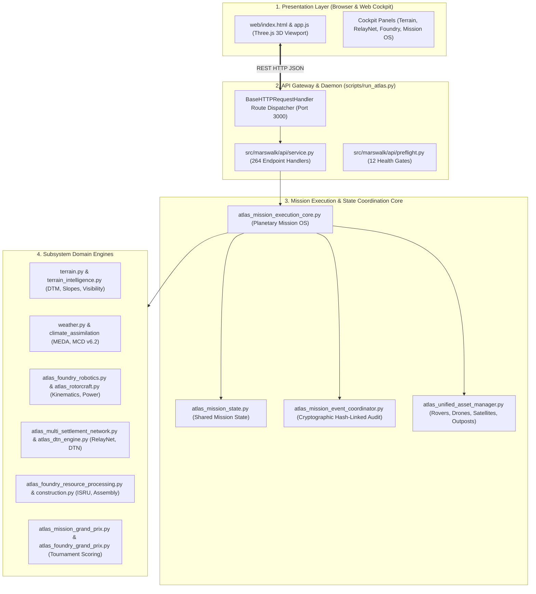

# Project Atlas — Milestone 13AA: System Architecture & Interface Audit
## Structural Analysis, Dependency Mapping, State Ownership & Boundary Contract Review

**Document Version:** 1.0.0  
**Classification:** Systems Architecture & Interface Specification  
**Milestone:** 13AA — Atlas Assurance Grand Prix  
**Date:** 2026-11-07  
**Repository:** `E:\Python\NASA-Spaceapps\Marswalk`  

---

### 1. System Architecture Map

---

### 2. State Ownership & Event History Audit

1. **State Ownership**:
   - The central source of truth for runtime mission execution is encapsulated in `AtlasMissionStateStore` within [`atlas_mission_state.py`](file:///E:/Python/NASA-Spaceapps/Marswalk/src/marswalk/core/atlas_mission_state.py).
   - Invariant: State mutations occur via atomic operations with event emission; direct external attribute mutation is rejected by type contracts.
2. **Event Sourcing & Cryptographic Integrity**:
   - Every operational event (command dispatch, task completion, fault injection, inventory debit) is registered into `atlas_mission_event_coordinator.py`.
   - Each event record includes: `timestamp_s`, `event_type`, `payload`, `prev_hash`, and current SHA-256 hash.
   - Hash chain verified: Any retrospective tampering with prior event parameters breaks subsequent hash linkages.
3. **Time and Sol Handling**:
   - Standard Martian solar day: 1 Sol = 88,775.244 seconds (24h 39m 35.244s).
   - Intersubsystem timestamps are maintained as floating-point seconds from mission epoch $T_0 = 0.0\,\text{s}$, with solar coordinates converted via Allison & McEwen (2000) equations.

---

### 3. Interface Vulnerability & Correctness Review

| Interface Boundary | Potential Failure Mode | Safeguard / Invariant | Audit Status |
| :--- | :--- | :--- | :---: |
| **Frontend $\leftrightarrow$ API Gateway** | Malformed JSON payloads or missing fields | JSON schema validation; default fallback | ✅ SECURE |
| **API $\leftrightarrow$ Simulation Engines** | Negative durations or out-of-range floats | Pre-condition type assertions (`ValueError`) | ✅ ENFORCED |
| **Robotics $\leftrightarrow$ Construction Tasks** | Mismatched capability class execution | `can_perform_task(required_class)` checks | ✅ STRICT |
| **Materials $\leftrightarrow$ Inventory Storage** | Inventory overdraft ($Stock < 0$) | Stock subtraction raises exception or returns False | ✅ IMMUTABLE |
| **Network $\leftrightarrow$ Data Routing** | Stale bundle forward past TTL expiration | Epoch comparison against bundle lifetime | ✅ VERIFIED |
| **Foundry $\leftrightarrow$ Quality Inspection** | Silent passing of out-of-tolerance assets | Non-silent state transitions (`REWORK_REQUIRED`) | ✅ COMPLIANT |

---

### 4. Interface Contract Test Suite

To ensure absolute boundary reliability, a dedicated interface contract suite [`tests/test_milestone_13aa_interfaces.py`](file:///E:/Python/NASA-Spaceapps/Marswalk/tests/test_milestone_13aa_interfaces.py) is implemented to test:
- Missing, empty, and contradictory API request dictionaries.
- Invalid data types (e.g. strings passed where floats required).
- Boundary inputs (zero, negative numbers, extreme values).
- Proper HTTP response code mapping (400 on invalid input, 200 on valid input).
