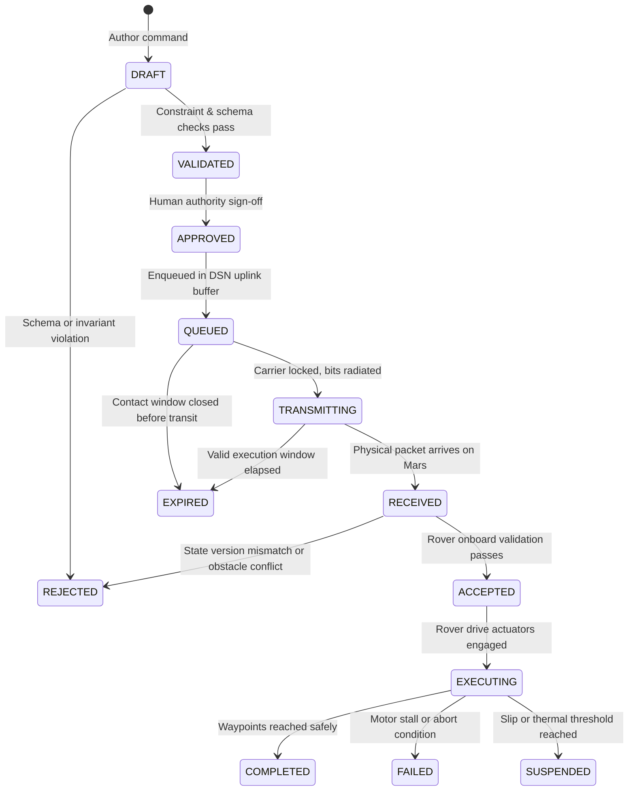

# PROJECT ATLAS — MILESTONE 13O
# COMMAND LIFECYCLE, PROTOCOL & IDEMPOTENCY SPECIFICATION
## CCSDS Packet Architecture, 10-State Formal State Machine, and Anti-Duplication Safeguards

**Milestone:** 13O — Atlas Deep Space Autonomy Lab  
**Repository:** `E:\Python\NASA-Spaceapps\Marswalk`  
**Core Implementation:** `src/marswalk/core/mars_command_transmission.py`

---

## 1. CCSDS-Inspired Deep Space Packet Format

Commands dispatched from Earth to Mars must adhere to rigorous structural standards inspired by the Consultative Committee for Space Data Systems (CCSDS) Telecommand (TC) architecture (CCSDS 232.0-B-4). Every telecommand generated in Atlas contains a fixed primary header, an operational secondary header, a validated payload, and cryptographic integrity verification digests.

```
+------------------------------------------------------------------------------------------------+
|                                    ATLAS CCSDS TELECOMMAND PACKET                             |
+------------------------------------------------------------------------------------------------+
|  OCTETS 0-1  |  OCTETS 2-3  |   OCTETS 4-5  |   OCTETS 6-7  |   OCTETS 8-15  |   OCTETS 16-47  |
| Version (3b) | Sequence     | Packet Length | Command ID    | Earth Dispatch | Payload SHA-256 |
| Type (1b)    | Counter      | (16-bit int)  | (16-bit hex)  | Timestamp      | Cryptographic   |
| Sec Hdr (1b) | (14-bit int) |               |               | (UTC float)    | Digest          |
| APID (11b)   | Flags (2b)   |               |               |                |                 |
+------------------------------------------------------------------------------------------------+
|                                  VARIABLE LENGTH PAYLOAD DATA                                  |
|  - Action Type (e.g. EXECUTE_TRAVERSE, SAMPLE_COLLECTION)                                      |
|  - Expected State Version (e.g. 1)                                                             |
|  - Waypoint Coordinates & Speed Boundaries                                                     |
|  - Energy & Thermal Invariants                                                                 |
|  - Execution Time Window & Expiration Deadline                                                 |
+------------------------------------------------------------------------------------------------+
```

### 1.1. Packet Header Fields
- **Version Number:** 3 bits; identifies the packet structure protocol version (Atlas default: `1`).
- **Application Process Identifier (APID):** 11 bits; identifies destination rover subsystem (e.g., `0x420` Mobility, `0x421` Robotic Arm, `0x422` Thermal/Power).
- **Sequence Count:** 14 bits; monotonically increasing counter per rover asset.
- **Payload SHA-256 Digest:** 32 octets (256 bits); cryptographic hash ensuring end-to-end data integrity across interplanetary relay hops.
- **Idempotency Key:** Cryptographic token generated from `rover_id:sequence_counter:sha256[:12]` enabling onboard deduplication.

---

## 2. Command Lifecycle Formal State Machine

A telecommand cannot be dispatched or executed arbitrarily. It progresses through a strictly monitored 10-state finite state machine with audited transitions:



### 2.1. State Transition Definitions
1. **`DRAFT`:** The initial planning state. Operator authors waypoint sequence, instrument activity, or parameters.
2. **`VALIDATED`:** Automated ground flight rules evaluate kinematics, power curves, terrain slope limits, and Draft 2020-12 schema compliance.
3. **`APPROVED`:** Authorized flight controller signs off based on command approval tier.
4. **`QUEUED`:** Loaded into Earth DSN ground station transmission buffer awaiting tracking pass.
5. **`TRANSMITTING`:** Radio frequency uplink underway across interplanetary space (one-way light time propagation).
6. **`RECEIVED`:** Electromagnetic bits captured by rover High Gain Antenna (HGA) or UHF relay, demodulated and assembled into memory buffer.
7. **`ACCEPTED`:** Rover Onboard Autonomy Engine validates expected state version against physical ground truth, checks line-of-traverse against live hazard map, and verifies battery/thermal margins.
8. **`REJECTED`:** Rover validator detects a collision with a newly formed hazard, a state version divergence, or an expired execution window. Rover enters contingency handling.
9. **`EXECUTING`:** Actuators (wheels, drill, mast) active under local closed-loop sensor guidance.
10. **`COMPLETED`:** Mission objective achieved; confirmation telemetry generated and enqueued for downlink.
11. **`FAILED` / `SUSPENDED` / `EXPIRED`:** Terminal or protective holding states when anomalies occur.

---

## 3. Approval Authority Tiers

To prevent unintended actuator engagement or mission-ending risks, Atlas categorizes commands into three formal approval tiers:

| Tier | Classification | Permitted Operations | Required Authorization |
|---|---|---|---|
| **Tier 1** | Routine Operations | Telemetry request, health check, small camera pointing, internal clock synchronization | Automated ground flight software or Tactical Planner |
| **Tier 2** | Tactical Mission | Waypoint traverse within nominal terrain, standard spectrometer rasters, low-power science | Tactical Mission Director & Flight Dynamics Lead |
| **Tier 3** | Critical / Irreversible | High-power drills, sample drop-off, pyro firing, flight software updates, hazard boundary override | Full Mission Directorate & Safety Tribunal Authority |

---

## 4. Idempotency & Deduplication Engine

In interplanetary communications, delayed acknowledgements (ACKs) are common. If an orbiter pass ends before an ACK is received on Earth, Earth Mission Control may presume the command packet was lost and issue a retransmission.

### 4.1. The Double-Actuation Hazard
Without idempotency safeguards, receiving the same telecommand twice would cause disastrous dual actuation:
- Driving an additional $100\text{ m}$ into an unmapped crater.
- Firing sample acquisition drills into an already hollowed rock core, shattering instrument bits.

### 4.2. Onboard Idempotency Cache
The Atlas Onboard Autonomy Engine maintains a deterministic Ring Buffer of executed idempotency keys:

$$\text{Key} = \text{SHA256}(\text{RoverID} \,\|\, \text{SequenceCount} \,\|\, \text{PayloadBytes})[0:16]$$

Upon packet arrival:
1. The rover calculates the packet's idempotency key.
2. The key is queried against the `ExecutedCommandRegistry`.
3. **If present:** The command is flagged as `DUPLICATE_IGNORED`. Actuators are **NOT** engaged. The cached completion status and ACK telemetry packet are re-downlinked to Earth immediately.
4. **If absent:** The command proceeds to onboard state and hazard validation.

---

## 5. Formal Preconditions and Invariants

Every command bundle specifies mandatory preconditions evaluated immediately prior to actuator execution:

```json
{
  "command_id": "CMD-2026-11-04-001",
  "expected_state_version": 1,
  "preconditions": {
    "min_battery_soc": 0.35,
    "max_terrain_slope_deg": 18.0,
    "max_wheel_slip_ratio": 0.20,
    "thermal_safe_range_c": [-40.0, 30.0],
    "hazard_avoidance_mask": "ACTIVE",
    "valid_until_sol": 1342.5
  }
}
```

If **any** precondition evaluates to `False`, the command is rejected, and an explainable decision record is generated without moving the wheels.

> [!WARNING]
> **MANDATORY ASTRONAUT SAFETY DISCLOSURE:**
> All command structures, approval tiers, idempotency engines, and execution invariants described herein are engineered exclusively for unmanned robotic planetary rovers. They are not certified, rated, or safe for human life-support or crewed space missions.
