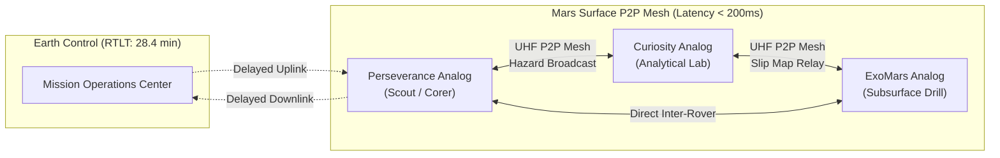

# PROJECT ATLAS — MILESTONE 13O
# DISTRIBUTED OPERATIONS & MULTI-ROVER FLEET INTELLIGENCE
## Peer-to-Peer Mesh Networking, Distributed Hazard Propagation, Network Partitions, and State Reconciliation

**Milestone:** 13O — Atlas Deep Space Autonomy Lab  
**Repository:** `E:\Python\NASA-Spaceapps\Marswalk`  
**Core Implementation:** `src/marswalk/core/mars_distributed_fleet_intelligence.py`

---

## 1. Rationale for Multi-Rover Fleet Intelligence

As robotic exploration of Mars advances towards coordinated fleets (such as sample collection rovers operating in tandem with sample retrieval landers and scout rovers), treating each rover as an isolated silo connected only via Earth is prohibitively inefficient. 

A round-trip message to Earth requires 28.4 minutes. If Rover 1 discovers a dangerous regolith sand trap, waiting for Earth to receive the telemetry, replan Rover 2's route, and uplink a new sequence would take hours—by which time Rover 2 may have already driven into the identical hazard.

Atlas implements **Distributed Fleet Intelligence**: rovers communicate directly via peer-to-peer (P2P) UHF proximity links ($400\text{ to }450\text{ MHz}$) across Martian terrain, sharing real-time environmental discoveries without Earth intervention.



---

## 2. Peer-to-Peer UHF Wireless Mesh Protocol

Rovers within line-of-sight or over-the-horizon relay range exchange compact proximity frames:
- **RF Standard:** Proximity-1 Space Link Protocol (CCSDS 211.0-B-5) adapted for surface rover-to-rover ad-hoc communication.
- **Frequency:** $401.5\text{ MHz}$ (UHF channel 1) with frequency agility to avoid interference with overhead orbiter overpasses ($435\text{ MHz}$).
- **Data Rate:** $128\text{ kbps}$ to $2\text{ Mbps}$ adaptive modulation depending on terrain diffraction and antenna elevation.
- **Effective Range:** $1.5\text{ km}$ across undulating dune terrain; up to $8\text{ km}$ with mast-mounted high-gain omnidirectional dipoles.

---

## 3. Distributed Hazard Broadcasting

When any rover encounters an uncataloged planetary hazard (rockfall, thermal slope failure, sand dune slip corridor), it broadcasts an immediate `HAZARD_ALERT` packet across the local mesh:

```json
{
  "packet_type": "P2P_HAZARD_ALERT",
  "originating_rover": "PERSEVERANCE_01",
  "broadcast_sol": 1342.385,
  "hazard_id": "HAZ-JEZERO-RF-084",
  "hazard_type": "ROCKFALL_SLUMP",
  "coordinates": {"lat": 18.4447, "lon": 77.4508, "x": 35.0, "y": 50.0},
  "bounding_radius_m": 8.5,
  "severity": "CRITICAL_MOBILITY_RISK",
  "recommended_avoidance_buffer_m": 12.0
}
```

### 3.1. Fleet Ingestion and Preemptive Replanning
Upon receiving the broadcast, neighboring rovers (e.g., `CURIOSITY_02` or `EXOMARS_01`):
1. Ingest the hazard coordinates into their local navigation obstacle costmaps.
2. Evaluate their own active and queued traverse trajectories.
3. If an upcoming leg intersects the hazard envelope, the receiving rover autonomously replans its path around the obstacle **before** physically encountering it.
4. Downlinks the coordinated collaborative avoidance event in the next Earth telemetry pass.

---

## 4. Network Partition Handling & Split-Brain Mitigation

Martian topography (crater rims, delta scarps, canyon walls) frequently breaks line-of-sight between rovers, causing temporary **Network Partitions**.

```
  [ Rover 1 ]               /\  (Delta Scarp / Rim)               [ Rover 2 ]
   (Western Floor)         /  \   LOS Blocked                    (Eastern Rim)
   Autonomous Ops         /    \                                 Autonomous Ops
   Local Queue           /      \                                Local Queue
```

### 4.1. Localized Autonomous Agency
During a partition:
- Each rover continues operating independently under its `BOUNDED_AUTONOMY` policy.
- Neither rover attempts to coordinate synchronous actions that require two-phase locking.
- All new discoveries, state increments, and hazard markers are written to a local **Distributed Ledger Queue**.

### 4.2. State Reconciliation upon Reconnection
When line-of-sight is restored:
1. Rovers initiate a Proximity-1 handshake exchange.
2. **Version Vector Exchange:** Rovers compare their causal version vectors $(\mathbf{V}_{\text{rover1}}, \mathbf{V}_{\text{rover2}})$.
3. **Conflict-Free Merge:**
   - **Hazards:** Union of hazard sets ($\mathcal{H}_{\text{merged}} = \mathcal{H}_1 \cup \mathcal{H}_2$). A hazard detected by either rover is permanently retained.
   - **Science Targets:** Highest scientific priority takes precedence; claimed targets prevent double-sampling.
   - **Clock Drift:** Synchronized to the highest precision onboard rubidium atomic clock or orbiter beacon reference.
4. The consolidated map state is unified without split-brain divergence or human intervention.

---

## 5. Collaborative Science Task Reallocation

When an autonomous detour forces a rover to consume excess energy, fleet intelligence enables dynamic task reallocation:
- If Rover 1 detours around a rockfall and drops battery reserve to $32\%$, it cancels an upcoming high-power Raman spectroscopy scan.
- It broadcasts a `TASK_DELEGATION_REQUEST` over UHF.
- Rover 2, positioned nearby with $82\%$ battery and identical spectrometer tooling, acknowledges and incorporates the science point into its own queue.

> [!WARNING]
> **MANDATORY ASTRONAUT SAFETY DISCLOSURE:**
> Multi-rover fleet protocols, mesh networking, hazard broadcasts, and distributed task reallocations documented here are designed solely for robotic exploration vehicles. They are not engineered, verified, or safe for human astronaut communications or life support operations.
