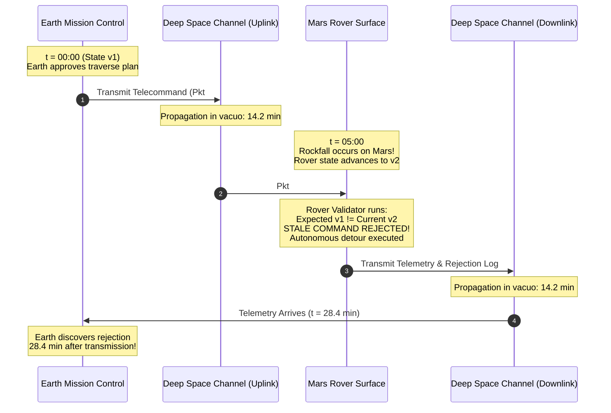

# PROJECT ATLAS — MILESTONE 13O
# EARTH–MARS COMMUNICATION ENVIRONMENT & PROPAGATION MODEL
## Relativistic Latency, Ground Station Tracking, Orbiter Relays, and Interplanetary Blackouts

**Milestone:** 13O — Atlas Deep Space Autonomy Lab  
**Repository:** `E:\Python\NASA-Spaceapps\Marswalk`  
**Core Implementation:** `src/marswalk/core/mars_communication_environment.py`

---

## 1. Physical Foundations of Interplanetary Communications

Operating robotic assets on the surface of Mars requires confronting the fundamental limits of electromagnetic propagation across the solar system. Because the orbital distance between Earth and Mars varies dramatically throughout the synodic cycle ($780\text{ days}$), speed-of-light communication latency is non-constant, non-negligible, and introduces an unbridgeable epistemic gap between Earth operations and surface reality.

### 1.1. Orbital Distance & Propagation Latency Range

Given the speed of light in vacuum $c = 299,792,458\text{ m/s}$ and $1\text{ Astronomical Unit (AU)} = 149,597,870,700\text{ m}$:

$$\tau_{\text{OWLT}} = \frac{d_{\text{Earth-Mars}}}{c}$$
$$\tau_{\text{RTLT}} = 2 \times \tau_{\text{OWLT}}$$

| Orbital Configuration | Distance ($\text{AU}$) | Distance ($\text{km}$) | One-Way Light Time (OWLT) | Round-Trip Light Time (RTLT) |
|---|---|---|---|---|
| **Perihelic Opposition (Closest Approach)** | $0.372\text{ AU}$ | $55.65 \times 10^6\text{ km}$ | $3.09\text{ min}$ ($185.6\text{ s}$) | $6.18\text{ min}$ ($371.2\text{ s}$) |
| **Nominal Baseline (Milestone 13O Reference)** | **$1.708\text{ AU}$** | **$255.51 \times 10^6\text{ km}$** | **$14.20\text{ min}$ ($852.3\text{ s}$)** | **$28.40\text{ min}$ ($1,704.6\text{ s}$)** |
| **Aphelic Conjunction (Farthest Separation)** | $2.683\text{ AU}$ | $401.37 \times 10^6\text{ km}$ | $22.31\text{ min}$ ($1,338.8\text{ s}$) | $44.62\text{ min}$ ($2,677.6\text{ s}$) |



---

## 2. Epistemic Separation: Ground Truth vs. Historical Belief

In terrestrial robotics, engineers often operate under the illusion of synchronous shared state. In planetary operations, this assumption is catastrophic. Project Atlas enforces strict epistemic distinctions:

1. **`EpistemicState.CURRENT_ON_MARS`:**
   - Physical truth at the current instant on Mars ($t_{\text{current}}$).
   - Known only to the onboard autonomy engine.
   - Includes real-time sensor streams, active obstacles, slip coefficients, battery voltage, and component temperatures.

2. **`EpistemicState.LAST_REPORTED_BY_MARS`:**
   - Earth Mission Control's belief state at $t_{\text{current}}$.
   - Represents telemetry generated at $t_{\text{current}} - \tau_{\text{OWLT}}$, received after transit.
   - Telemetry displays explicitly label data age:
     $$\Delta t_{\text{age}} = t_{\text{current}} - t_{\text{generation}} \ge \tau_{\text{OWLT}}$$
   - Any plan synthesized on Earth is inherently predicated on historical hypotheses that may no longer hold.

---

## 3. Deep Space Network (DSN) Ground Station Tracking

Direct-to-Earth (DTE) communication requires active line-of-sight tracking by NASA's Deep Space Network (DSN) complexes. DSN stations are spaced approximately $120^\circ$ apart in longitude to ensure continuous Earth coverage as the planet rotates:

```
                      NORTH POLE VIEW OF EARTH
                            [ Goldstone ]
                             (California)
                            /            \
                           /              \
                          /    ~120 deg    \
                         /                  \
                        /                    \
              [ Madrid ] -------------------- [ Canberra ]
               (Spain)        ~120 deg        (Australia)
```

### 3.1. Complex Parameters and Capabilities
- **Goldstone Deep Space Communications Complex (California, USA - $35^\circ 25' \text{N}, 116^\circ 53' \text{W}$):**
  - Antennas: DSS-14 ($70\text{ m}$), DSS-24/25/26 ($34\text{ m}$ Beam Waveguide).
  - High-power X-band and Ka-band uplink/downlink.
- **Madrid Deep Space Communications Complex (Robledo de Chavela, Spain - $40^\circ 25' \text{N}, 4^\circ 14' \text{W}$):**
  - Antennas: DSS-63 ($70\text{ m}$), DSS-54/55/65 ($34\text{ m}$).
- **Canberra Deep Space Communication Complex (Tidbinbilla, Australia - $35^\circ 24' \text{S}, 148^\circ 58' \text{E}$):**
  - Antennas: DSS-43 ($70\text{ m}$), DSS-34/35/36 ($34\text{ m}$).
  - Primary southern hemisphere tracking asset.

### 3.2. Handover Gaps and Contention
During Earth rotation, a tracking pass must transition from one DSN complex to the next (e.g., Goldstone setting $\rightarrow$ Canberra rising). During antenna slew, frequency re-lock, and carrier acquisition, tracking handover gaps ($15\text{ to }45\text{ minutes}$) occur. Milestone 13O models these gaps as non-communicating windows where packets are queued in ground station buffers.

---

## 4. Separation of Geometric Line-of-Sight from RF Availability

A critical architectural advance in Milestone 13O is decoupling geometric line-of-sight (LOS) from actual RF link availability:

$$\text{Link Available} = \text{Geometric LOS} \land (\text{Elevation} \ge \theta_{\text{mask}}) \land \text{DSN Scheduled} \land \neg\text{Atmospheric Blinding} \land \neg\text{Solar Conjunction}$$

1. **Geometric Horizon Mask:** Direct-to-Earth links require the rover's High Gain Antenna (HGA) to point above the local Martian terrain horizon ($\theta \ge 15^\circ$ elevation).
2. **Path Loss & Link Budget:** Free-space path loss (FSPL) scales with the square of distance and frequency:
   $$\text{FSPL (dB)} = 20 \log_{10}(d) + 20 \log_{10}(f) + 20 \log_{10}\left(\frac{4\pi}{c}\right)$$
   At X-band ($7.1\text{ to }8.4\text{ GHz}$), path loss between Earth and Mars exceeds $270\text{ dB}$, requiring cryogenic low-noise amplifiers and high-gain parabolic reflectors.
3. **Orbiter Relay Link Budget (UHF):** Rovers primarily communicate via UHF proximity links ($390\text{ to }450\text{ MHz}$) to orbiters overhead (MRO, Mars Odyssey, TGO, MAVEN). These passes last only $8\text{ to }15\text{ minutes}$ twice per sol.

---

## 5. Solar Conjunction Blackout Model

Approximately every 26 months, Mars and Earth align on opposite sides of the Sun in superior conjunction.

```
       [ EARTH ] ---------------------- ( SUN ) ---------------------- [ MARS ]
                                          |
                                   Plasma Corona
                               (Intense Scintillation)
```

- **Physics of Degradation:** Radio signals passing within close proximity to the solar corona ($< 2.0^\circ$ Sun-Earth-Probe angle) suffer severe solar plasma scintillation, phase jitter, Faraday rotation, and signal-to-noise degradation.
- **Operational Policy:** To eliminate the catastrophic hazard of corrupted telecommands being misinterpreted by rovers, NASA, ESA, and international space agencies enforce a **Mandatory Command Moratorium**:
  - Uplink transmission is completely prohibited for approximately 14 to 16 sols.
  - Rovers operate in autonomous survival or pre-loaded conservative science modes.
  - Surface data is buffered in solid-state non-volatile storage ($> 64\text{ GB}$) and downlinked in bulk once the elongation angle exceeds $2.0^\circ$.

Milestone 13O's `MarsCommunicationEnvironment` includes an explicit `solar_conjunction_blackout` predicate, which immediately rejects uplink attempts and queues outgoing telemetry in high-capacity storage.

---

## 6. Packet Loss, Corruption, and Channel Dynamics

The interplanetary channel is simulated as a discrete-event queue with parameterized noise:
- **Bit Error Rate (BER):** Modeled based on elevation angle and atmospheric dust loading.
- **Packet Integrity:** Protected by CRC-32 and payload SHA-256 integrity digests. Any packet failing hash verification on receipt is discarded and recorded as corrupted.
- **Queue Overflow:** Rover UHF and Earth DSN buffers have finite capacity. When buffers reach saturation during extended outages, lower-priority packets (e.g., routine engineering context) are dropped to preserve high-priority safety telemetry.

> [!WARNING]
> **MANDATORY ASTRONAUT SAFETY DISCLOSURE:**
> All communications models, propagation latencies, DSN tracking schedules, and solar conjunction policies documented here are designed strictly for unmanned robotic simulation and engineering analysis. Under no circumstances should these models be considered flight-certified or operationally safe for human astronauts.
