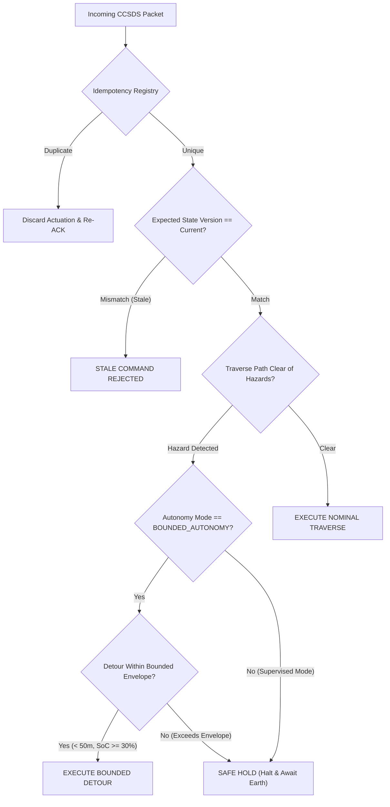

# PROJECT ATLAS — MILESTONE 13O
# ONBOARD ROVER AUTONOMY POLICY & CONTINGENCY EXECUTION
## Autonomy Modes, Stale Command Interception, Bounded Detour Envelopes, and Explainable Decision Records

**Milestone:** 13O — Atlas Deep Space Autonomy Lab  
**Repository:** `E:\Python\NASA-Spaceapps\Marswalk`  
**Core Implementation:** `src/marswalk/core/mars_onboard_autonomy.py`

---

## 1. The Need for Bounded Onboard Autonomy

Because radio signals require 3 to 22 minutes to cross interplanetary space, a rover operating on Mars cannot rely on terrestrial teleoperation to avoid sudden hazards. If a rockfall slump occurs along a planned traverse segment while a telecommand is in transit from Earth, executing that command blindly would cause rover rollover, high-centering, or catastrophic wheel entrapment.

The Atlas Onboard Autonomy Engine provides **deterministic, explainable, bounded local agency**:
- It evaluates incoming commands against physical reality on Mars.
- It rejects invalid, outdated, or hazardous instructions.
- It executes safe, localized contingencies within strictly bounded operational envelopes.
- It logs every engineering decision with complete mathematical transparency.



---

## 2. The Four Onboard Autonomy Modes

Atlas defines four hierarchical autonomy operational modes:

| Mode Name | Operational Authority | Permitted Contingencies | Safe Fallback Trigger |
|---|---|---|---|
| **`EARTH_SUPERVISED`** | Rigid Earth oversight. Commands executed exactly as authored; zero spatial deviation permitted. | Stop-and-hold only. Wheels locked on any detected deviation $> 0.5\text{ m}$. | Any stereo disparity error, slip $> 15\%$, or unexpected obstacle. |
| **`DELAYED_OPERATIONS`** | Execution of approved multi-step plan sequences under known communication latency. | Local hazard avoidance up to $5\text{ m}$; minor heading adjustments ($< 15^\circ$). | Unresolvable terrain blockage, battery drop below $40\%$. |
| **`BOUNDED_AUTONOMY`** *(Nominal)* | Full tactical agency within pre-certified safety envelopes without Earth permission. | Autonomous local path replanning up to $50\text{ m}$, obstacle circumnavigation, science retargeting. | Obstacle $> 50\text{ m}$, SoC $< 30\%$, slope $> 20^\circ$, loss of localization. |
| **`SAFE_HOLD`** | Absolute emergency survival state. Actuators unpowered; vehicle stationary. | Thermal heater management, high-gain antenna Earth point tracking, emergency beacon downlink. | Hardware fault, tilt $> 25^\circ$, unrecoverable software exception. |

---

## 3. Stale Command Detection Invariants

When a telecommand arrives on Mars, the Onboard Autonomy Engine submits it to an invariant validation pipeline before engaging motors:

### 3.1. State Version Invariant
Every plan synthesized on Earth is tagged with the state version of the rover at the time of authoring:

$$\text{Validate}(\text{Command}) \implies (\text{Command.expected\_state\_version} == \text{Rover.current\_state\_version})$$

If an intermediate local event (such as a slip realignment, a local obstacle detection, or an unpredicted solar array dust cleaning) caused the rover to increment its local state version, the incoming command is flagged as **stale** and rejected.

### 3.2. Dynamic Terrain Hazard Intersection
The rover continuously updates its local hazard map using stereo navigation cameras and hazard avoidance cameras (Hazcams):

$$\text{Intersection}(\text{Command.Path}, \text{ActiveHazards}) = \emptyset$$

If a rockfall or regolith slump is detected within the planned traverse corridor, the command fails validation.

### 3.3. Energy Reserve Floor Invariant
Commands must guarantee that completion leaves the battery State of Charge (SoC) above the minimum survival reserve:

$$\text{SoC}_{\text{final}} = \text{SoC}_{\text{current}} - \frac{E_{\text{traverse}} + E_{\text{instrument}}}{\text{BatteryCapacity}} \ge \text{SoC}_{\text{reserve}} \quad (\text{Nominal: } 0.30)$$

---

## 4. Bounded Local Detour Execution

When a command is rejected due to a local hazard and the vehicle is in `BOUNDED_AUTONOMY` mode, the rover does not freeze indefinitely. It evaluates whether a local detour satisfies the **Bounded Autonomy Envelope**:

$$\begin{aligned}
d_{\text{detour}} &\le d_{\text{max}} = 50.0\text{ meters} \\
|\Delta \theta_{\text{heading}}| &\le \theta_{\text{max}} = 45.0^\circ \\
\text{SoC}_{\text{projected}} &\ge 0.30 \quad (30\%\text{ battery reserve floor}) \\
t_{\text{execution}} &\le 3,600\text{ seconds} \quad (1\text{ hour maximum delay})
\end{aligned}$$

### 4.1. Tangential Avoidance Geometry
The engine calculates tangential avoidance vectors around the obstacle bounding sphere:

$$\vec{w}_{\text{detour}} = \vec{x}_{\text{hazard}} + (r_{\text{hazard}} + d_{\text{clearance}}) \cdot \hat{n}_{\perp}$$

where $\hat{n}_{\perp}$ is the unit normal vector perpendicular to the nominal traverse direction offering the lowest slope penalty. The rover executes the detour, bypasses the rockfall, arrives safely at the target waypoint, updates its local state version, and logs the action for subsequent Earth downlink.

---

## 5. Explainable Decision Records vs. Black-Box Scoring

In safety-critical deep space missions, heuristic "confidence percentages" (e.g. *"94.2% confident detour is safe"*) are unacceptable to planetary flight directors because they offer zero causal insight and cannot be formally audited.

Atlas replaces arbitrary confidence numbers with **Deterministic Explainable Decision Records**:

```json
{
  "timestamp_mars_sol": 1342.381,
  "event_type": "AUTONOMOUS_COMMAND_REJECTION",
  "command_id": "CMD-2026-11-04-001",
  "action_evaluated": "EXECUTE_NOMINAL_TRAVERSE",
  "decision": "REJECTED",
  "primary_rule_violated": "INV-HAZARD-INTERSECTION-01",
  "causal_explanation": "Planned path intersects uncataloged rockfall slump at coordinates (35.0, 50.0) with boulder diameter 1.4m exceeding rover belly-pan clearance (0.45m).",
  "formal_invariants_evaluated": {
    "state_version_check": "FAILED (Expected: 1, Actual: 2)",
    "hazard_intersection_check": "FAILED (Distance to obstacle: 0.0m)",
    "energy_margin_check": "PASSED (Projected SoC: 68.4% >= 30.0%)",
    "thermal_safe_check": "PASSED (-12.4 C in [-40, +30] C)"
  },
  "contingency_executed": "BOUNDED_LOCAL_DETOUR_NORTH",
  "detour_parameters": {
    "added_distance_m": 18.4,
    "max_heading_deflection_deg": 28.5,
    "battery_consumed_kwh": 0.14
  }
}
```

Every record is signed, archived in rover flash memory, and included in the first available telemetry downlink pass.

> [!WARNING]
> **MANDATORY ASTRONAUT SAFETY DISCLOSURE:**
> All autonomy algorithms, detour envelopes, hazard thresholds, and decision invariants documented here are designed for unmanned robotic vehicles. They must never be applied to, or construed as safe for, human astronaut surface operations.
