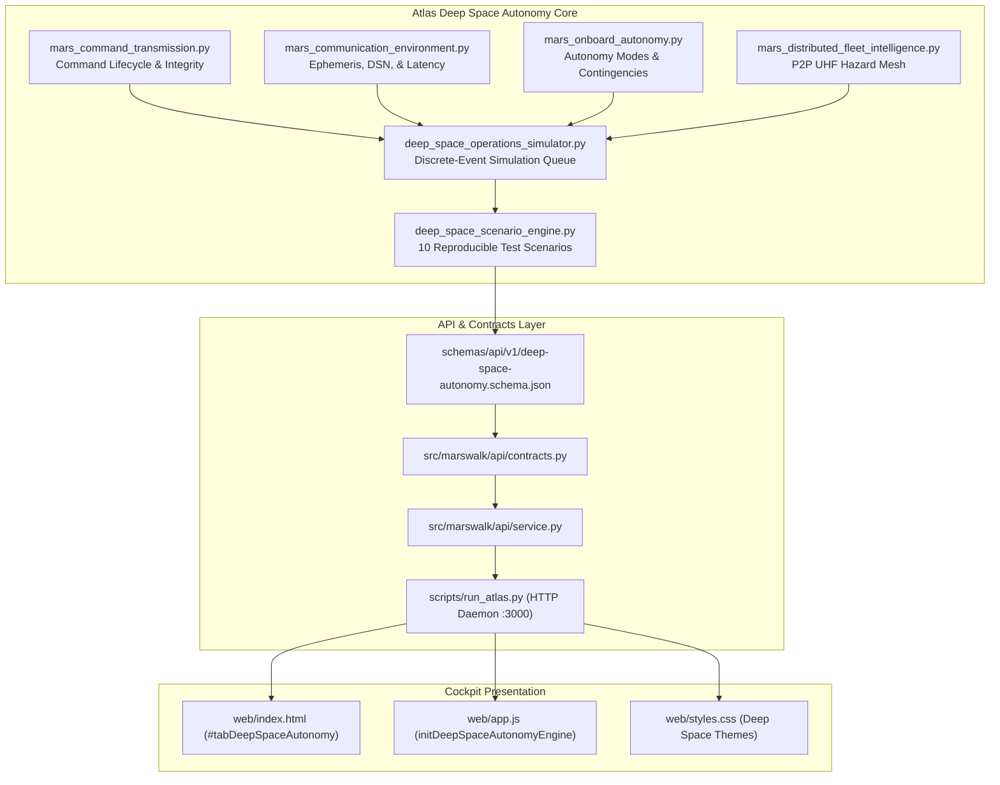

# PROJECT ATLAS — MILESTONE 13O
# SYSTEM ARCHITECTURE: DEEP SPACE AUTONOMY LAB
## Earth–Mars Communication, Distributed Intelligence & Bounded Autonomous Operations

**Milestone:** 13O — Atlas Deep Space Autonomy Lab  
**Repository:** `E:\Python\NASA-Spaceapps\Marswalk`  
**Primary Integration Modules:**
- `src/marswalk/core/mars_command_transmission.py`
- `src/marswalk/core/mars_communication_environment.py`
- `src/marswalk/core/mars_onboard_autonomy.py`
- `src/marswalk/core/mars_distributed_fleet_intelligence.py`
- `src/marswalk/core/deep_space_operations_simulator.py`
- `src/marswalk/core/deep_space_scenario_engine.py`
- `schemas/api/v1/deep-space-autonomy.schema.json`

---

## 1. Executive Architectural Summary

Milestone 13O transitions Project Atlas from a synchronized planning tool into a high-fidelity, discrete-event simulation environment for robotic exploration under extreme deep space communication constraints. The primary operational reality of planetary robotics on Mars is that **Earth cannot drive the rover in real time**. 

With an orbital distance ranging from $0.372\text{ AU}$ to $2.683\text{ AU}$, one-way light time (OWLT) varies between $3.1\text{ minutes}$ and $22.3\text{ minutes}$ (round-trip light time RTLT: $6.2\text{ to }44.6\text{ minutes}$, with a nominal reference of $14.2\text{ minutes}$ OWLT and $28.4\text{ minutes}$ RTLT). In addition, direct-to-Earth (DTE) and orbiter relay passes are intermittent, interrupted by planetary occultations, Deep Space Network (DSN) ground station tracking handover gaps, and biennial solar conjunction blackouts.

```
+----------------------------------------------------------------------------------------------------+
|                                    PROJECT ATLAS 2.0 LAB ARCHITECTURE                             |
+----------------------------------------------------------------------------------------------------+
|                                                                                                    |
|   +--------------------------+         +--------------------------+         +--------------------+ |
|   |   EARTH MISSION CONTROL  |         |   DEEP SPACE CHANNEL     |         |   ONBOARD ROVER    | |
|   |         DOMAIN           |         |       ENVIRONMENT        |         |   AUTONOMY ENGINE  | |
|   +--------------------------+         +--------------------------+         +--------------------+ |
|   | - Command Authoring      |  Uplink | - OWLT Latency (3-22m)   |  In-    | - State Versioning | |
|   | - Approval Hierarchy     | ------->| - Packet Loss & Bit Err  |-------> | - Stale Invariant  | |
|   | - State Reconstruction   | (Pkt Q) | - DSN Station Tracking   | Transit |   Interception     | |
|   | - Downlink Ingestion     |         | - Solar Conjunction Veto |         | - Bounded Detour   | |
|   |                          |         |                          |         |   Execution        | |
|   | Epistemic State:         | Downlink| - RTLT Round-Trip Latency| Tele-   | - Explainable Log  | |
|   | LAST_REPORTED_BY_MARS    | <-------| - Orbiter Pass Windowing | <-------| - Multi-Rover UHF  | |
|   +--------------------------+ (TLM Q) +--------------------------+  metry  | Epistemic State:   | |
|                                                                             | CURRENT_ON_MARS    | |
|                                                                             +--------------------+ |
+----------------------------------------------------------------------------------------------------+
```

---

## 2. The Three Operating Worlds & Epistemic Separation

A foundational principle of Milestone 13O is strict epistemic separation between operational domains:

1. **Earth Mission Control Domain:**
   - Possesses delayed, historical situational awareness (`EpistemicState.LAST_REPORTED_BY_MARS`).
   - Telemetry display always indicates the Martian timestamp of generation and the age-of-data metric ($\Delta t_{\text{age}} = t_{\text{Earth}} - t_{\text{Mars, tlm}}$).
   - Generates telecommand sequences with explicit `expected_state_version`, spatial boundaries, and safety invariants.

2. **Deep Space Communication Channel Domain:**
   - Physical layer representing speed-of-light propagation delays across interplanetary vacuum ($\tau_{\text{prop}} = d_{\text{Earth-Mars}} / c$).
   - Explicit RF availability distinct from geometric line-of-sight (incorporating DSN 70m/34m antenna tracking schedules at Goldstone, Madrid, and Canberra, atmospheric attenuation, plasma scintillation, and solar conjunction sun-earth-probe angles).
   - Packet queue dynamics: First-In-First-Out with priority preemption, bandwidth throttling, and deterministic bit error models.

3. **Onboard Rover Autonomy Engine Domain:**
   - Real-time ground truth awareness (`EpistemicState.CURRENT_ON_MARS`).
   - Local hazard detection: evaluates camera stereo disparities, slip ratios, IMU tilt, and terrain obstacles against planned traverse segments.
   - Formal validation of incoming telecommands prior to dispatching drive actuators.
   - Autonomous contingency execution within strictly bounded envelopes without waiting for Earth intervention.

---

## 3. Core Software Subsystems

The system architecture is structured across six dedicated Python modules in `src/marswalk/core/`:



### 3.1. Command Transmission & Verification (`mars_command_transmission.py`)
- Implements CCSDS-inspired packetization with primary headers containing packet version, command ID, mission ID, spacecraft ID, sequence count, creation timestamp, and CRC-32 / SHA-256 payload digests.
- Enforces a 10-state lifecycle: `DRAFT -> VALIDATED -> APPROVED -> QUEUED -> TRANSMITTING -> RECEIVED -> ACCEPTED / REJECTED -> EXECUTING -> COMPLETED / FAILED / SUSPENDED / EXPIRED`.
- Multi-tier approval authority: Routine telemetry downlinks (Tier 1), Tactical traverses (Tier 2), and Direct arm manipulation / safety overrides (Tier 3).
- Idempotency deduplication preventing accidental re-execution of delayed telecommand retransmissions.

### 3.2. Communication Environment (`mars_communication_environment.py`)
- Independent uplink and downlink propagation calculation based on true Mars ephemeris distance ($0.372\text{ to }2.683\text{ AU}$).
- Ground station network scheduling modeling Goldstone (DSS-14/25/26), Madrid (DSS-54/55/65), and Canberra (DSS-34/35/43).
- Orbiter relay passes (MRO, Mars Odyssey, TGO, MAVEN) simulating UHF proximity links ($400\text{ MHz}$) with finite overpass contact windows.
- Solar conjunction safety policy: automatic uplink blackout triggered when Sun-Earth-Mars angle $< 2.0^\circ$.

### 3.3. Onboard Autonomy Engine (`mars_onboard_autonomy.py`)
- Four operating autonomy modes:
  1. `EARTH_SUPERVISED`: Direct waypoint following; halts on any anomaly.
  2. `DELAYED_OPERATIONS`: Executes pre-validated sequences; minor local deviations permitted.
  3. `BOUNDED_AUTONOMY`: Nominal operational mode; evaluates environmental invariants, autonomously executes local detours up to $50\text{ m}$, preserves battery reserve $\ge 30\%$.
  4. `SAFE_HOLD`: Hardware safety state; locks brakes, disables non-essential loads, reorients HGA towards Earth line-of-sight.
- Stale command detection checking state version incrementation, active terrain hazard intersection, energy reserve deficit, and instrument thermal operational limits.
- Explainable decision logging generating deterministic records with cause, rule identifier, and alternative mitigation path.

### 3.4. Distributed Fleet Intelligence (`mars_distributed_fleet_intelligence.py`)
- Inter-rover peer-to-peer UHF mesh networking allowing direct sharing of hazards, slip maps, and relay schedule handoffs between co-located surface assets (e.g., Perseverance and Curiosity analog models).
- Network partition handling: rovers operating out of line-of-sight maintain localized state vectors, queuing delta updates until proximity link acquisition.
- Causal ordering and deterministic state reconciliation upon reconnection.

### 3.5. Discrete-Event Simulator (`deep_space_operations_simulator.py`)
- Deterministic event queue operating on priority timestamps with tie-breaking sequence IDs.
- Causal ancestry tracking linking effects to parent causes across interplanetary space.
- Bit-exact simulation replay: identical initial seeds produce bit-exact event trajectories and cryptographic state hashes.

### 3.6. Scenario Engine (`deep_space_scenario_engine.py`)
- Catalog of 10 fully realized operational scenarios.
- Complete 8-stage state machine for Flagship Scenario 01 ("The Rover That Lost Earth").

---

## 4. API Endpoints & Contract Integration

The deep space autonomy engine is exposed via RESTful endpoints registered in `src/marswalk/api/contracts.py` and served by `scripts/run_atlas.py`:

| Endpoint | Method | Purpose | Response Schema Validation |
|---|---|---|---|
| `/api/deep-space/status` | `GET` | Returns telemetry, channel latency, DSN state, and autonomy modes | `deep-space-autonomy.schema.json` |
| `/api/deep-space/scenarios` | `GET` | Lists available operational scenarios with metadata | `deep-space-autonomy.schema.json` |
| `/api/deep-space/scenario/run` | `POST` | Executes or advances a multi-stage operational scenario | `deep-space-autonomy.schema.json` |
| `/api/deep-space/command/create` | `POST` | Authors and validates a CCSDS telecommand packet on Earth | `deep-space-autonomy.schema.json` |
| `/api/deep-space/command/transmit` | `POST` | Dispatches approved command into deep space uplink channel | `deep-space-autonomy.schema.json` |
| `/api/deep-space/simulation/advance` | `POST` | Advances simulation clock by specified time interval $\Delta t$ | `deep-space-autonomy.schema.json` |
| `/api/deep-space/inject-hazard` | `POST` | Injects unexpected terrain obstacle or telemetry drop | `deep-space-autonomy.schema.json` |
| `/api/deep-space/reset` | `POST` | Resets simulator state to deterministic baseline | `deep-space-autonomy.schema.json` |

---

## 5. Planetary Science & Non-Probabilistic Integrity

Atlas strictly maintains scientific truth disclosures:
- Interplanetary distances and light-time propagation calculations are derived from real orbital dynamics and speed of light in vacuum ($c = 299,792,458\text{ m/s}$).
- Solar conjunction angles are computed from planetary heliocentric positions.
- Terrain obstacles represent real Jezero Crater high-resolution DTM slopes and CTX orthomosaics.
- Autonomy decisions are strictly deterministic and explainable via formal invariant predicates, avoiding black-box or non-reproducible heuristics.

> [!WARNING]
> **MANDATORY ASTRONAUT SAFETY DISCLOSURE:**
> All modeled communications delays, rover autonomy modes, bounded detours, and command validation algorithms are robotic research and simulation tools. They are designed exclusively for unmanned planetary exploration and must NEVER be construed as operationally certified or safe for human astronauts.
