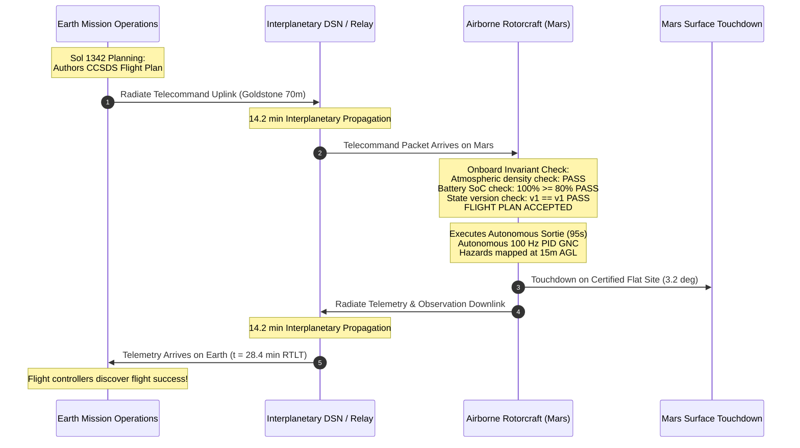

# PROJECT ATLAS — MILESTONE 13P
# AERIAL AUTONOMY & CONTINGENCY EXECUTION UNDER DELAYED COMMUNICATIONS
## 13O Deep Space Integration, Pre-Loaded Flight Sequences, Loss-of-Link Handling, and Bounded Aerial Agency

**Milestone:** 13P — Atlas Aerial Corps: Multi-Rotorcraft Intelligence, Aerial Science, Flight Dynamics & Rover–Aircraft Cooperation  
**Repository:** `E:\Python\NASA-Spaceapps\Marswalk`  
**Core Integration:** `src/marswalk/core/mars_flight_dynamics.py` & `src/marswalk/core/mars_command_transmission.py`

---

## 1. The Myth of the Planetary Joystick

A common misconception in popular media is that NASA engineers fly Martian helicopters using remote-control joysticks in Mission Control. Due to orbital distance ($0.372\text{ to }2.683\text{ AU}$), radio signals require $3.1\text{ to }22.3\text{ minutes}$ one-way ($14.2\text{ minutes}$ nominal OWLT; $28.4\text{ minutes}$ RTLT).

If a gust of wind tips a rotorcraft mid-flight on Mars, Earth will not even learn of the tip until nearly a quarter-hour later—by which time a vehicle lacking onboard autonomy would have completed 40 violent rollover cartwheels and shattered into fragments.

**Every phase of Martian rotorcraft flight—takeoff, waypoint tracking, visual odometry, obstacle avoidance, attitude stabilization, and touchdown—is 100% autonomous.**

---

## 2. The Six Aerial Autonomy Operational Modes

Atlas establishes six discrete, formal flight autonomy modes:

| Mode Name | Operational Authority | Permitted Contingencies | Safe Fallback Trigger |
|---|---|---|---|
| **`EARTH_SUPERVISED`** | Ground standby only. Vehicle executes telemetry checks and rotor health tests; zero takeoff authority. | Abort spinup; stay on ground. | Any sensor anomaly or pre-flight communication loss. |
| **`PRELOADED_AUTONOMOUS`** | Execution of strictly timed, pre-validated waypoint trajectories uploaded from Earth. | Altitude hold; pause at waypoint. | Minor tracking error ($> 2.0\text{ m}$). |
| **`BOUNDED_AERIAL_AUTONOMY`** *(Nominal)* | Closed-loop 3D trajectory tracking, autonomous obstacle detection, and alternate landing selection. | Autonomous diversion up to $50\text{ m}$ to certified alternate airfields. | Primary landing site slope $> 8^\circ$, unexpected dust gust $> 12\text{ m/s}$. |
| **`NAVIGATION_HOLD`** | Immediate velocity zeroing; maintains steady hover at current altitude $(x, y, z)$. | Station-keeping for up to $30\text{ s}$ while evaluating landing options. | Temporary loss of visual features / dust clearing. |
| **`EMERGENCY_LANDING`** | Immediate vertical descent at $-1.2\text{ m/s}$ onto local terrain at current coordinates. | Throttle back to touchdown; shutdown rotors upon contact ($< 1.5\text{ s}$). | Battery SoC $\le 20\%$, rotor over-temperature, sustained link loss. |
| **`SAFE_HOLD`** | Complete hardware quiescence on the surface. Rotors locked; survival heaters active. | Non-volatile flash log storage; beacon downlink. | Landed state; severe component degradation. |

---

## 3. Loss-of-Link (LOS) Contingency Policy

If the UHF proximity transceiver loses carrier lock with the rover or orbiter while airborne:
1. **Timeout Trigger:** A $5.0\text{ second}$ heartbeat timer expires.
2. **State Transition:** The aircraft transitions from `PRELOADED_AUTONOMOUS` to `BOUNDED_AERIAL_AUTONOMY`.
3. **Contingency Evaluation:**
   - **If Battery SoC $> 40\%$ and within $25\text{ m}$ of Alternate Airfield:** Complete flight path to the pre-designated Alternate Landing Site and execute touchdown.
   - **If Battery SoC $\le 30\%$ or over rough terrain:** Transition immediately to `NAVIGATION_HOLD` for $5\text{ seconds}$, align vehicle heading with local wind, and initiate `EMERGENCY_LANDING`.
4. **Post-Touchdown Reconnection:** Once landed, the vehicle powers down the main rotor drive, switches the UHF transceiver to beacon mode, and awaits link restoration to transmit the flight log.

> [!WARNING]
> **MANDATORY ASTRONAUT SAFETY DISCLOSURE:**
> All flight autonomy modes, loss-of-link policies, and emergency descent procedures documented here are designed strictly for unmanned robotic rotorcraft. They must NEVER be used or construed as certified safe for human astronaut flight or crewed vehicles.
