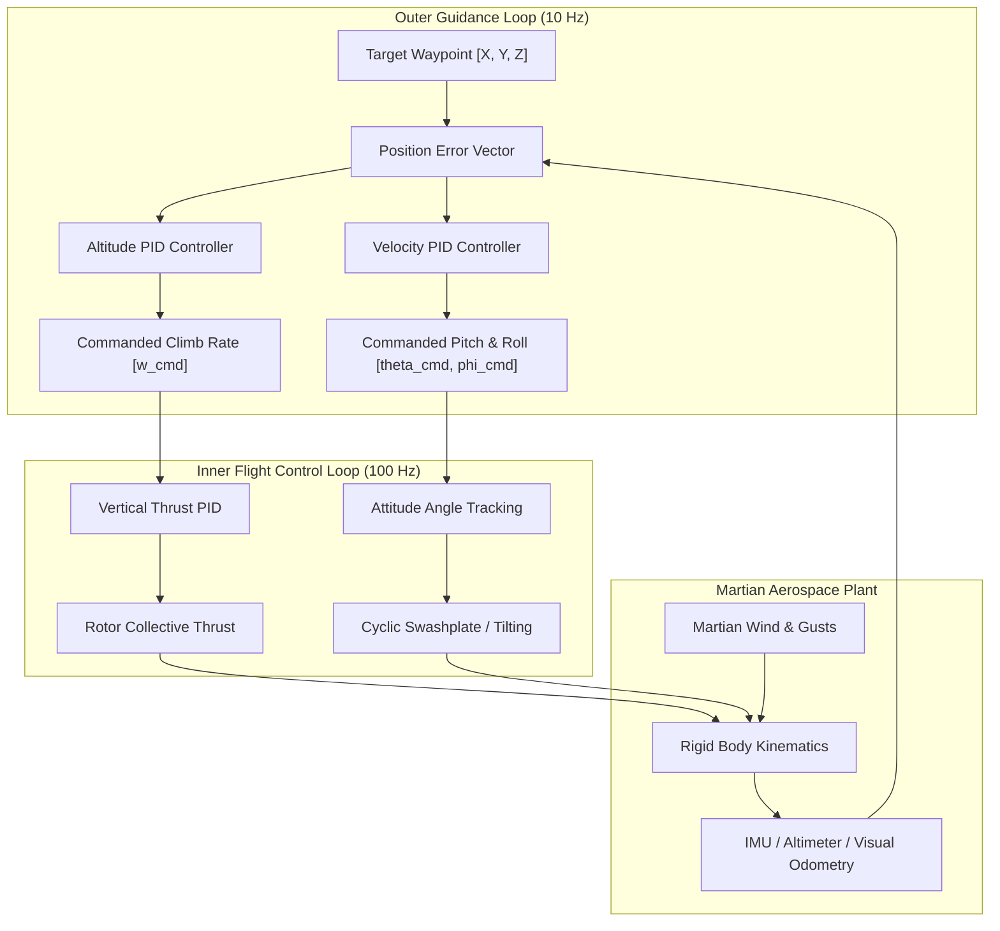

# PROJECT ATLAS — MILESTONE 13P
# FLIGHT DYNAMICS, GUIDANCE, NAVIGATION & CONTROL (GNC)
## 6-DOF Trajectory Simulation, Cascade PID Stabilization, Wind Gust Rejection, and Autonomous Flight Phases

**Milestone:** 13P — Atlas Aerial Corps: Multi-Rotorcraft Intelligence, Aerial Science, Flight Dynamics & Rover–Aircraft Cooperation  
**Repository:** `E:\Python\NASA-Spaceapps\Marswalk`  
**Core Implementation:** `src/marswalk/core/mars_flight_dynamics.py`

---

## 1. Flight Dynamics Formulation on Mars

Simulating rotorcraft flight on Mars requires accounting for reduced gravity ($g_{\text{Mars}} = 3.721\text{ m/s}^2$) and low aerodynamic damping. In Earth's dense atmosphere, a helicopter experiences high aerodynamic pitch and roll damping that naturally opposes angular rates. On Mars, because dynamic pressure $q = \frac{1}{2}\rho V^2$ is roughly 80 times smaller, aerodynamic damping is weak, requiring rapid active feedback control to prevent divergent oscillations.

### 1.1. Translational Equations of Motion
For an aircraft of mass $m$ with rotor thrust vector $\vec{T}$ tilted by Euler roll ($\phi$), pitch ($\theta$), and yaw ($\psi$) angles, translational acceleration in the local North-East-Down (NED / Topocentric) reference frame is:

$$\begin{aligned}
m \ddot{x} &= T \sin\theta \cos\psi - T \sin\phi \sin\psi - D_x \\
m \ddot{y} &= T \sin\theta \sin\psi + T \sin\phi \cos\psi - D_y \\
m \ddot{z} &= T \cos\theta \cos\phi - m g_{\text{Mars}} - D_z
\end{aligned}$$

where:
- $\vec{D} = [D_x, D_y, D_z]^T$ is the total body parasite drag vector:
  $$\vec{D} = \frac{1}{2} \rho \left\|\vec{V}_{\text{rel}}\right\| \vec{V}_{\text{rel}} \cdot f_{\text{eq}}$$
- $\vec{V}_{\text{rel}} = \vec{V} - \vec{W}$ is the relative airspeed vector accounting for atmospheric wind $\vec{W} = [W_x, W_y, W_z]^T$.

---

## 2. Cascade PID Guidance, Navigation & Control Architecture

To ensure robust flight stability, Atlas implements a cascade feedback architecture:

### 2.1. Altitude & Vertical Velocity Loop
Altitude control uses a two-stage cascade:
1. **Position-to-Velocity Stage:**
   $$\dot{z}_{\text{cmd}} = K_{p,z} (z_{\text{target}} - z) + K_{i,z} \int (z_{\text{target}} - z) dt + K_{d,z} (-\dot{z})$$
   clamped to $[-v_{\text{descent, max}}, +v_{\text{climb, max}}] = [-2.0, +3.0]\text{ m/s}$.
2. **Velocity-to-Thrust Stage:**
   $$\Delta T = K_{p,w} (\dot{z}_{\text{cmd}} - \dot{z}) + K_{i,w} \int (\dot{z}_{\text{cmd}} - \dot{z}) dt + K_{d,w} (-\ddot{z})$$
   $$T_{\text{command}} = m g_{\text{Mars}} + \Delta T$$
   clamped to $[0.2 \cdot m g, 2.0 \cdot m g]$ to guarantee controlled descent without rotor over-speed or zero-g blade flapping.

### 2.2. Horizontal Position & Velocity Loop
Horizontal navigation translates waypoint distance errors into bank angle commands:

$$\theta_{\text{cmd}} = \text{PID}_x(V_{x,\text{cmd}} - \dot{x}), \quad \phi_{\text{cmd}} = -\text{PID}_y(V_{y,\text{cmd}} - \dot{y})$$

Bank angles are strictly clamped to $|\theta|, |\phi| \le 18.0^\circ$ to prevent excessive loss of vertical thrust margin in thin air.

### 2.3. Heading (Yaw) Control
Yaw heading is oriented along the trajectory track vector ($\psi_{\text{target}} = \text{atan2}(\Delta y, \Delta x)$) to minimize lateral rotor drag and maintain optimal camera pointing:

$$\dot{\psi}_{\text{cmd}} = K_{p,\psi} (\psi_{\text{target}} - \psi) + K_{d,\psi} (-\dot{\psi})$$

clamped to $\pm 45.0^\circ/\text{s}$.

---

## 3. Flight Phase State Transitions

The vehicle progresses through a 10-state deterministic state machine:

| Mode | Entry Trigger | Active Controllers | Safe Exit Criteria |
|---|---|---|---|
| **`GROUND_STANDBY`** | Initial boot / landed | All motors off; avionics idle | Pre-flight telemetry validated |
| **`ROTOR_SPINUP`** | Flight plan executed | RPM ramp to nominal ($2537\text{ RPM}$) | Rotor reaches $95\%$ nominal RPM |
| **`VERTICAL_TAKEOFF`** | Spinup verified | Vertical climb PID ($w_{\text{cmd}} = 1.5\text{ m/s}$) | Altitude reaches clearance ($10 - 15\text{ m}$) |
| **`HOVER`** | Takeoff complete | 3D position lock ($x, y, z$) | Waypoint target acquired |
| **`FORWARD_FLIGHT`** | Cruise path active | Pitch tilt + airspeed tracking ($V_{\text{cruise}} = 7\text{ m/s}$) | Waypoint proximity $< 1.5\text{ m}$ |
| **`TERRAIN_MAPPING`** | Survey raster active | Altitude lock + camera footprint sync | Lawnmower survey completed |
| **`VERTICAL_DESCENT`** | Final waypoint reached | Controlled descent ($w_{\text{cmd}} = -1.2\text{ m/s}$) | Altitude AGL $< 0.2\text{ m}$ |
| **`TOUCHDOWN_SHUTDOWN`** | Landing gear contact | Rapid rotor shutdown ($< 1.5\text{ s}$) | Rotors stopped; vehicle stable |
| **`EMERGENCY_LANDING`** | Battery $< 20\%$ or link loss | Immediate vertical descent at current $(x, y)$ | Touchdown completed |
| **`SAFE_HOLD`** | Hardware anomaly / high tilt | Motors disengaged; survival heaters active | Grounded state maintained |

---

## 4. Wind Disturbance & Gust Rejection Modeling

Martian surface winds typically average $2\text{ to }10\text{ m/s}$, but dust devils and convective boundary layer thermals can produce sudden horizontal gusts exceeding $15\text{ m/s}$.

Atlas models wind as:

$$\vec{W}(t) = \vec{W}_{\text{steady}} + \vec{W}_{\text{gust}}(t)$$

- When a crosswind gust strikes the vehicle, the horizontal velocity controller automatically tilts the rotor disk into the wind ($\Delta\theta \propto -W_x$).
- If wind velocity exceeds $12\text{ m/s}$, the advancing tip Mach reaches critical compressibility ($M_{\text{adv}} > 0.78$), and the flight autonomy engine automatically commands an **altitude reduction** to ground boundary layer levels ($h \le 8\text{ m}$) where wind shear diminishes.

> [!WARNING]
> **MANDATORY ASTRONAUT SAFETY DISCLOSURE:**
> All flight dynamics models, control laws, and GNC simulations documented here apply exclusively to unmanned robotic rotorcraft. Under no circumstances should these control models be considered flight-certified or safe for human astronauts.
