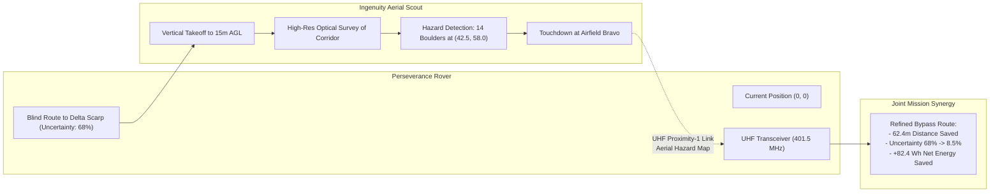

# PROJECT ATLAS — MILESTONE 13P
# ROVER–AIRCRAFT COOPERATIVE MISSION ENGINE
## Joint Ground-Aerial Exploration, Route Refinement, Hazard Discovery, and Net Energy Quantification

**Milestone:** 13P — Atlas Aerial Corps: Multi-Rotorcraft Intelligence, Aerial Science, Flight Dynamics & Rover–Aircraft Cooperation  
**Repository:** `E:\Python\NASA-Spaceapps\Marswalk`  
**Core Implementation:** `src/marswalk/core/mars_aerial_rover_coordinator.py`

---

## 1. The Synergistic Value of Joint Ground-Air Exploration

A ground rover possesses massive scientific analytical capability (robotic arm, core drill, Raman/X-ray spectrometers, sample caching) and multi-sol endurance, but suffers from low mobility ($0.05 - 0.10\text{ m/s}$) and a severely restricted surface line-of-sight ($2 - 4\text{ meters}$ elevation). It can easily drive into dead-end ravines, high-center on hidden boulder fields, or become trapped in soft sand ripple troughs.

An aerial rotorcraft possesses high speed ($6 - 12\text{ m/s}$), unrestricted 3D perspective over escarpments and canyon rims, and $0.78\text{ cm/px}$ imaging resolution, but is strictly constrained by short flight endurance ($90 - 180\text{ seconds}$).

The **Rover–Aircraft Cooperative Engine** couples these asymmetric capabilities into a unified planetary exploration team:

---

## 2. Quantifying Cooperative Mission Value

In Project Atlas, aerial reconnaissance is not an animation gimmick; it must produce **measurable, reproducible engineering value**:

$$\Delta d_{\text{rover}} = d_{\text{blind\_rover}} - d_{\text{refined\_rover}}$$
$$\Delta E_{\text{mission}} = \left(E_{\text{rover, blind}} - E_{\text{rover, refined}}\right) - E_{\text{aircraft, flight}}$$
$$\Delta U_{\text{uncertainty}} = U_{\text{baseline}} - U_{\text{refined}}$$

### 2.1. Signature Crater Reveal Scenario Quantitative Breakdown

| Operational Metric | Rover-Only Blind Traverse | Aerial-Assisted Joint Traverse | Net Synergy Impact |
|---|---|---|---|
| **Traverse Ground Distance** | $208.5\text{ m}$ (Includes $45\text{ m}$ backtrack) | $146.1\text{ m}$ (Smooth detour) | **$62.4\text{ m}$ Saved ($-30.0\%$)** |
| **Terrain Traverse Uncertainty** | $68.0\%$ (High risk of entrapment) | $8.5\%$ (High-res cleared route) | **$59.5\%$ Uncertainty Reduction** |
| **Rover Energy Consumed** | $667.2\text{ Wh}$ ($3.2\text{ Wh/m}$) | $467.5\text{ Wh}$ ($3.2\text{ Wh/m}$) | **$199.7\text{ Wh}$ Saved on Rover** |
| **Aircraft Flight Energy Invested** | $0.0\text{ Wh}$ (Scout grounded) | $117.3\text{ Wh}$ ($95\text{ s}$ flight) | **$117.3\text{ Wh}$ Aircraft Investment** |
| **Net Mission Energy Delta** | $0.0\text{ Wh}$ (Baseline) | $+82.4\text{ Wh}$ Net Savings | **$+82.4\text{ Wh}$ Net Positive Benefit** |
| **Detected Hazards** | $0$ (Encountered blindly) | $14$ Boulders ($r \ge 0.85\text{ m}$) | **Zero Collision / Zero Wear** |

---

## 3. Dynamic Launch/Abort Tradeoff Policy

Deploying an aerial scout is not always optimal. An aerial sortie consumes scarce battery energy and incurs operational risk. Atlas enforces a formal decision rule:

$$\text{Launch Aerial Scout} \iff (\Delta d_{\text{rover}} > 20.0\text{ m} \lor \Delta U > 30.0\%) \land (\Delta E_{\text{mission}} > 0.0\text{ Wh}) \land (\text{Wind} < 10.0\text{ m/s})$$

If the terrain ahead is already certified smooth and planar by previous rover tracks, or if the energy cost of flight exceeds the energy saved by avoiding minor deviations, the coordinator **rejects the sortie**, keeping the aircraft in `GROUND_STANDBY` to conserve battery.

> [!WARNING]
> **MANDATORY ASTRONAUT SAFETY DISCLOSURE:**
> All cooperative planning algorithms, energy tradeoff formulations, and route refinement metrics documented here are engineered solely for unmanned robotic systems. They must never be applied to, or construed as safe for, human astronaut surface navigation.
