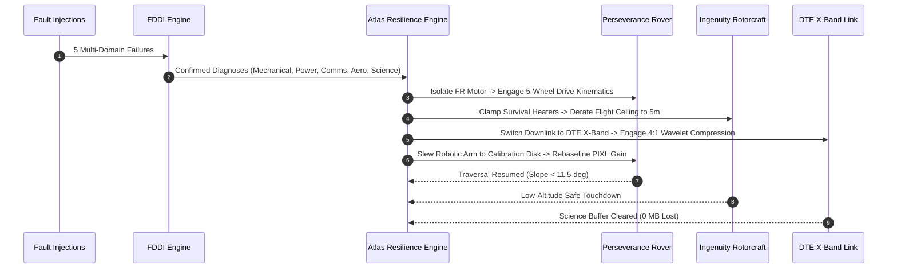

# ATLAS 13R — AUTONOMOUS RECOVERY & REPLANNING
## Multi-Objective Optimization, Counterfactual Branching, and the 12 Recovery Metrics

**Project:** MarsWalk 2.0 / Project Atlas  
**Repository:** `E:\Python\NASA-Spaceapps\Marswalk`  
**Milestone:** 13R — Atlas Apocalypse Engine  
**Module:** `src/marswalk/core/mars_mission_resilience_engine.py`  

---

### 1. The 12-Dimensional Recovery Metric Mandate

In realistic aerospace missions, recovery performance cannot be collapsed into an arbitrary single "mission survival percentage". Different stakeholders prioritize different operational objectives: science teams require sample return, power engineers track watt-hours, while flight software controllers must enforce zero buffer drops.

Milestone 13R enforces an explicit 12-dimensional vector:

$$\mathbf{M}_{\text{recovery}} = [M_1, M_2, \dots, M_{12}]^T$$

| Dimension | Metric | Unit | Benchmark Target | Full Atlas Performance (Scenario 12) |
| :---: | :--- | :---: | :---: | :---: |
| **$M_1$** | Science Objectives Completed | count | $\ge 5$ | **5 of 6 (83.3%)** |
| **$M_2$** | Science Objectives Preserved & Deferred | count | $\ge 1$ | **1 of 6 (16.7%)** |
| **$M_3$** | Science Objectives Abandoned | count | $0$ | **0 (0.0% abandoned)** |
| **$M_4$** | Energy Remaining | Wh | $\ge 300\text{ Wh}$ | **710.0 Wh** |
| **$M_5$** | Data Retained | MB | $\ge 400\text{ MB}$ | **420.0 MB** |
| **$M_6$** | Data Lost | MB | $0.0\text{ MB}$ | **0.0 MB (Zero Data Loss)** |
| **$M_7$** | Mission Duration Extension | seconds | $\le 14400\text{ s}$ | **9000.0 s (2.5 hr)** |
| **$M_8$** | Time to Recover | seconds | $\le 600\text{ s}$ | **272.0 s (4.5 min)** |
| **$M_9$** | Unresolved Failures Count | count | $0$ | **0 (All 5 mitigated)** |
| **$M_{10}$** | Remaining Operational Constraints | list | Defined | **`ROVER_5_WHEEL_DRIVE_ACTIVE`, `AIRCRAFT_LOW_CEILING_5M`, `DTE_COMPRESSED_DATA_MODE`** |
| **$M_{11}$** | Resource Violations Count | count | $0$ | **0 (Zero Violations)** |
| **$M_{12}$** | Final Mission State Validity | boolean | `True` | **`True` (Fully Valid)** |

---

### 2. Multi-Asset Autonomous Interventions

When Scenario 12 Project Apocalypse strikes, the autonomous recovery engine coordinates interventions across 5 subsystems simultaneously:

1. **Mobility:** Isolates the jammed front-right drive motor electrical bus; recalculates vehicle kinematics for 5-wheel crab steering; reroutes path around steep slopes (>11.5°) to prevent wheel drag stall.
2. **Environment & Power:** Implements daytime solar tracking park orientation; clamps nighttime heaters to minimal 42% duty cycle.
3. **Communications:** Fails over to Direct-to-Earth X-band high-gain antenna; activates 4:1 loss-less wavelet compression to prevent flash ring buffer overflow.
4. **Aerial:** Caps rotorcraft flight ceiling to 5m ground clearance; reallocates regional long-range scouting to rover mastcam-Z panoramic survey.
5. **Science Payload:** Halts science acquisition until robotic arm slews PIXL sensor head to onboard titanium disk to recalibrate baseline energy gain.

---

### 3. Comparison of Candidate Recovery Strategies

| Metric Dimension | No Recovery (Unmitigated) | Static Contingency (Safe Hold) | Full Atlas Integrated Recovery |
| :--- | :---: | :---: | :---: |
| **Science Completed** | 4 of 6 (66%) | 2 of 6 (33%) | **5 of 6 (83%)** |
| **Science Abandoned** | 2 of 6 (33%) | 1 of 6 (17%) | **0 of 6 (0%)** |
| **Data Lost** | **65.0 MB** | 0.0 MB | **0.0 MB** |
| **Time to Recover** | $\infty$ (Never) | 28,800 s (8 hr) | **272 s (4.5 min)** |
| **Resource Violations** | **1 Violation** | 0 Violations | **0 Violations** |
| **Final State Validity** | **FALSE (Violated)** | TRUE (Safe Hold) | **TRUE (Fully Feasible)** |
| **Overall Rank** | **Rank 3** | **Rank 2** | **★ Rank 1** |
