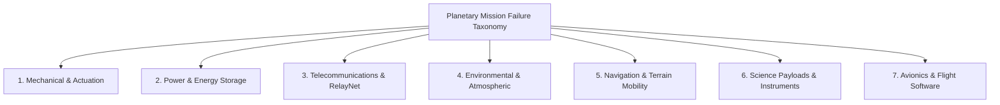

# ATLAS 13R — FAILURE TAXONOMY SPECIFICATION
## Planetary Robotics Failure Domains, Dynamic Profiles, and Severity Classification

**Project:** MarsWalk 2.0 / Project Atlas  
**Repository:** `E:\Python\NASA-Spaceapps\Marswalk`  
**Milestone:** 13R — Atlas Apocalypse Engine  
**Module:** `src/marswalk/core/mars_failure_taxonomy.py`  

---

### 1. Architectural Scope

Planetary exploration vehicles operate in high-radiation, extreme thermal, unpaved aeolian terrains millions of kilometers from Earth. Standard consumer robotics failure models fail to capture the multi-domain coupling unique to Mars operations. 

Milestone 13R establishes a formal 7-domain planetary failure taxonomy adapted from NASA-STD-8729.1 and MIL-STD-882E:

---

### 2. Failure Domain Definitions

1. **Mechanical & Actuation (`FailureClass.MECHANICAL`):**
   - Drive wheel stator jamming, rock wedging in wheel bogie rocker mechanism, drill bit binding in silica rock, mast azimuth gimbal stalling.
   - Primary metric impacts: Traversal velocity penalty (up to 45%), motor overcurrent surge (+65W), crab-angle steering bias.

2. **Power & Thermal Storage (`FailureClass.POWER`):**
   - Atmospheric dust tau obscuration, solar array dust deposition, Li-ion battery internal impedance escalation, PDU overcurrent trips.
   - Primary metric impacts: Solar flux drop (590 W/m² down to <150 W/m²), battery charge current suppression, survival heater bus clamps.

3. **Telecommunications (`FailureClass.COMMUNICATIONS`):**
   - UHF Electra relay transceiver drops during orbiter overhead pass, X-band High-Gain Antenna (HGA) elevation gimbal limits, DTE RF amplifier lockups.
   - Primary metric impacts: Uplink/downlink throughput dropped to 0 kbps, flash solid-state buffer accumulation, ring buffer overflow risk.

4. **Environmental (`FailureClass.ENVIRONMENTAL`):**
   - Regional and global encircling dust storms (optical depth tau > 2.8), extreme nocturnal Jezero cold-soak (ambient -98.5°C), low atmospheric density collapses.
   - Primary metric impacts: Rapid thermal drain on chassis heaters, boundary layer density drops suppressing rotorcraft lift.

5. **Navigation & Mobility (`FailureClass.NAVIGATION`):**
   - Wheel slippage on steep aeolian sand ripple crests, Visual Odometry (VO) feature loss on uniform dust sheets, IMU gyro bias drift.
   - Primary metric impacts: Wheel slip ratio > 35%, localization covariance matrix growth, false hazard trip stops.

6. **Science Payloads (`FailureClass.SCIENCE_PAYLOAD`):**
   - PIXL spectrometer thermal cold-plate drift, SHERLOC deep-UV laser pulse degradation, Mastcam-Z filter wheel detent lock, RIMFAX radar antenna detuning.
   - Primary metric impacts: Centroid shift in X-ray energy channels (+0.18 keV), risking false biogenic or carbonate detections in volcanic basalt.

7. **Flight Software & Avionics (`FailureClass.SOFTWARE_SYSTEM`):**
   - Memory heap fragmentation from high-res image buffers, autonomous scheduling sequence deadlocks, flight computer watchdog pre-trips (<1.8s margin).
   - Primary metric impacts: CPU throttling, warm boot state recovery, thread quarantine.

---

### 3. Dynamic Temporal Profiles

Failures are not merely static Boolean states. Milestone 13R introduces dynamic temporal profiles:

| Profile Type | Mathematical Dynamics | Planetary Example |
| :--- | :--- | :--- |
| **`IMMEDIATE`** | Step function: $I(t) = 1.0$ for $t \ge t_0$ | Drive gear shear, transceiver power trip |
| **`DELAYED`** | Armed at $t_0$, step function at $t_0 + \Delta t$ | Unrecognized thermal creep triggering trip |
| **`PROGRESSIVE`** | Continuous ramp: $I(t) = \min(1.0, \frac{t - t_0}{\tau})$ | Rotor blade dust pitting, solar array dust deposition |
| **`INTERMITTENT`** | Square wave: $I(t) = 1.0$ if $(t \pmod T) / T < D$ | Diurnal thermal expansion micro-fracture |
| **`PERSISTENT`** | Hardware remains failed until intervention | Motor lock, cable disconnect |
| **`RECOVERABLE`** | Clears on reset, thermal cooldown, or power cycle | Avionics buffer deadlock, spectrometer recalibration |
| **`IRREVERSIBLE`** | Permanent physical damage | Cracked gear teeth, eroded rotor blades |

---

### 4. Observable Telemetry Residuals

Each fault instance exposes formal `SymptomRecord` entries:
$$\text{Residual} = x_{\text{observed}} - \bar{x}_{\text{nominal}}$$
A symptom is formally declared whenever:
$$x_{\text{observed}} < x_{\text{nominal, min}} \quad \text{or} \quad x_{\text{observed}} > x_{\text{nominal, max}}$$

This explicit decoupling of internal fault physics from external observable telemetry enables realistic Fault Detection, Diagnosis, and Isolation (FDDI).
