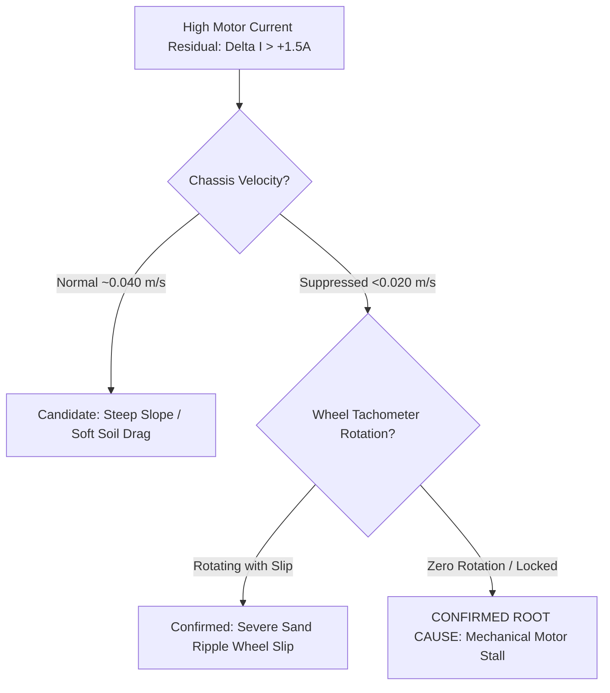

# ATLAS 13R — FAULT DETECTION & ISOLATION ARCHITECTURE
## Observability Residuals, Competing Hypotheses Disambiguation, and Containment Mapping

**Project:** MarsWalk 2.0 / Project Atlas  
**Repository:** `E:\Python\NASA-Spaceapps\Marswalk`  
**Milestone:** 13R — Atlas Apocalypse Engine  
**Module:** `src/marswalk/core/mars_fault_diagnosis.py`  

---

### 1. The Observability Gap

In planetary flight systems, internal physical damage cannot be directly probed. A telemetry channel does not report "gear tooth fractured"; it reports:
- Motor drive current: 4.8 A (nominal range: 1.8 – 2.8 A).
- Chassis forward velocity: 0.015 m/s (commanded: 0.042 m/s).

A naive threshold detector might confuse this with:
1. An unmodeled steep incline (e.g. 18° loose sand dune slope).
2. Soft soil wheel sinkage / excessive slip.
3. Mechanical stator jam.

Milestone 13R implements a multi-sensor FDDI engine that disambiguates competing hypotheses using cross-sensor invariants.

---

### 2. Disambiguation Decision Matrix

| Observable Telemetry Signatures | Competing Candidate Explanations | Discriminating Invariant Test | Confirmed Diagnosis |
| :--- | :--- | :--- | :--- |
| $\Delta I > 1.5\text{A}, \; v \approx 0.04\text{ m/s}$ | Motor wear vs. 18° sand slope | Velocity tracking nominal under current surge | **Terrain Drag** (Confidence 62%) |
| $\Delta I > 1.5\text{A}, \; v < 0.02\text{ m/s}$ | Soil sinkage vs. Gearbox fracture | Tachometer zero rotation under 28V drive command | **Mechanical Actuator Stall** (Confidence 96%) |
| $\text{Solar Flux} < 200\text{ W/m}^2$ | Cell aging vs. Atmospheric Tau Spike | Diurnal curve shape & broad-spectrum Pyranometer drop | **Dust Storm Tau Surge** (Confidence 94%) |
| $\text{SNR} < -15\text{ dB during pass}$ | Antenna pointing error vs. UHF hardware trip | Azimuth tracking gimbal encoder within target cone | **UHF Transceiver Blackout** (Confidence 98%) |
| $\Delta E_{\text{centroid}} = +0.18\text{ keV}$ | Novel lithology vs. Thermal drift | Calibration target baseline offset check | **Spectrometer Thermal Drift** (Confidence 91%) |

---

### 3. Composite System Health Index

The FDDI engine calculates a calibrated scalar health index $H \in [0.05, 1.0]$:
$$H = \max\left(0.05, \; 1.0 - \sum_{c \in \text{Confirmed}} w(\text{Severity}_c) - \sum_{h \in \text{Candidates}} 0.05 \cdot P(h)\right)$$

Where:
- $w(\text{CATASTROPHIC}) = 0.80$
- $w(\text{CRITICAL}) = 0.35$
- $w(\text{MARGINAL}) = 0.12$
- $w(\text{NEGLIGIBLE}) = 0.04$

This allows mission operators and autonomous executives to instantly assess overall vehicle degradation.
