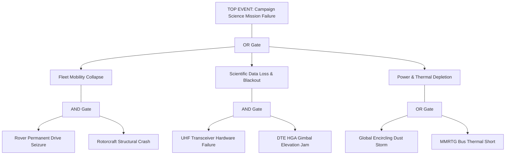

# ATLAS 13R — FMEA & FAULT TREE ANALYSIS
## Formal Failure Mode Effects Analysis, Risk Priority Numbers, and Minimal Cut Sets

**Project:** MarsWalk 2.0 / Project Atlas  
**Repository:** `E:\Python\NASA-Spaceapps\Marswalk`  
**Milestone:** 13R — Atlas Apocalypse Engine  
**Module:** `src/marswalk/core/mars_failure_mode_analysis.py`  

---

### 1. FMEA Table & Risk Priority Numbers (RPN)

Following NASA-STD-8729.1 standards, each critical failure mode is scored on three 1–10 axes:
1. **Severity ($S \in [1, 10]$):** Consequence on mission success and vehicle survival (10 = permanent catastrophic asset loss).
2. **Occurrence ($O \in [1, 10]$):** Probability of occurrence per 100 sols of surface exploration (10 = almost inevitable).
3. **Detection ($D \in [1, 10]$):** Likelihood that telemetry and onboard FDDI will fail to detect the failure before consequential impact (10 = completely invisible).

$$\text{RPN} = S \times O \times D \quad \in [1, 1000]$$

| ID | Subsystem | Failure Mode | $S$ | $O$ | $D$ | Initial RPN | Autonomous Mitigation Action | Mitigated RPN |
| :--- | :--- | :--- | :---: | :---: | :---: | :---: | :--- | :---: |
| **FMEA-01** | Mobility Drive | FR Motor Gearbox Seizure | 8 | 4 | 3 | **96** | Actuator isolation & 5-wheel kinematic re-steering | **36** (-62%) |
| **FMEA-02** | Rotor Propulsion | Rotor Blade Tip Erosion | 9 | 5 | 4 | **180** | Sortie abort & flight ceiling limited to 5m | **30** (-83%) |
| **FMEA-03** | Telecom Relay | UHF Electra Transceiver Loss | 7 | 3 | 2 | **42** | Failover to Direct-To-Earth X-band & 4:1 compression | **16** (-62%) |
| **FMEA-04** | Power & Thermal | Synoptic Storm Tau Spike | 9 | 4 | 2 | **72** | Low-power hibernation & survival heater clamping | **15** (-79%) |
| **FMEA-05** | Science (PIXL) | Cold-Plate Energy Drift | 7 | 5 | 6 | **210** | Autonomous calibration disk re-baselining | **18** (-91%) |

---

### 2. Boolean Fault Tree Analysis (FTA)

The top-level undesirable event is `TOP_LEVEL_SCIENCE_CAMPAIGN_FAILURE`.

### 3. Minimal Cut Sets

Minimal cut sets identify the smallest combinations of primary events that guarantee system failure:
1. $\{\text{EVENT\_PLANET\_DUST\_STORM}\}$ (Single point of failure for solar assets)
2. $\{\text{EVENT\_MMRTG\_SHORT}\}$ (Single point of failure for RTG rover)
3. $\{\text{EVENT\_ROV\_MOBILITY\_LOST}, \text{EVENT\_AERO\_SCOUT\_CRASH}\}$ (Dual fleet mobility failure)
4. $\{\text{EVENT\_UHF\_FAILURE}, \text{EVENT\_HGA\_GIMBAL\_STALL}\}$ (Dual telecommunications loss)

Atlas autonomous recovery strategies specifically address these cut sets by introducing dynamic redundancy across ground and aerial assets.
