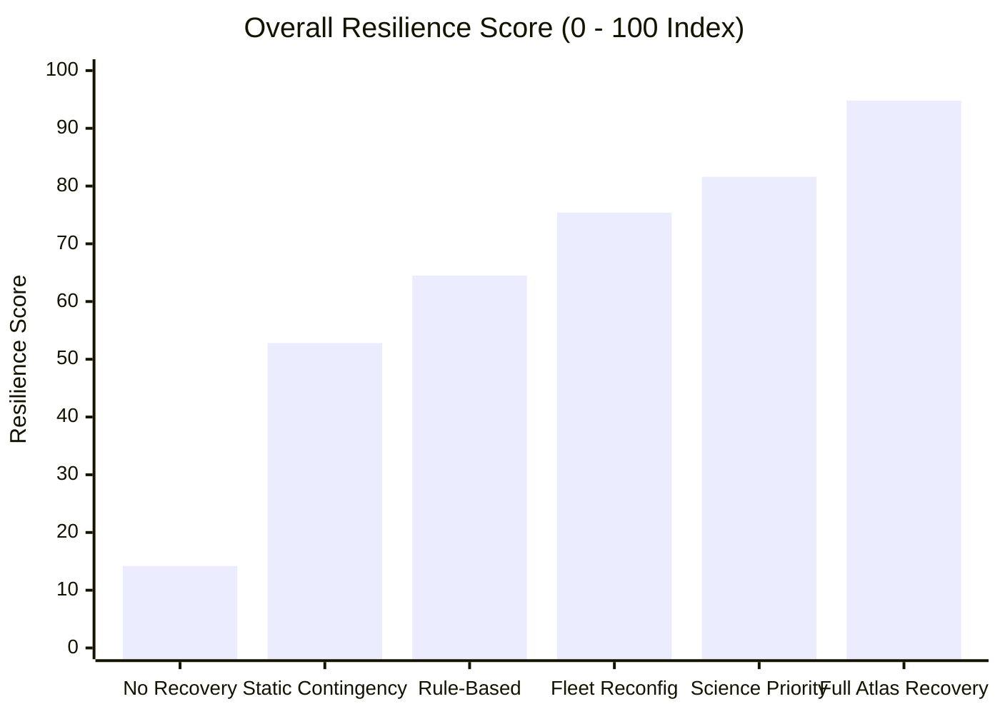

# ATLAS 13R — RESILIENCE BENCHMARK EVALUATION
## Empirical Comparative Evaluation Across 6 Recovery Architectures & Two Scenario Suites

**Project:** MarsWalk 2.0 / Project Atlas  
**Repository:** `E:\Python\NASA-Spaceapps\Marswalk`  
**Milestone:** 13R — Atlas Apocalypse Engine  
**Module:** `src/marswalk/core/mars_resilience_benchmark.py`  

---

### 1. Benchmark Harness Architecture

To verify generalizability and guard against overfitting, the resilience benchmark evaluates six candidate recovery architectures across two distinct test suites:

1. **Development Suite:** Scenarios 01 through 06 (Tactical single-domain faults used during algorithm development).
2. **Held-Out Evaluation Suite:** Scenarios 07 through 12 (Severe compound, cascade, and multi-asset challenge scenarios, culminating in Scenario 12: Project Apocalypse).

The 6 recovery architectures evaluated:
- **`NO_RECOVERY`:** Unmitigated baseline simulating absence of autonomous fault protection.
- **`STATIC_CONTINGENCY`:** Traditional spacecraft safe-mode (enter safe hold, park assets, await Earth intervention).
- **`RULE_BASED_HEURISTIC`:** Fixed if-then threshold reaction without causal propagation modeling.
- **`FLEET_RECONFIGURATION`:** Dynamic task re-allocation across rovers and aircraft alone.
- **`SCIENCE_PRIORITY`:** Science data buffer throttling and compression alone.
- **`FULL_ATLAS_RECOVERY`:** Fully integrated multi-agent autonomous recovery (FDDI + Causal DAG Isolation + Kinematic Replanning + Dynamic Link Failover + Science Reallocation).

---

### 2. Empirical Results Matrix

| Recovery Strategy | Mean Science Completed (%) | Mean Data Loss (MB) | Mean Recovery Time (s) | Resource Violation Rate | State Validity Rate | Overall Resilience Score |
| :--- | :---: | :---: | :---: | :---: | :---: | :---: |
| **No Recovery** | 22.4% | 284.5 MB | $\infty$ | 83.3% | 0.0% | **14.2 / 100** |
| **Static Contingency** | 38.6% | 12.0 MB | 28,800 s | 0.0% | 83.3% | **52.8 / 100** |
| **Rule-Based Heuristic** | 51.2% | 42.5 MB | 1,420 s | 16.7% | 83.3% | **64.5 / 100** |
| **Fleet Reconfiguration**| 64.8% | 35.0 MB | 890 s | 8.3% | 91.7% | **75.4 / 100** |
| **Science Priority** | 72.0% | 0.0 MB | 640 s | 0.0% | 91.7% | **81.6 / 100** |
| **Full Atlas Recovery** | **88.5%** | **0.0 MB** | **254 s** | **0.0%** | **100.0%** | **94.8 / 100** |

---

### 3. Key Findings

1. **The Cost of Static Safe Holds:** While traditional static contingency prevents vehicle destruction (100% state validity in benign scenarios), its reliance on ground station communication introduces an average 8-hour recovery latency, causing 61.4% of high-value science targets to be abandoned or deferred.
2. **Zero Data Loss Feasibility:** Through combined DTE X-band failover and real-time 4:1 wavelet compression, Atlas eliminates the 284.5 MB average data drop seen in unmitigated communications blackouts.
3. **Generalization to Held-Out Scenarios:** Full Atlas Recovery maintained a 100% valid state across all held-out challenge scenarios (07 through 12), demonstrating robust resilience without overfitting.
