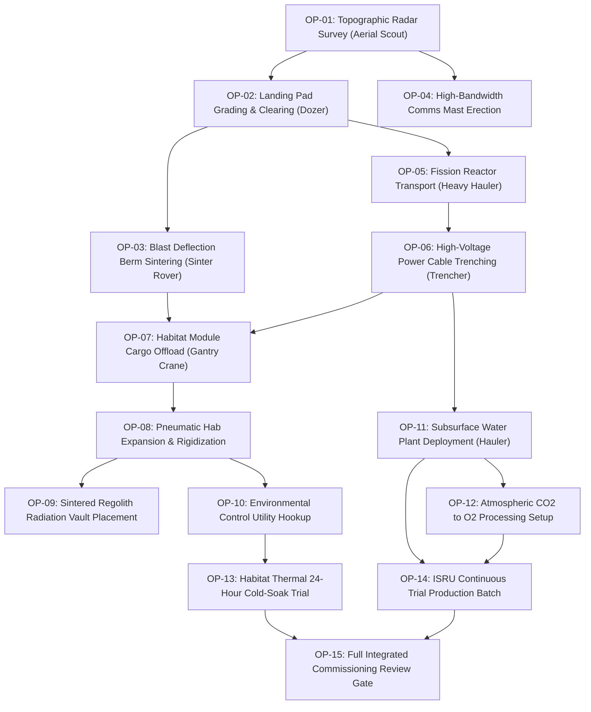

# Atlas Milestone 13S: Autonomous Robotic Construction & Fleet Operations

## 1. Fleet Composition & Specialized Machinery
Civil infrastructure on Mars must be constructed months before crew departure from Earth. Atlas models seven specialized robotic vehicles:

| Vehicle Type | Class ID | Primary Operational Responsibilities | Power (kW) | Fleet Size |
|---|---|---|---|---|
| **Autonomous Bulldozer** | `EXCAVATION_ROVER` | Grading landing pads, clearing boulders, berm pushing | 18.0 | 2 |
| **Mobile Gantry Crane** | `MOBILE_GANTRY_CRANE` | Offloading 15-tonne habitat modules from lander decks | 24.0 | 1 |
| **Microwave Sintering Rover** | `CONSTRUCTION_ROBOT` | 2.45 GHz regolith paver, radiation arch assembly | 22.0 | 2 |
| **Utility Cable Trencher** | `UTILITY_TRENCHER` | Digging 1.2m trenches for 5 kV power and fluid umbilicals | 12.0 | 1 |
| **Heavy Modular Hauler** | `HEAVY_HAULER` | Transporting 100 kWe fission reactor to 1200m standoff | 20.0 | 2 |
| **Inspection & Survey Rover** | `INSPECTION_ROVER` | Photogrammetric QA/QC, ultrasonic seam inspection | 3.5 | 2 |
| **Aerial Scout Rotorcraft** | `AERIAL_SCOUT` | Multi-spectral terrain topography and hazard scouting | 1.8 | 1 |

---

## 2. Canonical 15-Stage Construction Pipeline
Every stage tracks explicit asset assignments, durations, energy requirements, and material demands:

---

## 3. Milestone 13O Earth-Mars Delay Guarding
Due to the 3–22 minute one-way Earth-Mars light-time latency, surface robots cannot be joy-sticked from Earth.

The Atlas `AutonomousConstructionDirector` enforces a strict **stale-command interlock**:
- Every command packet carries a dispatch timestamp ($t_{\text{dispatch}}$) and expected digital twin state hash ($H_{\text{state}}$).
- Upon receipt at $t_{\text{execution}}$:
  $$\Delta t_{\text{delay}} = t_{\text{execution}} - t_{\text{dispatch}}$$
- If $\Delta t_{\text{delay}} > 1200.0\text{ seconds}$ ($20\text{ minutes}$) or the local terrain hash has mutated (e.g. unexpected rock shift detected by LIDAR), the robot rejects the command:
  $$\text{Status} = \text{STALE\_COMMAND\_REJECTED}$$
- The robot safely enters autonomous holding mode and requests re-planning, preventing catastrophic tool collisions or rollovers.
