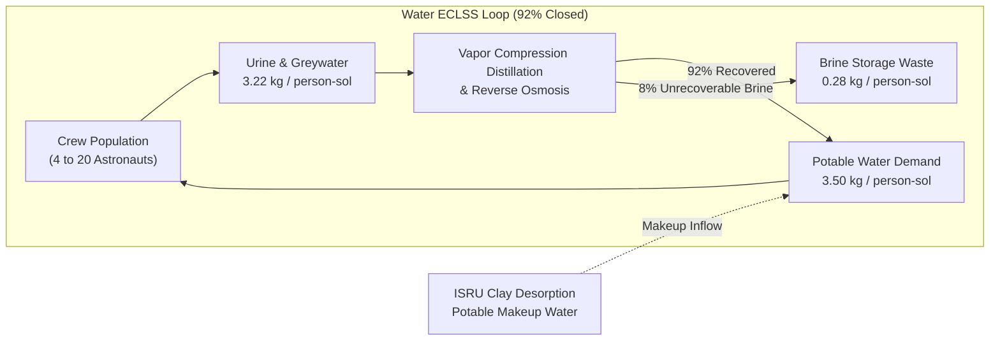

# Atlas Milestone 13S: Resource and Consumables Accounting

## 1. Multi-Sol Commodity Balance Formulation
Every consumable commodity $c \in \{\text{Water, Oxygen, Food}\}$ is tracked across each sol of simulation by the master inventory equation:

$$M_{\text{final}}(c) = M_{\text{initial}}(c) + M_{\text{produced\_isru}}(c) + M_{\text{imported}}(c) - M_{\text{consumed\_crew}}(c) - M_{\text{process\_losses}}(c)$$

$$\text{Days of Reserve Remaining}(c) = \frac{M_{\text{final}}(c)}{\dot{M}_{\text{daily\_burn}}(c)}$$

---

## 2. Realistic Non-Closed Environmental Control & Life Support (ECLSS) Loops

Popular literature frequently assumes 100% closed life-support loops. In aerospace reality (e.g. ISS experience and NASA ECLSS baselines), loops are **strictly non-closed** due to brine unrecoverability, cabin overboard leakage, trace contaminant venting, and metabolic conversion:

### Key Parameters:
1. **Potable Water:**
   - Gross Consumption: $3.50\text{ kg / person-sol}$ (drinking, rehydration, hygiene).
   - Wastewater Recycling Efficiency: $92.0\%$.
   - Unrecoverable Brine Loss: $8.0\%$ ($0.28\text{ kg / person-sol}$ required as net makeup).
   - Shortfall Threshold: $< 30.0\text{ person-sols}$ triggers emergency rationing.

2. **Breathable Oxygen:**
   - Gross Consumption: $0.84\text{ kg / person-sol}$ ($550\text{ L/day}$ at STP).
   - Sabatier / Bosch Recovery Efficiency: $88.0\%$.
   - Cabin Leakage & Airloop Loss: $12.0\%$ ($0.10\text{ kg / person-sol}$ net makeup).
   - Shortfall Threshold: $< 30.0\text{ person-sols}$.

3. **Caloric Food Rations:**
   - Gross Consumption: $0.65\text{ kg dry-mass / person-sol}$ ($2,800\text{ kcal}$).
   - Local biological greenhouse production: Modeled as experimental zero baseline in initial precursor phases; 100% supplied from Earth-imported stores.
   - Shortfall Threshold: $< 45.0\text{ person-sols}$.
