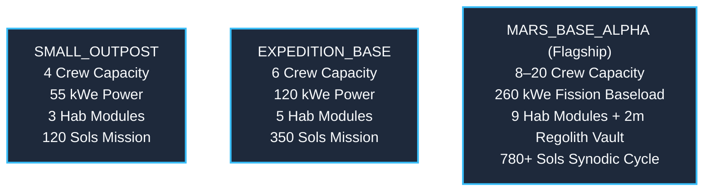
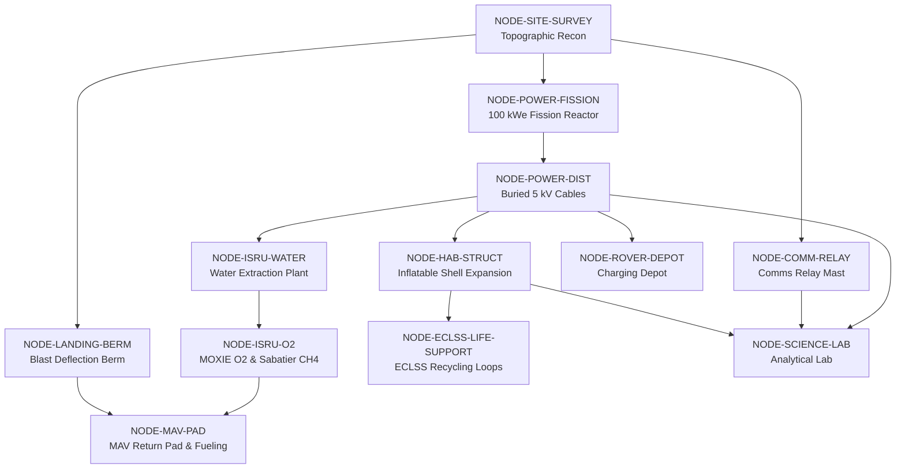

# Atlas Milestone 13S: Planetary Settlement Architecture Foundation

## 1. Executive Overview
Milestone 13S introduces the **Atlas Settlement Engine**, translating NASA's Moon to Mars Architecture Definition Document (ADD) and 2024 Architecture Concept Review (ACR) principles into an operational, physics-grounded digital twin of long-duration Martian surface infrastructure.

The digital twin models the full lifecycle across six mission phases:
- **Phase A — Reconnaissance:** High-resolution orthomosaic mapping and subsurface sounding.
- **Phase B — Precursor Deployment:** Autonomous landing pad preparation, surface power reactor transport, and initial telecommunications relay setup.
- **Phase C — Civil Construction:** Multi-robot regolith excavation, berm sintering, habitat expansion, and utility trenching.
- **Phase D — Integrated Commissioning:** Environmental cold-soak trials, pressure leak proofing, and ISRU trial production batches.
- **Phase E — Long-Duration Autonomous Operations:** Continuous commodity stockpiling and habitat conditioning.
- **Phase F — Hypothetical Crew-Arrival Readiness Review:** Formal qualification audit assessing structural, life-support, power, and logistics reserves.

---

## 2. NASA Moon to Mars 12 Architecture Elements
Atlas explicitly categorizes all surface infrastructure nodes under the 12 Moon-to-Mars architecture elements:

| Element ID | Element Name | Core System in Atlas Digital Twin | Key Subsystems |
|---|---|---|---|
| **ELEM-01** | Habitation | Multi-module habitat cluster (`HAB-CREW-01`, `HAB-LAB-01`) | 56.5 kPa pressure shell, active HVAC, trace heaters |
| **ELEM-02** | Power | Nuclear Fission Baseloader & Hybrid Solar Array | 100–260 kWe Stirling reactor, 600 kWh storage, 7-tier load shedding |
| **ELEM-03** | In-Situ Resource Utilization | ISRU Chemical & Thermal Plants | Phyllosilicate water desorption, MOXIE SOXE O2, Sabatier CH4, Sintering |
| **ELEM-04** | Autonomous Robotics | 7 Specialized Construction Assets | Bulldozers, gantry cranes, microwave sinters, trenchers, haulers |
| **ELEM-05** | Communications & Navigation | Telemetry Mast & RelayNet Integration | Steerable X-band Direct-To-Earth (DTE) dish, UHF Electra orbiter relay |
| **ELEM-06** | Data & Avionics | Autonomous Mission Operations Center | Delayed command verification, state hashing, sensor fusion |
| **ELEM-07** | Surface Mobility | Fleet Charging Depot & Rovers | Inductive fast-charging pads, pressurized and unpressurized rovers |
| **ELEM-08** | Logistics & Supply Chain | Cargo Manifests & Synodic Resupply | Modular lander packaging, tare mass tracking, spares inventory |
| **ELEM-09** | Infrastructure Support | Regolith Blast Berms & Foundations | Microwave-sintered landing pads, dust deflection walls, thermal vaults |
| **ELEM-10** | Science & Utilization | Analytical Geochemistry Laboratory | PIXL, SHERLOC, clean sample gloveboxes, core storage |
| **ELEM-11** | Transportation Interfaces | Touchdown Zone & MAV Propellant Loading | Cryogenic liquid O2 and CH4 transfer arms, umbilical towers |
| **ELEM-12** | Maintenance & Sustainment | Autonomous Repair Depot | Tool-swapping end-effectors, actuator spares, filter replenishment |

---

## 3. Configurable Settlement Archetypes
Atlas models three standardized surface settlement archetypes:

1. **Small Outpost (`SMALL_OUTPOST`):**
   - Focus: Early robotic outpost and emergency shelter.
   - Population: 4 crew capacity.
   - Power: 55 kWe Hybrid Solar PV + Storage.
   - Habitation: 3 modules (Crew Quarters, Life Support, Logistics).

2. **Expedition Base (`EXPEDITION_BASE`):**
   - Focus: Multi-discipline field geology and deep-drilling campaign.
   - Population: 6 crew capacity.
   - Power: 120 kWe Fission Baseloader.
   - Habitation: 5 modules including dedicated Analytical Science Laboratory.

3. **Mars Base Alpha (`MARS_BASE_ALPHA` — Flagship):**
   - Focus: Permanent, self-sustaining scientific settlement with full propellant synthesis.
   - Population: 8 nominal, scalable to 20 crew.
   - Power: 260 kWe redundant Nuclear Fission baseloader.
   - Habitation: 9-module pressurized cluster protected by a 2.0-meter sintered regolith anti-radiation vault.

---

## 4. Causal Infrastructure Dependency DAG
Infrastructure elements cannot be commissioned arbitrarily. The Atlas `InfrastructureDependencyDAG` enforces prerequisite ordering:

Every node transition tracks strict commissioning states: `UNCOMMISSIONED` $\to$ `PRECONDITIONS_MET` $\to$ `COMMISSIONING` $\to$ `COMMISSIONED` $\to$ `OPERATIONAL` $\to$ `DEGRADED`.
