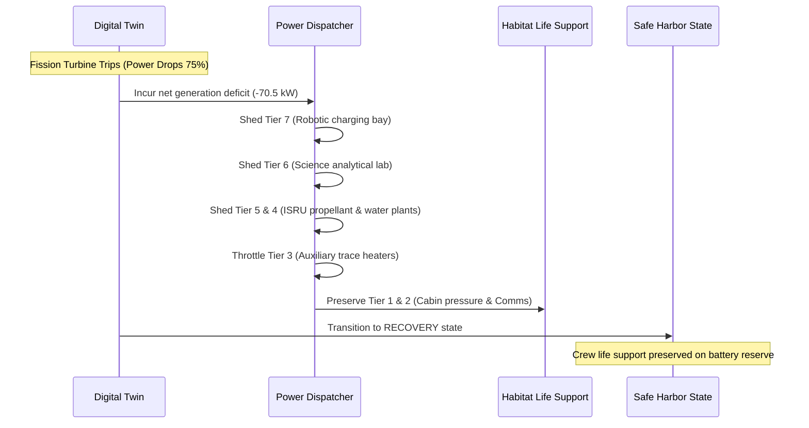

# Atlas Milestone 13S: Settlement Resilience & 13R Integration

## 1. Resilience Philosophy & Fault Propagation
A long-duration planetary settlement is a tightly coupled system of systems. A malfunction in surface power does not remain isolated—it immediately cascades into water extraction halting, habitat heating throttling, and air revitalizer starvation.

Milestone 13S integrates directly with the **Milestone 13R Apocalypse Engine**, modeling causal fault propagation and autonomous load reprioritization across five major settlement failure modes:
1. `PRIMARY_GENERATOR_OUTAGE`: Loss of the main 100/250 kWe Stirling reactor.
2. `SOLAR_DUST_STORM_DEPLETION`: Global dust storm elevating atmospheric tau to $2.85$.
3. `WATER_EXTRACTION_PUMP_LOCK`: Mechanical auger jam in the thermal extraction plant.
4. `CARGO_RESUPPLY_DELAY`: Launch scrub delaying the Earth-Mars resupply lander by 180 sols.
5. `COMPOUND_INFRASTRUCTURE_APOCALYPSE`: Multiple simultaneous hardware failures under severe environmental stress.

---

## 2. Dynamic Load Shedding & Safe Harbor Mode
Under a severe power deficit (e.g., fission alternator trip or depleted batteries), the `SettlementResilienceEvaluator` executes autonomous emergency load management:

### Invariant Resilience Directives:
1. **Life Support Preservation:** Priority Tier 1 (Cabin Pressurization & Trace Contaminant Removal) must NEVER be shed under survivable power states.
2. **Graceful Production Throttling:** ISRU water and oxygen production can be safely paused for dozens of sols without risking crew survival due to pre-accumulated stockpiles.
3. **Safe Harbor Transition:** If power drops below $25\text{ kW}$, the entire settlement transitions from `OPERATIONAL_SIMULATION` to `RECOVERY` mode, conserving energy exclusively for habitat environmental integrity.
