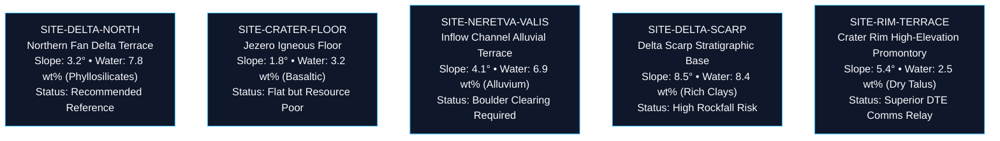

# Atlas Milestone 13S: Multi-Criteria Site Selection & SWIM Uncertainty

## 1. Scientific Philosophy
Settlement location selection is often trivialized as picking a single spot with a high arbitrary score. In reality, planetary surface engineering involves competing tradeoffs across four non-collapsible axes:
1. **Terrain Suitability:** Slope, surface roughness, bearing capacity, and contiguous clearing area.
2. **Environmental Hostility:** Diurnal temperature extremes, atmospheric density, and dust storm deposition.
3. **Resource Potential:** Hydration percentage, overburden depth, and evidence confidence levels.
4. **Operational Feasibility:** Direct-to-Earth (DTE) visibility, landing safety clearance, and nuclear reactor standoff distance.

Atlas explicitly rejects single-score reductions, presenting decision-makers with the raw scientific attributes and uncertainty intervals.

---

## 2. NASA SWIM Water-Ice Uncertainty Preservation
A major scientific failure in popular Mars colonization literature is treating speculative orbital radar signatures as confirmed pure water ice. 

In equatorial and mid-latitude regions like Jezero Crater ($18.4^\circ\text{N}$), pure subsurface glacial slab ice is thermally unstable over geological timescales. The actual water resources exist predominantly as **adsorbed and structural hydration in phyllosilicate clay minerals** and hydrated sulfate salts.

Atlas formalizes the NASA Subsurface Water Ice Mapping (SWIM) uncertainty hierarchy:

| Confidence Level | Definition | Representative Sensor Evidence | Uncertainty |
|---|---|---|---|
| `ORBITAL_INDICATION` | Speculative orbital dielectric or thermal inertia proxy | Epithermal neutron (MONS) or SHARAD radar anomaly | &plusmn; 45% |
| `GEOLOGICALLY_INFERRED` | Fluvial sedimentology or layered clay deposits | CRISM infrared spectral absorption bands (1.4, 1.9, 2.2 &mu;m) | &plusmn; 35% |
| `RESOURCE_CANDIDATE` | Multi-instrument spatial agreement with shallow talus | Co-registered HiRISE, CTX, and CRISM mineral mapping | &plusmn; 25% |
| `LOCALLY_CHARACTERIZED` | In-situ ground-penetrating radar sounding | Rover RIMFAX radar subsurface permittivity profiles | &plusmn; 15% |
| `SIMULATED_EXTRACTABLE` | Engineering extraction model verified with mass audit | Ground drill core sample analyzed via APXS/CheMin | &plusmn; 5% |

---

## 3. Candidate Jezero Crater Settlement Sites

### Detailed Site Comparison:
1. **SITE-DELTA-NORTH (Recommended Reference):**
   - Coordinates: $18.4421^\circ\text{N}, 77.4528^\circ\text{E}$
   - Elevation: $-2540\text{ m}$ (thick atmosphere benefits aerodynamic landing).
   - Terrain: Mean slope $3.2^\circ$, flat contiguous area $125,000\text{ m}^2$, bearing capacity $145\text{ kPa}$.
   - Water: $7.8\text{ wt}\%$ in smectite clay beds at $0.45\text{ m}$ overburden depth.
   - Operations: $1,200\text{ m}$ standoff depression available for 100 kWe fission reactor.

2. **SITE-CRATER-FLOOR:**
   - Coordinates: $18.3812^\circ\text{N}, 77.5840^\circ\text{E}$
   - Terrain: Ultra-flat mean slope $1.8^\circ$, vast landing clearing.
   - Weakness: Low hydration ($3.2\text{ wt}\%$); requires mining 2.4&times; more regolith per tonne of water.

3. **SITE-NERETVA-VALIS:**
   - Coordinates: $18.5204^\circ\text{N}, 77.3315^\circ\text{E}$
   - Hydration: $6.9\text{ wt}\%$, excellent canyon wall shielding.
   - Weakness: Boulder fields require 96 hours of autonomous robotic clearing.
