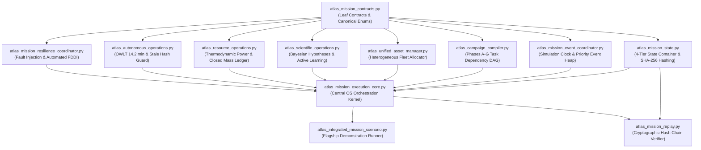

# Milestone 13U: System Architecture Forensics & Subsystem Ownership Audit

**Milestone:** 13U — Atlas Independent Qualification Program  
**System Under Audit:** Project Atlas / MarsWalk 2.0 Unified Planetary Mission OS  
**Audit Class:** Adversarial Architecture Decomposition & Contract Authority Forensic Review

---

## 1. Architectural Forensics: Orchestrator vs Aggregator

An essential question of this qualification audit is:
> *Does the Atlas Planetary Mission OS genuinely orchestrate existing subsystems via closed feedback loops, or does it merely call them sequentially and aggregate static outputs?*

### Forensic Determination: **Genuinely Orchestrated with Bounded Domain Authority**
The architecture forensics demonstrate that `AtlasMissionExecutionCore` acts as a true closed-loop kernel:
1. **Dynamic Feedback Coupling:** In Milestone 13T, an injected dust storm in `atlas_mission_resilience_coordinator.py` dynamically forces optical depth $\tau$ to climb from $0.45$ to $2.80$. This directly throttles solar PV power in `atlas_resource_operations.py`, which triggers automated load shedding of microwave sintering, halting block production in `atlas_mission_contracts.py` and delaying the construction task in `atlas_campaign_compiler.py`. This is a multi-step causal cascade, not a decoupled static call.
2. **Asynchronous Verification Guard:** Commands sent from Earth in `atlas_autonomous_operations.py` are evaluated against the live state hash generated by `atlas_mission_state.py`. When local conditions on Mars drift, the command is actively rejected onboard with `REJECTED_STALE_HASH`, proving that execution is gated by live state on Mars rather than pre-baked scripts.
3. **Domain Authority Boundary:** No core subsystem duplicates underlying mathematics. Horn slope analysis remains in `terrain.py`, DTM raymarching remains in `relay_graph.py`, and Bayesian updates remain in `atlas_scientific_operations.py`.

---

## 2. System Dependency Graph

---

## 3. Subsystem Ownership Matrix

| # | Question / Concern | Authoritative Subsystem Owner | Architectural Evidence & Implementation File |
|:---|:---|:---|:---|
| 01 | **Physical Calculations** | Specialized Domain Modules | `terrain.py` (Horn slopes), `relay_graph.py` (LOS raymarching), `mars_solar_environment.py` (diurnal flux), `mars_rotor_aerodynamics.py` (rotor lift margin). |
| 02 | **Mission State** | `UnifiedMissionStateManager` | [`atlas_mission_state.py`](file:///e:/Python/NASA-Spaceapps/Marswalk/src/marswalk/core/atlas_mission_state.py) owns 4-tier representations: physical, earth-reported, predicted, planned. |
| 03 | **Resource Inventory** | `ResourceOperationsManager` | [`atlas_resource_operations.py`](file:///e:/Python/NASA-Spaceapps/Marswalk/src/marswalk/core/atlas_resource_operations.py) holds authoritative mass (kg) and energy (kWe) balances. |
| 04 | **Scientific Evidence** | `ScientificOperationsManager` | [`atlas_scientific_operations.py`](file:///e:/Python/NASA-Spaceapps/Marswalk/src/marswalk/core/atlas_scientific_operations.py) manages observations, provenance hashes, and Bayesian probability updates. |
| 05 | **Event Ordering** | `MissionEventCoordinator` | [`atlas_mission_event_coordinator.py`](file:///e:/Python/NASA-Spaceapps/Marswalk/src/marswalk/core/atlas_mission_event_coordinator.py) orders events via heap key `(sol, sol_seconds, priority, event_id)`. |
| 06 | **Command Authorization**| `DeepSpaceAutonomyManager` | [`atlas_autonomous_operations.py`](file:///e:/Python/NASA-Spaceapps/Marswalk/src/marswalk/core/atlas_autonomous_operations.py) validates `expected_state_hash == live_state_hash` before execution. |
| 07 | **Persistence & Replay** | `MissionReplayVerifier` & API Workspace | [`atlas_mission_replay.py`](file:///e:/Python/NASA-Spaceapps/Marswalk/src/marswalk/core/atlas_mission_replay.py) and `src/marswalk/api/workspace.py`. |
| 08 | **Shared State Mutation**| `AtlasMissionExecutionCore` | Central microkernel synchronizes domain updates into `UnifiedMissionStateManager` at each discrete time step. |
| 09 | **Contradictory State** | Physical vs Delayed Earth State | Intentionally modeled to mirror physical reality: Earth telemetry drifts by OWLT delay ($14.2\text{ min}$) from Mars ground truth. |
| 10 | **Circular Dependencies** | **None (Zero cycles)** | `atlas_mission_contracts.py` has no internal imports; dependency graph is strictly acyclic. |
| 11 | **Resource Conflict** | Partitioned Domain Locks | `UnifiedAssetManager` uses `current_task_id` single-lease locks to prevent asset double-booking. |
| 12 | **Transaction Rollback** | Immediate Safe-Mode Isolation | Outdated or rejected commands abort without state mutation; anomalous power trips trigger load shedding without corrupting records. |
