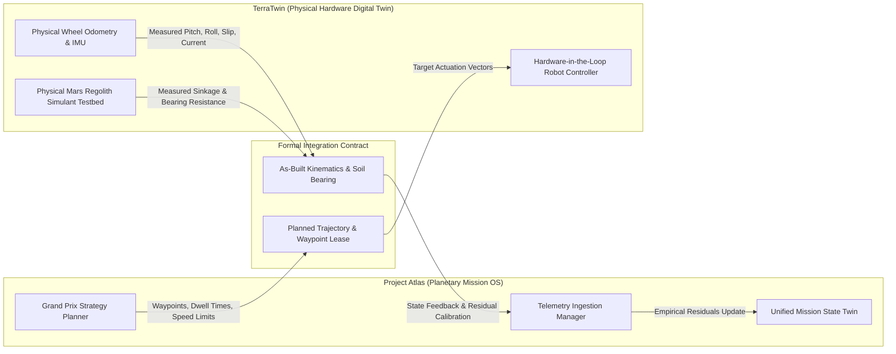

# Project Atlas — Milestone 13X: TerraTwin Future Integration Boundary Specification

**Project:** MarsWalk 2.0 / Project Atlas  
**Milestone:** 13X — Atlas Mission Grand Prix  
**Document:** `docs/13x-terratwin-integration-boundary.md`  
**Status:** **ARCHITECTURAL BOUNDARY SPECIFICATION (HARDWARE DEFERRED)**  

---

## 1. Scope & Deferral Mandate

In strict accordance with the Milestone 13X mission charter:
- **Physical Hardware is Out of Scope:** No physical robots, mock-ups, actuators, or local telemetry bridges are commissioned in Milestone 13X.
- **Teammate Repository Isolation:** The teammate's TerraTwin repository must not be modified, imported, or executed prematurely.
- **Autonomous Operability:** The Atlas Mission Grand Prix simulator remains 100% operational, reproducible, and verifiable in software without requiring TerraTwin dependencies.

This document establishes the formal data-contract interface, coordinate frames, and telemetry schemas required when physical hardware or hardware-in-the-loop (HIL) TerraTwin digital twins are bridged in future milestones.

---

## 2. Anticipated Data Exchange Schema



---

## 3. Core Contract Fields & Data Units

When integrated, the exchange protocol shall communicate via JSON-over-WebSocket or gRPC with the following standardized fields:

### 3.1 Atlas-to-TerraTwin (Command & Trajectory Envelope)
```json
{
  "contract_version": "1.0.0-terratwin",
  "mission_id": "ATLAS-GRAND-PRIX-EXPEDITION",
  "sol_timestamp": 14.25,
  "command_id": "CMD-TRAVERSE-TGT-04",
  "assigned_asset_id": "ATLAS-ROVER-01",
  "target_waypoint": {
    "grid_rc": [45, 32],
    "planetocentric_lat": 18.4447,
    "planetocentric_lon": 77.4508,
    "elevation_m": -2531.2
  },
  "constraints": {
    "max_allowed_slope_deg": 15.0,
    "max_ground_speed_mps": 0.045,
    "max_motor_power_w": 280.0,
    "emergency_halt_timeout_sec": 3.0
  }
}
```

### 3.2 TerraTwin-to-Atlas (Physical State Feedback & Empirical Residuals)
```json
{
  "contract_version": "1.0.0-terratwin",
  "packet_id": "TELEM-ROVER-01-SOL14-0042",
  "device_id": "TERRATWIN-PHYSICAL-UNIT-01",
  "timestamp_utc": "2026-11-07T00:40:00Z",
  "telemetry": {
    "kinematics": {
      "chassis_pitch_deg": 4.2,
      "chassis_roll_deg": -1.8,
      "wheel_slip_ratio": 0.082,
      "actual_ground_speed_mps": 0.041
    },
    "soil_mechanics": {
      "measured_sinkage_cm": 1.4,
      "estimated_bearing_pressure_kpa": 165.0,
      "regolith_traction_coefficient": 0.52
    },
    "power_system": {
      "instantaneous_power_w": 268.5,
      "battery_voltage_v": 28.4,
      "battery_current_a": 9.45,
      "core_temperature_c": 18.5
    }
  },
  "anomaly_alerts": []
}
```

---

## 4. Coordinate Reference Frame Harmonization

To prevent catastrophic spatial misalignment:
1. **Planetary Frame:** IAU Mars 2000 Sphere ($R_m = 3,396,190\text{ m}$), Planetocentric East-Positive Longitude ($0^\circ \text{ to } 360^\circ$).
2. **Local Topographic Frame:** USGS CTX Jezero Crater 20m grid coordinates ($(r, c) \in [0, 249]$), North-Up, East-Right.
3. **TerraTwin Body Frame:** Forward ($+X$), Right ($+Y$), Down ($+Z$) conforming to standard ISO 8855 terrestrial rover conventions.

---

## 5. Non-Interference Guarantee

- Atlas does not require live TerraTwin hardware to run the 8-round Grand Prix tournament, Monte Carlo simulations, or the 3D WebGL theater.
- All Grand Prix benchmarks operate with high numerical repeatability in purely software-evaluated physics.
- The interface contracts described herein provide a drop-in integration bridge once physical hardware trials commence in downstream programs.
