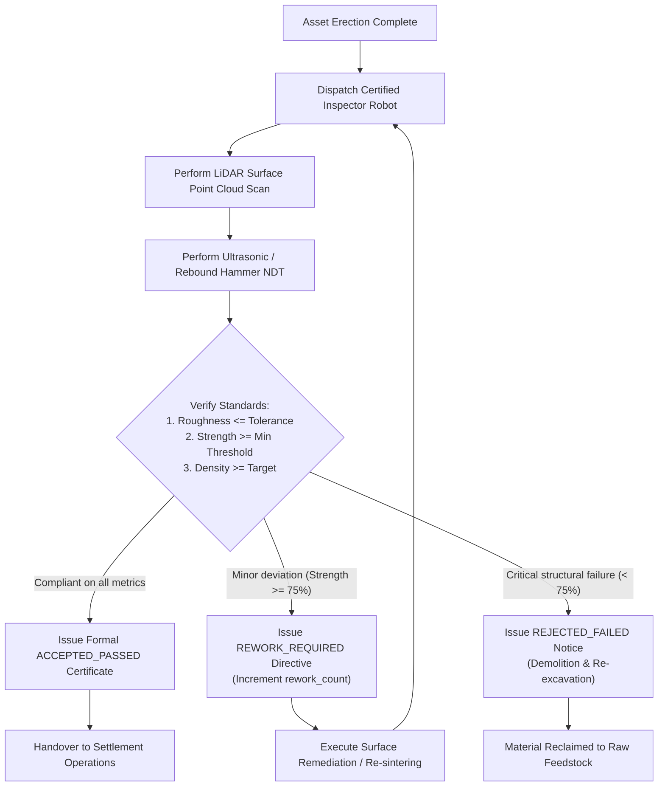

# Project Atlas — Milestone 13Z: Construction Acceptance Methodology
## Non-Destructive Quality Assurance, LiDAR Planarity Verification & Defect Remediation

**Document Version:** 1.0.0  
**Classification:** Quality Assurance & Structural Engineering Standard  
**System Designation:** ATLAS-FOUNDRY-QA-13Z  
**Repository:** `E:\Python\NASA-Spaceapps\Marswalk`  

---

### 1. Structural Acceptance Standards

Every infrastructure asset registered in the Milestone 13Z `INFRASTRUCTURE_CATALOGUE` possesses explicit quantitative tolerance thresholds:

| Infrastructure Asset | Footprint ($\text{m}^2$) | Max Surface Roughness ($\text{cm}$) | Min Compressive Strength ($\text{MPa}$) | Density Compliance Target |
| :--- | :---: | :---: | :---: | :---: |
| **`LANDING_ZONE_PREPARATION`** | 10,000 | 5.0 | 0.8 | $\ge 85\%$ |
| **`LANDING_PAD_SEGMENTS`** | 2,500 | 1.0 | 45.0 | $\ge 95\%$ |
| **`ACCESS_ROADS_MOBILITY_ROUTES`** | 5,000 | 3.0 | 2.5 | $\ge 90\%$ |
| **`EQUIPMENT_FOUNDATIONS`** | 400 | 0.5 | 35.0 | $\ge 95\%$ |
| **`REGOLITH_BERMS_SHIELDING`** | 1,200 | 10.0 | 1.2 | $\ge 88\%$ |
| **`UTILITY_TRENCHES`** | 300 | 4.0 | 1.5 | $\ge 85\%$ |
| **`SOLAR_ARRAY_FOUNDATIONS`** | 600 | 1.0 | 30.0 | $\ge 92\%$ |
| **`ANTENNA_FOUNDATIONS_MASTS`** | 200 | 0.5 | 40.0 | $\ge 95\%$ |
| **`EQUIPMENT_SHELTERS`** | 800 | 2.0 | 28.0 | $\ge 90\%$ |
| **`MODULAR_STORAGE_BAYS`** | 1,000 | 2.5 | 25.0 | $\ge 90\%$ |
| **`POWER_DISTRIBUTION_HUBS`** | 300 | 0.8 | 35.0 | $\ge 95\%$ |
| **`SURFACE_RELAY_STATIONS`** | 150 | 1.0 | 30.0 | $\ge 92\%$ |

---

### 2. Inspection Verification Workflow

---

### 3. Non-Silent Traceability

The `FoundryInspectionEngine` generates an immutable `InspectionReport` containing:
- Unique certificate ID (`INSP-XXXXX`).
- Inspector robot ID and timestamp.
- Empirical metrics vs. design criteria.
- Detailed defect forensic narrative and recommended corrective action.
- Status updates: `ACCEPTED_PASSED`, `REWORK_REQUIRED`, or `REJECTED_FAILED`.

Under project rules, simulated inspection records cannot silently ignore out-of-tolerance values; every remediation cycle is documented and reflected in the campaign's final rework rate metric.
