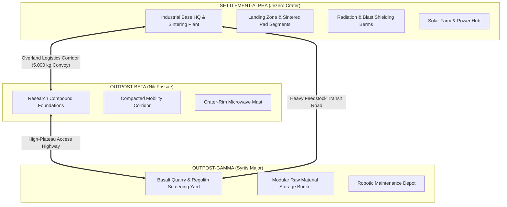
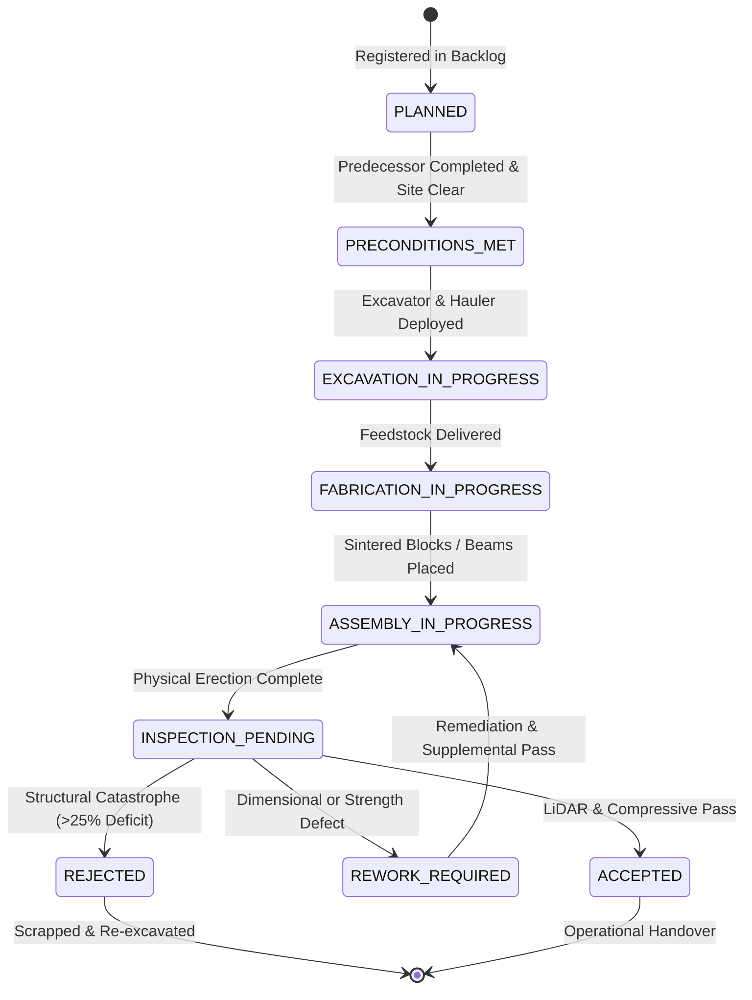

# Project Atlas — Milestone 13Z: Planetary Foundry Architecture
## Autonomous Robotic Construction, ISRU Manufacturing & Industrial Surface Operations

**Document Version:** 1.0.0  
**Classification:** Scientific Software Technical Specification  
**System Designation:** ATLAS-FOUNDRY-ARCH-13Z  
**Repository:** `E:\Python\NASA-Spaceapps\Marswalk`  
**Flagship Configuration:** `ATLAS-MARS-INDUSTRIAL-CAMPAIGN-001`  

---

### 1. Executive Summary

Milestone 13Z expands Project Atlas from a planetary exploration and fleet communications platform into a multi-settlement autonomous robotic construction and in-situ resource utilization (ISRU) manufacturing simulator. The system models the transformation of raw Martian surface materials into certified unpressurized surface infrastructure across three distinct Martian settlements:
- **`SETTLEMENT-ALPHA` (Jezero Crater)**: Primary industrial hub and advanced manufacturing complex.
- **`OUTPOST-BETA` (Nili Fossae)**: High-altitude geological research outpost and regional power nexus.
- **`OUTPOST-GAMMA` (Syrtis Major)**: Deep-regolith extraction and basalt quarry facility.

The architecture strictly enforces 10 non-negotiable physical and operational invariants governing mass conservation, equipment capability matching, non-silent quality verification, energy accounting, and delay-tolerant logistics without teleportation.

---

### 2. Multi-Settlement Topology & Asset Scope

---

### 3. Core Architectural Modules

The Planetary Foundry subsystem is located in `src/marswalk/core/` and comprises 10 tightly coupled modules:

| Module | Source File | Core Responsibility |
| :--- | :--- | :--- |
| **Materials & Inventory** | [`atlas_foundry_materials.py`](file:///E:/Python/NASA-Spaceapps/Marswalk/src/marswalk/core/atlas_foundry_materials.py) | 8 material categories, strict mass conservation, batch tracking, evidence classification. |
| **Robotics & Kinematics** | [`atlas_foundry_robotics.py`](file:///E:/Python/NASA-Spaceapps/Marswalk/src/marswalk/core/atlas_foundry_robotics.py) | 6 industrial robot classes, payload constraints, battery drain, maintenance wear, 18-unit canonical fleet. |
| **Structures Catalogue** | [`atlas_foundry_structures.py`](file:///E:/Python/NASA-Spaceapps/Marswalk/src/marswalk/core/atlas_foundry_structures.py) | 12 unpressurized surface assets, bills of quantities (BOQ), predecessor graphs, structural state machine. |
| **Resource Processing** | [`atlas_foundry_resource_processing.py`](file:///E:/Python/NASA-Spaceapps/Marswalk/src/marswalk/core/atlas_foundry_resource_processing.py) | Screening (82% yield), sintering (92% yield), compaction (98% yield), geopolymer curing. |
| **Quality & Inspection** | [`atlas_foundry_inspection.py`](file:///E:/Python/NASA-Spaceapps/Marswalk/src/marswalk/core/atlas_foundry_inspection.py) | LiDAR geometric scanning, compressive strength proxy, non-silent rework tracking, audit reports. |
| **Maintenance & Resilience**| [`atlas_foundry_maintenance.py`](file:///E:/Python/NASA-Spaceapps/Marswalk/src/marswalk/core/atlas_foundry_maintenance.py) | Fault injection, maintainer dispatch, mechanical breakdown isolation, spare parts consumption. |
| **Construction Coordination**| [`atlas_foundry_construction.py`](file:///E:/Python/NASA-Spaceapps/Marswalk/src/marswalk/core/atlas_foundry_construction.py) | Phased task decomposition (`SITE_SURVEY` to `FINAL_INSPECTION`), capability matching, dependency gates. |
| **Foundry Scheduling** | [`atlas_foundry_scheduler.py`](file:///E:/Python/NASA-Spaceapps/Marswalk/src/marswalk/core/atlas_foundry_scheduler.py) | 5 strategy implementations: Fast Build, Min Mass, Energy Saver, Resilience First, Atlas Industrial Director. |
| **Scenario Engine** | [`atlas_foundry_scenario_engine.py`](file:///E:/Python/NASA-Spaceapps/Marswalk/src/marswalk/core/atlas_foundry_scenario_engine.py) | 12 canonical campaigns simulating single-asset to multi-settlement infrastructure expansion. |
| **Foundry Grand Prix** | [`atlas_foundry_grand_prix.py`](file:///E:/Python/NASA-Spaceapps/Marswalk/src/marswalk/core/atlas_foundry_grand_prix.py) | Algorithmic tournament benchmarking all 5 strategies across standardized workloads. |

---

### 4. Architectural State Machine

Every constructed asset transitions through an explicit lifecycle governed by structural engineering gates:

---

### 5. Architectural Invariants Enforced

1. **`INV-01-MASS-CONSERVATION`**: $M_{in} = M_{out} + M_{waste}$. Unscreened feedstock undergoes mechanical screening yielding 82% usable fines and 18% cobble waste. Sintering yields 92% high-density masonry pavers and 8% thermal spall loss.
2. **`INV-02-TASK-DEPENDENCY`**: No downstream structure (e.g. `LANDING_PAD_SEGMENTS`) can commence until registered predecessors (e.g. `LANDING_ZONE_PREPARATION`) achieve formal `ACCEPTED` status.
3. **`INV-03-QUALITY-NON-SILENT-REWORK`**: Sub-standard surfaces or low-strength concrete cannot be silently passed. The system flags `REWORK_REQUIRED`, logs inspection failure reports, and increments remediation counts.
4. **`INV-04-CAPABILITY-MATCHING`**: Robots are strictly certified by functional class (`EXCAVATOR`, `HAULER`, `MANUFACTURER`, `ASSEMBLER`, `INSPECTOR`, `MAINTAINER`) and maximum payload rating.
5. **`INV-05-RESILIENCE-AND-REPAIR`**: Mechanical faults immobilize equipment into isolated states, requiring maintainer rovers and spare parts stock to restore nominal health.
6. **`INV-06-ENERGY-ACCOUNTING`**: Every task strictly deducts kWh from the assigned robot's battery and tracks facility thermal/electrical consumption.
7. **`INV-07-UNIT-CONSISTENCY`**: Metric SI units (kg, m, kWh, hours) enforced. Inventory balances reject overdrafts.
8. **`INV-08-ISRU-MAXIMIZATION`**: Foundations, roads, berms, and pads achieve $\ge 85\%$ in-situ mass fraction.
9. **`INV-09-SPARE-PARTS-ACCOUNTING`**: Maintenance interventions decrement actual settlement stockpiles of fasteners and replacement components.
10. **`INV-10-NETWORK-COORDINATION`**: Inter-settlement material transfers deduct from the origin inventory and credit the destination inventory without instantaneous teleportation.
