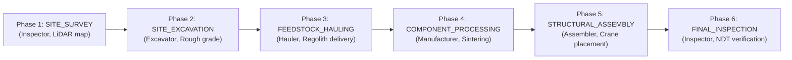

# Project Atlas — Milestone 13Z: Robotics & Task Planning
## Autonomous Fleet Kinematics, Capability Matching & Phased Construction Orchestration

**Document Version:** 1.0.0  
**Classification:** Autonomous Systems & Robotics Specification  
**System Designation:** ATLAS-FOUNDRY-ROBOTICS-13Z  
**Repository:** `E:\Python\NASA-Spaceapps\Marswalk`  

---

### 1. Heterogeneous Fleet Specification

The Milestone 13Z canonical industrial fleet consists of 18 robots distributed across the three settlements:

| Robot Class | Units | Role & Actuation | Max Payload ($\text{kg}$) | Nominal Power ($\text{kW}$) | Battery ($\text{kWh}$) | Speed ($\text{km/h}$) |
| :--- | :---: | :--- | :---: | :---: | :---: | :---: |
| **`EXCAVATOR`** | 3 | Continuous bucket drum / trencher | 2,500 | 15.0 | 100.0 | 5.0 |
| **`HAULER`** | 4 | Heavy articulated regolith bed | 5,000 | 10.0 | 80.0 | 8.0 |
| **`MANUFACTURER`**| 3 | Microwave sintering & geopolymer 3D print | 1,500 | 25.0 | 100.0 | 2.0 |
| **`ASSEMBLER`** | 4 | 6-DOF high-precision robotic crane | 1,200 | 8.0 | 50.0 | 3.0 |
| **`INSPECTOR`** | 2 | Dual LiDAR, hyperspectral & probe mast | 50 | 0.8 | 30.0 | 3.0 |
| **`MAINTAINER`** | 2 | Dexterous manipulator & welder | 300 | 2.0 | 40.0 | 4.0 |

---

### 2. Fleet Settlement Distribution

- **`SETTLEMENT-ALPHA` (8 Robots)**:
  - `ROB-001` (Excavator), `ROB-002` (Hauler), `ROB-003` (Hauler), `ROB-004` (Manufacturer), `ROB-005` (Assembler), `ROB-006` (Assembler), `ROB-007` (Inspector), `ROB-008` (Maintainer).
- **`OUTPOST-BETA` (5 Robots)**:
  - `ROB-009` (Excavator), `ROB-010` (Hauler), `ROB-011` (Manufacturer), `ROB-012` (Assembler), `ROB-013` (Inspector).
- **`OUTPOST-GAMMA` (5 Robots)**:
  - `ROB-014` (Excavator), `ROB-015` (Hauler), `ROB-016` (Manufacturer), `ROB-017` (Assembler), `ROB-018` (Maintainer).

---

### 3. Phased Task Decomposition

Every registered infrastructure project is decomposed by the `MultiRobotConstructionPlanner` into six sequential phases:

1. **`SITE_SURVEY`**: Topographic scan, subsurface obstruction identification via ground-penetrating radar, establishing reference datum.
2. **`SITE_EXCAVATION`**: Regolith removal, boulder clearance, trenching for subsurface conduits.
3. **`FEEDSTOCK_HAULING`**: Regolith transport from excavation pits to screening yards and construction pads.
4. **`COMPONENT_PROCESSING`**: In-situ thermal sintering of pavers, geopolymer casting, or berm soil grading.
5. **`STRUCTURAL_ASSEMBLY`**: Interlocking block placement, tension rod anchoring, footing alignment.
6. **`FINAL_INSPECTION`**: High-resolution LiDAR surface planarity check, density compliance, non-destructive strength verification.
