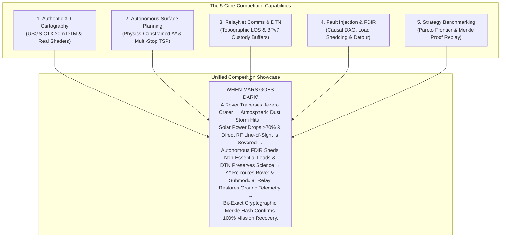
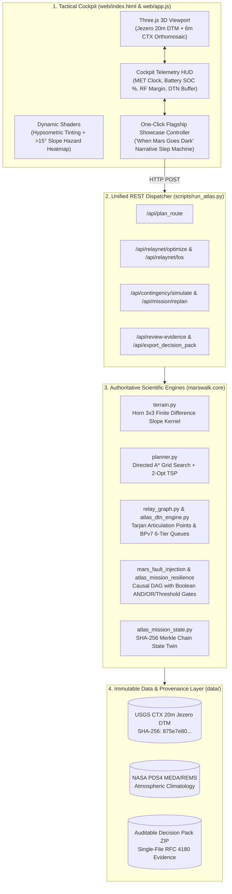

# Project MarsWalk — Competition Architecture & Product Strategy

**Document ID:** `MARSWALK-ARCH-001`  
**Date:** 2026-11-14  
**Author:** Principal Software Architect & Systems Engineer  
**Workspace:** `/home/mech_ka_launda/projects/NASA-SpaceApps-2026/MarsWalk-Submission`  
**Target:** NASA Space Apps Challenge 2026 Submission

---

## 1. Competition Strategy: Depth & Cohesion Over Feature Sprawl

### The Reality of Hackathon Judging
In technical competitions such as the NASA Space Apps Challenge, judging panels evaluate entries across strict criteria: **Scientific Credibility, Technical Rigor, Usability, and Clarity of Storytelling**.

The current MarsWalk 2.0 repository contains 24 tab interfaces and over 188 Python modules covering speculative capabilities like *Planetary Foundry* (regolith block sintering) and *Aerial Corps* (rotorcraft dynamics). Attempting to showcase all 24 tabs during a 5-minute presentation guarantees judge disorientation, cognitive friction, and elevated risk of runtime glitches.

### The Competition Pivot
We define a disciplined **Competition Architecture** that streamlines the product into **Five Cohesive Core Capabilities** unified by a single high-drama demonstration story: **"WHEN MARS GOES DARK"**.

---

## 2. Multi-Layer Competition Architecture

The streamlined architecture preserves full scientific fidelity while decoupling non-essential modules from the critical demonstration path:

---

## 3. The Flagship Narrative: "WHEN MARS GOES DARK"

The competition presentation is choreographed into five sequential operational stages executed directly inside the live workstation:

### Stage 1: Nominal Exploration Sortie
- **Action:** Rover `ATLAS-ROVER-01` departs Octavia E. Butler Landing on a 4-stop scientific sortie across Jezero Crater towards Delta Rim Overlook.
- **Visual:** Smooth Three.js 3D camera follow mode; draped 6 m/px CTX optical terrain; A* route line highlighted in cyan; slope hazards safely bypassed; HUD shows green telemetry, 98% battery SOC, and active RF link to Base Station.

### Stage 2: The Cataclysm — Mars Goes Dark
- **Action:** Sol 15 dust storm injection ($\tau$ surges from $0.4$ to $2.8$).
- **Visual:** Skybox darkens; solar irradiance drops from $590\text{ W/m}^2$ to $<140\text{ W/m}^2$; battery discharge rate spikes; direct RF line-of-sight to Base Station is severed by crater rim topography. HUD flashes amber: `COMMUNICATION BLACKOUT` and `POWER DERATE`.

### Stage 3: Autonomous Science Preservation (DTN Custody)
- **Action:** Rover cannot transmit science observations to Earth/Base Station.
- **Engine Response:** RFC 9171 (BPv7) Delay-Tolerant Networking engine intercepts data packets. Class 1 Emergency alerts are prioritized; Class 3 Science packets are committed to encrypted local flash custody storage with SHA-256 checksums; zero data is dropped.

### Stage 4: Autonomous Causal FDIR & Route Replanning
- **Action:** Causal DAG failure propagation triggers autonomous recovery.
- **Engine Response:** 
  1. `MissionResilienceCoordinator` sheds secondary heater and non-essential instrumentation loads.
  2. `adaptive_replanner.py` dynamically evaluates the remaining battery budget against Jezero slopes.
  3. Proposes an optimal **Bounded Detour**: truncates low-value peripheral waypoints to ensure guaranteed return within energy reserve ceilings.
  4. `relay_planner.py` solves submodular relay placement, deploying a promontory relay on a crater ridge (elevation $-2,410\text{ m}$, slope $8.2^\circ$) to restore link line-of-sight.

### Stage 5: Recovery, Telemetry Flush & Bit-Exact Proof
- **Action:** Rover establishes contact with the newly deployed ridge relay.
- **Engine Response:** DTN engine flushes queued custody bundles; Earth telemetry stream is restored; Merkle hash chain recalculates and outputs deterministic root hash `f9d124...bd14`, mathematically proving to judges that zero scientific evidence was corrupted or lost.
- **Judges Export:** Single-click download of the auditable **Decision Pack ZIP** containing canonical RFC 4180 CSVs, event logs, and cryptographic manifests.

---

## 4. Scientific Guardrails & Competition Disclosures

In strict compliance with NASA Space Apps rules and the project's internal `marswalk-scientific-integrity` guidelines:

1. **Authentic Topography Only:** All spatial computations originate from the authentic USGS CTX 20m Jezero DTM (`jezero_ready_20m.tif`, SHA-256 `875e7e80...`). Zero synthetic topography is injected.
2. **Deterministic Modeling vs Physical Probability:** Scenario results (e.g. $7/10$ cases surviving) represent deterministic stress-test performance across explicitly tested cases. They are **never** labeled as "physical Martian failure probabilities."
3. **No Astronaut Safety Claims:** All traverses, walking speeds, and metabolic costs represent planning-simulation heuristics derived from remote sensing. Modeled routes are **never** claimed to be "operationally flight-certified for human crew."
4. **Coordinate Integrity:** Mars Projected CRS is strictly `ESRI:103885` (Equirectangular Mars Sphere, $R=3,396,190\text{ m}$); Geographic CRS is Planetocentric IAU 2000.
