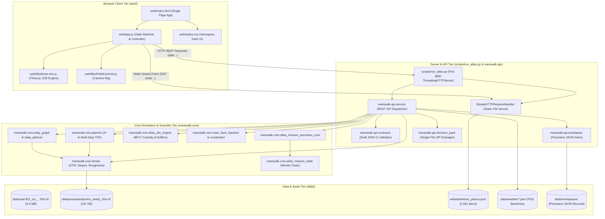
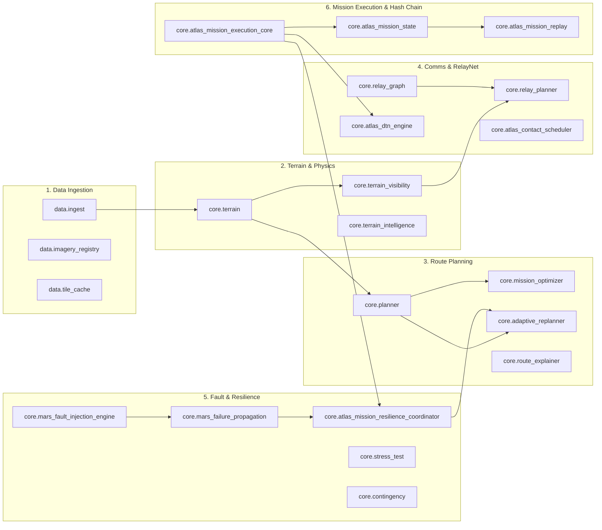
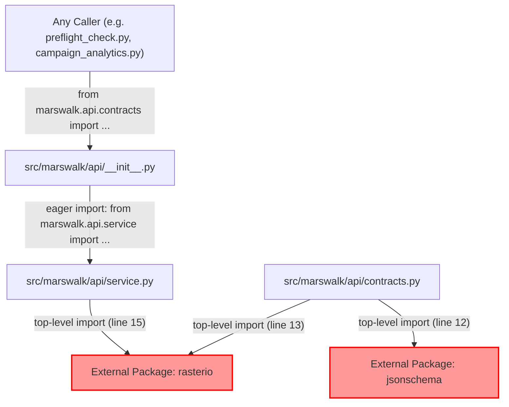
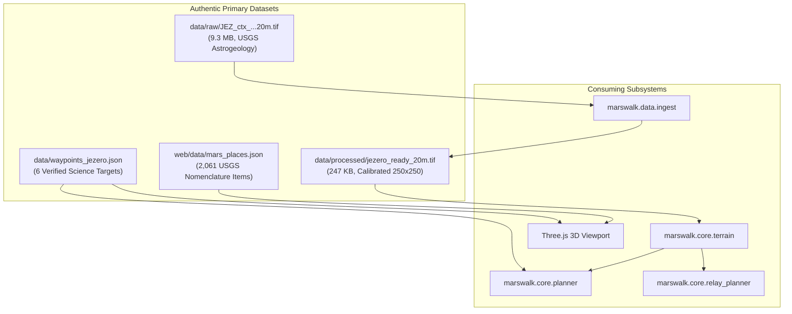

# Project MarsWalk — Subsystem Dependency & Data Flow Map

**Document ID:** `MARSWALK-DEP-001`  
**Date:** 2026-11-14  
**Author:** Principal Software Architect & Systems Engineer  
**Workspace:** `/home/mech_ka_launda/projects/NASA-SpaceApps-2026/MarsWalk-Submission`  
**Target Environment:** Ubuntu 22.04 LTS

---

## 1. High-Level Subsystem Communication Graph

The MarsWalk 2.0 / Project Atlas software system is structured as an interactive client-server architecture backed by an authoritative discrete-event simulation kernel:



---

## 2. Detailed Internal Module Dependency Matrix

### 2.1 Python Core Module Dependency Chains



---

## 3. The Eager Import Bottleneck (Architectural Defect)

A critical architectural coupling defect was discovered during the reconnaissance:



### Defect Explanation
In `src/marswalk/api/__init__.py`:
```python
# Line 5: Eagerly imports service.py
from marswalk.api.service import plan_route_api, gauntlet_api, parse_endpoint_rc
```
Because `service.py` has `import rasterio` on line 15, importing *anything* from `marswalk.api` (such as `contracts.py` or `workspace.py`) triggers an immediate top-level `ModuleNotFoundError` if `rasterio` is not installed, even if the calling script does not perform any raster operations!

**Resolution Strategy (For Milestone 2):**  
Decouple `__init__.py` so that imports from `marswalk.api` do not eagerly import `service.py` unless explicitly requested, or guard `import rasterio` inside functions that actually read GeoTIFFs.

---

## 4. External Software and Library Dependencies

### 4.1 Python Package Dependencies

| Package | Declared in `requirements.txt` | Current Ubuntu System Status | Impact if Missing |
|:---|:---:|:---:|:---|
| `numpy` | `>=2.0.0` | Installed (v1.21.5) | Numerical calculations execute, but version mismatch exists. |
| `scipy` | `>=1.14.0` | Installed (v1.8.0) | Spatial trees work; version difference. |
| `rasterio` | `>=1.4.0` | **NOT INSTALLED** | **CRITICAL BLOCKER:** Prevents server boot and DTM loading. |
| `affine` | `>=2.4.0` | **NOT INSTALLED** | **CRITICAL BLOCKER:** Needed for GeoTIFF spatial coordinates. |
| `jsonschema` | `>=4.20.0` | **NOT INSTALLED** | **BLOCKER:** Needed for API request contract enforcement. |
| `requests` | `>=2.31.0` | Installed (v2.25.1) | Functional for HTTP API tests. |
| `websockets` | `>=12.0` | Installed (v9.1) | Usable for CDP streams. |
| `pytest` | `>=8.0.0` | Installed (v6.2.5) | **DEFECT:** Does not support `pythonpath` config in `pyproject.toml`. |
| `plotly` | Optional | **NOT INSTALLED** | Only impacts Streamlit `app.py`. |
| `streamlit` | Optional | **NOT INSTALLED** | Only impacts Streamlit `app.py`. |

### 4.2 Native Linux System Libraries (Ubuntu 22.04 LTS)
`rasterio` requires native C/C++ geospatial libraries. When building or installing into a virtual environment, the system requires:
- `libgdal-dev` (GDAL geospatial data abstraction library)
- `libproj-dev` (Cartographic projections library)
- `libgeos-dev` (Geometry engine)
- Standard wheels (`pip install rasterio`) typically bundle precompiled GDAL binaries, avoiding manual compile times if wheel compatibility is met.

### 4.3 Node.js & Web Runtime
- **Node.js:** System has `v22.23.5` installed.
- **npm dependencies:** None. All web dependencies (`three.min.js`, `OrbitControls.js`) are vendored in `web/libs/`.

---

## 5. File & Dataset Dependency Map


