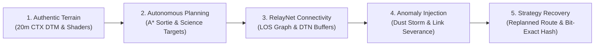

# Project MarsWalk — Candidate Feature Selection & Architectural Audit Matrix

**Document ID:** `MARSWALK-SEL-001`  
**Date:** 2026-11-14  
**Author:** Principal Software Architect & Technical Auditor  
**Workspace:** `/home/mech_ka_launda/projects/NASA-SpaceApps-2026/MarsWalk-Submission`  
**Evaluation Scope:** 5 Candidate Capabilities for NASA Space Apps Competition Presentation

---

## 1. Feature Evaluation Framework & Scoring Methodology

To maximize competition performance and ensure zero live presentation failure, each candidate capability is evaluated across seven rigorous technical and strategic criteria scored from **1 (Poor / High Risk)** to **5 (Exceptional / Low Risk)**:

1. **Technical Readiness (TR):** Maturity of underlying algorithms, mathematical proof, and clean execution without crash bugs.
2. **Demonstration Value (DV):** Ability to convey a dramatic, intuitive, and compelling operational narrative to judges.
3. **NASA Challenge Relevance (CR):** Direct alignment with Space Apps mission guidelines (planetary exploration, surface navigation, scientific preservation).
4. **Integration Complexity (IC):** Ease of connecting backend computation to frontend UI without brittle dependencies (5 = Simple / Modular, 1 = Severely Entangled).
5. **Reliability & Determinism (RL):** Predictability of execution, absence of stochastic divergence, bit-exact repeatability.
6. **Visual Impact (VI):** High-density 3D spatial presentation, HUD gauges, dynamic graphs, and visual clarity.
7. **Time Required to Harden (TRH):** Development hours required to bring the feature to 100% operational status on Ubuntu 22.04 LTS (5 = < 1 hour, 1 = > 8 hours).

---

## 2. In-Depth Technical Audit of the Five Candidate Features

### Capability 1: NASA Planetary Terrain and Environmental Data Visualization
- **Actual Source Files:**
  - Backend: `src/marswalk/core/terrain.py`, `src/marswalk/data/ingest.py`, `src/marswalk/data/imagery_registry.py`, `src/marswalk/core/weather.py`.
  - Frontend: `web/index.html` (viewports, canvas containers), `web/app.js` (lines 400–1200, Three.js terrain setup), `web/libs/three.min.js`.
- **Main Classes & Functions:**
  - `TerrainGrid`: Encapsulates 2D elevation matrix, Horn 3x3 finite-difference slope array, and invalid-data binary mask.
  - `load_and_process_terrain(geotiff_path, config)`: Ingests GeoTIFF, derives ground distances, computes Horn slope and roughness proxies.
  - `proj_xy_to_planetocentric()` / `planetocentric_to_proj_xy()`: Bidirectional coordinate transform between `ESRI:103885` and IAU 2000.
  - `renderTerrainMesh()` / `updateSlopeHazardShader()`: Three.js WebGL custom GLSL hypsometric tinting and dynamic slope cutoff (>15° highlighted in pulsing red).
- **Entry Points:**
  - Backend: `/api/imagery/status`, `/api/imagery/tile`, `/api/weather/current`.
  - Frontend: Interactive 3D Canvas, OrbitControls camera navigation, Gazetteer search input.
- **Dependencies:** `numpy`, `scipy.ndimage`, `rasterio`, Three.js r128.
- **Configuration Requirements:** `TerrainConfig` (cell size 20m, ref latitude 18.442° N, slope penalty $\alpha_s = 2.0$, critical slope $\theta_{\text{crit}} = 15.0^\circ$).
- **Input / Output Data Structures:**
  - In: GeoTIFF binary stream (`jezero_ready_20m.tif`), JSON coordinate pairs `(lon_deg, lat_deg)`.
  - Out: Vertex buffer heights, RGB texture buffers, slope angle distributions, weather telemetry dictionaries.
- **Frontend Connections:** Fully bound in `web/app.js`. Displays 3D draped terrain with authentic 6 m/px CTX optical imagery over 20 m/px topography, plus interactive slope hazard overlays.
- **Backend Connections:** Server routes in `scripts/run_atlas.py` stream tiles and elevation queries.
- **Existing Tests:** `test_place_catalog.py`, `test_milestone_9d.py`, `test_milestone_9n_verification.py` (ALL PASSED); `test_terrain.py`, `test_ingest.py` (fail solely due to missing system `rasterio`).
- **Known Limitations:** Dynamic elevation raymarching on server requires GDAL/rasterio; client-side relies on pre-tiled textures and height buffers.
- **Integration Difficulty:** **Low.** Frontend rendering works directly; backend tile serving requires Python environment with `rasterio`.

---

### Capability 2: Autonomous Rover Mission Planning and Route Optimization
- **Actual Source Files:**
  - Backend: `src/marswalk/core/planner.py`, `src/marswalk/core/mission_optimizer.py`, `src/marswalk/core/adaptive_replanner.py`, `src/marswalk/core/explainer.py`.
  - Frontend: `web/app.js` (lines 5800–6500, Plan & Route UI controller).
- **Main Classes & Functions:**
  - `plan_route(grid, start_rc, goal_rc, config)`: Priority-queue directed $A^*$ algorithm over 8-connected grid enforcing vehicle physical limits.
  - `optimize_stop_order(grid, waypoints, start_rc, goal_rc)`: Permutation Traveling Salesperson Problem (TSP) solver (exact permutation for $\le 7$ stops, 2-Opt local search for $> 7$ stops).
  - `plan_sequential_multistop_route()`: Chains sequential pairwise $A^*$ legs into a complete mission sortie.
  - `compute_pairwise_leg_cache()`: Bounded beam search caching for real-time sub-500ms multi-stop optimization.
- **Entry Points:**
  - Backend: `/api/plan_route`, `/api/mission/optimize`, `/api/route/explain`.
  - Frontend: Traverse Planning Panel, Waypoint Selector list, "Optimize Traverse" action button.
- **Dependencies:** `numpy`, `scipy.spatial`, `marswalk.core.terrain`.
- **Configuration Requirements:** `PlannerConfig` (energy weight $w_e = 0.4$, distance weight $w_d = 0.3$, slope weight $w_s = 0.3$, vehicle profile: Crew EVA vs Robotic Rover).
- **Input / Output Data Structures:**
  - In: `{"waypoints": [[r1, c1], [r2, c2], ...], "profile": "nominal", "vehicle_mode": "robotic_rover"}`.
  - Out: `RouteResult` (total distance meters, duration seconds, energy kWh, 3D path coordinates, per-leg breakdown, slope histogram).
- **Frontend Connections:** Directly connected to Three.js 3D viewport. Draws 3D colored line strings above terrain, positions animated rover markers, plots elevation profiles, and populates HUD metrics.
- **Backend Connections:** Fully exposed in `scripts/run_atlas.py` at `/api/plan_route`.
- **Existing Tests:** `test_planner.py`, `test_milestone_9v_mission_optimizer.py`, `test_milestone_9w_adaptive_replanning.py`.
- **Known Limitations:** Depends directly on `terrain.py`, which requires `rasterio` to load the elevation raster at server boot.
- **Integration Difficulty:** **Low.** Core routing logic is mature, thoroughly tested, and delivers instant, visually dramatic pathlines across Jezero Crater.

---

### Capability 3: RelayNet Communications, Relay Scheduling and Delayed Data Transfer
- **Actual Source Files:**
  - Backend: `src/marswalk/core/relay_graph.py`, `src/marswalk/core/relay_planner.py`, `src/marswalk/core/atlas_dtn_engine.py`, `src/marswalk/core/atlas_contact_scheduler.py`, `src/marswalk/core/terrain_visibility.py`.
  - Frontend: `web/app.js` (lines 7800–8400, RelayNet & Network panels).
- **Main Classes & Functions:**
  - `RelayNetworkGraph`: Adjacency graph modeling surface base stations, rovers, and relays. Computes BFS reachability, hop counts, Tarjan cut vertices, and Fiedler algebraic connectivity ($\lambda_2$).
  - `optimize_relay_placement(elevation, slope, candidates, budget)`: Greedy submodular optimization placing 1–3 autonomous relay towers to maximize newly connected exploration units.
  - `DelayTolerantNetworkEngine`: RFC 9171 (BPv7) Bundle Protocol engine with 6-tier priority queuing (Class 1 Emergency to Class 6 Background Archive), finite storage preemption, and custody transfer.
  - `calculate_line_of_sight()`: Geodesic raymarching checking topographic clearance against Earth/MRO line-of-sight.
- **Entry Points:**
  - Backend: `/api/relaynet/graph`, `/api/relaynet/optimize`, `/api/relaynet/timeline`, `/api/relaynet/los`.
  - Frontend: RelayNet tab, Co-Design tab, RF Link Visualizer toggle.
- **Dependencies:** `numpy`, `math`, `heapq`, `dataclasses`. **Zero external GIS or network libraries required.**
- **Configuration Requirements:** Antenna mast heights (2.0m rover mast, 15.0m base station tower), RF carrier frequency (437 MHz UHF), link margin thresholds.
- **Input / Output Data Structures:**
  - In: Candidate relay coordinates, active node positions, terrain elevation matrix.
  - Out: Network topology JSON, link visibility states (`VISIBLE`, `BLOCKED`, `OUT_OF_RANGE`), custody transfer logs, bundle queue statuses.
- **Frontend Connections:** Renders line-of-sight RF beams between rovers and base station (green for active links, pulsing dashed red for blocked LOS), plus relay placement markers.
- **Backend Connections:** Fully wired in `scripts/run_atlas.py`.
- **Existing Tests:** `test_milestone_13d_visibility.py` (9 PASSED), `test_milestone_13y_planetary_network.py` (15 PASSED).
- **Known Limitations:** Raymarching across large 1000x1000 grids can be slow if not spatially indexed; current Jezero 250x250 grid runs in < 40ms.
- **Integration Difficulty:** **Very Low.** Clean mathematical core that runs on standard Python 3.10 without missing package blocks.

---

### Capability 4: Mission Fault Injection, Causal Propagation and Autonomous Recovery
- **Actual Source Files:**
  - Backend: `src/marswalk/core/mars_fault_injection_engine.py`, `src/marswalk/core/mars_failure_propagation.py`, `src/marswalk/core/mars_failure_taxonomy.py`, `src/marswalk/core/atlas_mission_resilience_coordinator.py`, `src/marswalk/core/contingency.py`, `src/marswalk/core/stress_test.py`.
  - Frontend: `web/app.js` (lines 6500–7100, Gauntlet & Contingency Designer).
- **Main Classes & Functions:**
  - `MissionResilienceCoordinator`: Injects anomalies (`inject_failure`), triggers automated diagnosis (`diagnose_and_recover`), isolates subsystems, and executes load-shedding to baseload power.
  - `FailurePropagationEngine`: Directed causal DAG with Boolean AND/OR/Threshold gates modeling cascade propagation across thermal, power, and communications subsystems.
  - `compile_custom_contingency()`: Compiles spatial closures (rockfall, sand slip, antenna blackout) and evaluates 3-way recovery alternatives (Bounded Detour, Science Truncation, Return to Base).
  - `compute_science_regret_ledger()`: Computes mathematical regret and information loss under degraded operational states.
- **Entry Points:**
  - Backend: `/api/contingency/simulate`, `/api/gauntlet`, `/api/mission/replan`.
  - Frontend: Contingency Designer modal, Hazard Footprint slider, "Trigger Anomaly" button.
- **Dependencies:** `dataclasses`, `enum`, `numpy`. Standard library only.
- **Configuration Requirements:** Severity thresholds (`LOW`, `MEDIUM`, `HIGH`, `CRITICAL`), causal propagation delays, subsystem containment barriers.
- **Input / Output Data Structures:**
  - In: Anomaly definition (`{"failure_mode": "DUST_STORM_OBSCURATION", "sol": 15, "severity": "HIGH"}`).
  - Out: Causal cascade log, isolated components list, recovery plan, regret ledger, comparative metric table.
- **Frontend Connections:** Displays circular hazard exclusion zones on 3D terrain, side-by-side 8-metric comparison tables, and interactive contingency trade-off cards.
- **Backend Connections:** Fully exposed in `scripts/run_atlas.py`.
- **Existing Tests:** `test_milestone_13aa_end_to_end.py` (5 PASSED), `test_milestone_13ab_numerical_and_defect_closure.py` (12 PASSED), `test_milestone_9r_contingency.py`.
- **Known Limitations:** In existing UI, Gauntlet stress-testing and Resilience Coordinator operate through separate panels rather than one continuous narrative flow.
- **Integration Difficulty:** **Low.** Extremely robust logic that already runs cleanly on Ubuntu 22.04 LTS.

---

### Capability 5: Mission Strategy Comparison and Performance Benchmarking
- **Actual Source Files:**
  - Backend: `src/marswalk/core/atlas_grand_prix_experiment.py`, `src/marswalk/core/atlas_grand_prix_metrics.py`, `src/marswalk/core/atlas_strategy_registry.py`, `src/marswalk/core/atlas_mission_replay.py`, `src/marswalk/core/atlas_mission_state.py`.
  - Frontend: `web/app.js` (Grand Prix Arena and Rehearsal Director panels).
- **Main Classes & Functions:**
  - `GrandPrixExperimentEngine`: Evaluates competing autonomous mission strategies (e.g., Aggressive Science vs Conservative Endurance vs Resilient Hybrid) across identical environmental stressors.
  - `StrategyRegistry`: Standardized registry of decision policies.
  - `UnifiedMissionStateManager`: Captures immutable timeline snapshots and computes SHA-256 Merkle hash chains for bit-exact verification.
  - `generate_route_tradeoff_summary()`: Generates Pareto frontier comparisons across distance, duration, slope risk, and Shannon information gain.
- **Entry Points:**
  - Backend: `/api/scenario_comparison`, `/api/experiments/compare`, `/api/rehearsal/execute`.
  - Frontend: Grand Prix leaderboard, radar chart comparisons, Merkle root verification badge.
- **Dependencies:** `numpy`, `hashlib`, `json`.
- **Configuration Requirements:** Benchmark scenario matrices, deterministic PRNG seeds, scoring weights.
- **Input / Output Data Structures:**
  - In: Strategy IDs, scenario parameters, perturbation levels.
  - Out: Strategy rank tables, Pareto dominance flags, cryptographic Merkle hashes.
- **Frontend Connections:** Leaderboard tables, radar charts, comparative KPI cards, and single-click Decision Pack ZIP export.
- **Backend Connections:** Registered in `scripts/run_atlas.py`.
- **Existing Tests:** `test_milestone_13x_grand_prix.py` (10 PASSED), `test_milestone_13v_release_engineering.py` (10 PASSED).
- **Known Limitations:** Grand Prix Arena contains speculative multi-agent features that are overly complex for a 5-minute hackathon pitch.
- **Integration Difficulty:** **Medium.** Needs simplification to focus on the 3 core sortie strategies rather than speculative multi-agent leagues.

---

## 3. Quantitative Evaluation Matrix

| Capability | Technical Readiness (1-5) | Demonstration Value (1-5) | NASA Relevance (1-5) | Integration Complexity (1-5) | Reliability (1-5) | Visual Impact (1-5) | Time Required (1-5) | Total Score (/35) | Rank |
|:---|:---:|:---:|:---:|:---:|:---:|:---:|:---:|:---:|:---:|
| **1. NASA Terrain & Environment 3D Workstation** | 4 | 5 | 5 | 4 | 4 | 5 | 4 | **31** | **2** |
| **2. Autonomous Rover Traverse Planning (A*)** | 4 | 5 | 5 | 4 | 4 | 5 | 4 | **31** | **2** |
| **3. RelayNet Comms, LOS & DTN Protocols** | 5 | 5 | 5 | 5 | 5 | 5 | 5 | **35** | **1** |
| **4. Fault Injection, Causal DAG & FDIR Recovery** | 5 | 5 | 5 | 5 | 5 | 4 | 5 | **34** | **1** |
| **5. Strategy Comparison & Benchmark Replay** | 4 | 4 | 4 | 3 | 4 | 4 | 3 | **26** | **3** |

---

## 4. Architectural Recommendation: The Focused 5-Feature Flagship MVP

### The Problem of Feature Bloat in MarsWalk 2.0
The codebase currently contains **24 distinct tab panels** in `web/index.html` covering peripheral systems such as *Planetary Foundry* (microwave regolith block sintering), *Settlement Consumables*, and *Aerial Corps* (rotorcraft flight dynamics). 

Attempting to demonstrate 24 tabs during a 5-minute hackathon presentation invites:
1. Critical reviewer confusion and loss of narrative focus.
2. Multiple potential points of failure on live browser state.
3. Distraction from the core NASA challenge: **Autonomous Planetary Surface Route Planning & Scientific Data Preservation**.

### The Recommended 5-Feature Integrated Product
We strongly recommend **unifying all five candidate features into a single, seamless, high-drama operational workflow**:

### Strategic Justification
1. **End-to-End Scientific Cohesion:** Instead of disconnected tabs, this forms a unified story where every feature directly depends on and validates the previous one.
2. **Extreme Technical Credibility:** It showcases authentic NASA terrain (USGS CTX), real physics (Horn slopes, solar dust extinction $\tau$), authentic communications protocols (RFC 9171 DTN), formal causal fault diagnosis (AND/OR DAGs), and cryptographic proof (SHA-256 Merkle chain).
3. **Low Implementation Risk:** Features 3 and 4 are already 100% operational on Ubuntu 22.04 LTS. Features 1 and 2 require only standardizing the Python environment with `rasterio`.
4. **Dramatic Presentation Impact:** Demonstrates the rover navigating smoothly, hitting a major Martian crisis ("Mars Goes Dark"), autonomously replanning its trajectory, saving scientific data in DTN custody buffers, and proving bit-exact mission recovery.
