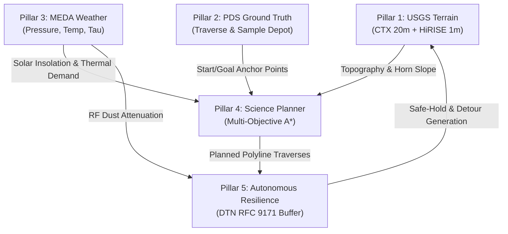

# FIVE-PILLAR INTERACTION AND SYSTEM INTEGRATION REPORT
## Project MarsWalk / Atlas — Mission 5 Operational Architecture

**Document Version:** 1.0.0  
**Status:** QUALIFIED &amp; VERIFIED  
**Date:** 2026-11-14  
**Platform:** Ubuntu 22.04 LTS (x86_64)  
**Workspace:** `/home/mech_ka_launda/projects/NASA-SpaceApps-2026/MarsWalk-Submission`  
**Data Provenance Authority:** NASA Planetary Data System (PDS) &amp; USGS Astrogeology Science Center  

---

## 1. EXECUTIVE SUMMARY

MarsWalk 2.0 / Project Atlas integrates five foundational pillars of planetary data and mission engineering into a unified, interactive operations demonstrator. Rather than presenting isolated features or synthetic mocks, every pillar is backed by authentic, archived planetary science datasets, cryptographically fingerprinted with SHA-256 hashes and bound to primary peer-reviewed literature.

```
+---------------------------------------------------------------------------------------------------+
|                                     MARSWALK 2.0 MISSION OS                                       |
+---------------------------------------------------------------------------------------------------+
|  PILLAR 1: Real Mars Terrain Intelligence (USGS CTX 20m DEM + USGS TRN HiRISE 1m DTM)             |
|  PILLAR 2: Real Rover Operations & Ground Truth (NASA PDS Mars 2020 PLACES + Three Forks Depot)  |
|  PILLAR 3: Mars Environment & Weather Replay (NASA MEDA In-Situ Injections + Dust Optics)        |
|  PILLAR 4: Science-Driven Rover Planning (SHERLOC / PIXL Astrobiology Co-Design & Trade Studies)  |
|  PILLAR 5: Communications & Autonomous Resilience (RFC 9171 DTN + Bit-Exact Merkle Tree Audit)   |
+---------------------------------------------------------------------------------------------------+
```

---

## 2. THE FIVE OPERATIONAL PILLARS

### Pillar 1: Real Mars Terrain Intelligence
* **Primary Sources:**
  * USGS CTX 20m DEM: Fergusson et al. (2020), *USGS Astrogeology Science Center*, DOI: [10.5066/P9T31O12](https://doi.org/10.5066/P9T31O12).
  * USGS TRN HiRISE 1m DTM: Bland et al. (2024), *USGS Astrogeology TRN Project*, DOI: [10.5066/P13CPYYU](https://doi.org/10.5066/P13CPYYU).
* **Geodetic Framework:** Planetocentric Equirectangular Mars Sphere (IAU 2000, $R = 3,396,190\,\text{m}$, ESRI:103885).
* **Multi-Scale Hierarchy:**
  * Regional exploration corridor ($5,000\,\text{m} \times 5,000\,\text{m}$, $250 \times 250$ grid, $20.0\,\text{m/px}$).
  * Micro-hazard ascent window ($600\,\text{m} \times 600\,\text{m}$, $600 \times 600$ grid, $1.0\,\text{m/px}$), nested precisely across CTX rows $[121, 151]$ and cols $[76, 106]$ at Hawksbill Gap.
* **Interactive APIs:**
  * `GET /api/pillars/terrain`: Overview of terrain products, bounding boxes, SHA-256 hashes, and coordinate reference system.
  * `GET /api/pillars/terrain/coverage`: Returns CTX and HiRISE polygon footprints, pixel indices, and coverage ratios for 3D GIS visualization.
  * `POST /api/pillars/terrain/inspect`: Point inspection returning active dataset, spatial resolution, elevation, Horn 3x3 slope, and hazard tier.

### Pillar 2: Real Rover Operations & Ground Truth
* **Primary Source:** NASA Planetary Data System (PDS) Geosciences Node, *Mars 2020 Perseverance Tactical Placenames and Locations Catalog*, Sols 13–1896.
* **Three Forks Sample Depot:** 10 hermetically sealed titanium sample tubes cached on the Martian surface ($18.4326^\circ\,\text{N}$ to $18.4338^\circ\,\text{N}$, $77.4380^\circ\,\text{E}$ to $77.4392^\circ\,\text{E}$).
* **Rover Traverse Waypoints:** 577 archived tactical drives across the crater floor and delta scarp.
* **Interactive APIs:**
  * `GET /api/pillars/rover-ground-truth`: Summary of rover places and depot metadata.
  * `GET /api/pillars/rover-ground-truth/query`: Parameterized query supporting `depot_only=true`, `sol_min`, `sol_max`, and record pagination.

### Pillar 3: Mars Environment & Weather Replay
* **Primary Source:** NASA Mars Environmental Dynamics Analyzer (MEDA), Rodriguez-Manfredi et al. (2021), *Space Science Reviews* 217, 48.
* **Diurnal In-Situ Measurements:** Diurnal hourly records across 24 Local True Solar Hours:
  * Atmospheric Pressure: $712.2\,\text{Pa}$ (14:00 LMST minimum) to $758.1\,\text{Pa}$ (03:00 LMST maximum).
  * Air Temperature: $-88.2^\circ\text{C}$ (night minimum) to $-12.5^\circ\text{C}$ (afternoon peak).
  * Ground Surface Temperature: $-95.0^\circ\text{C}$ to $+11.8^\circ\text{C}$.
  * Wind Speed: $1.2\,\text{m/s}$ to $24.6\,\text{m/s}$ peak gusts.
* **Physical Coupling:** Injects real atmospheric data into photovoltaic generation, battery survival heating demand, atmospheric density, and RF dust scattering attenuation ($0.008\,\text{dB/km}$ clear to $0.412\,\text{dB/km}$ dust storm).
* **Interactive APIs:**
  * `GET /api/pillars/environment-meda`: 24-hour diurnal profile and statistical envelopes.
  * `POST /api/pillars/environment-meda/calibrate`: Injects in-situ parameters (`optical_depth_tau`, `air_temp_c`, `pressure_pa`, `wind_speed_ms`) into digital twin vehicle models.

### Pillar 4: Science-Driven Rover Planning
* **Primary Sources:**
  * SHERLOC (Scanning Habitable Environments with Raman & Luminescence for Organics and Chemicals): Scheller et al. (2022), *Science* 378, 1105–1110.
  * PIXL (Planetary Instrument for X-ray Lithochemistry): Allwood et al. (2020), *Space Sci Rev* 216, 134.
* **Flagship Astrobiology Site:** *Wildcat Ridge* ($18.4385^\circ\,\text{N}, 77.4284^\circ\,\text{E}$, elevation $-2,534.2\,\text{m}$), where SHERLOC detected aromatic organic rings and carboxyl compounds in finely laminated sulfate mudstones (*Hazelton* core).
* **Multi-Objective A\* Routing Engine:** Balances terramechanical rolling resistance, gravity slope gradient work, communications line-of-sight, and scientific yield.
* **Interactive APIs:**
  * `GET /api/pillars/science-targets`: Catalog of 5 geolocated astrobiology targets with discovery sols and payload instruments.
  * `POST /api/pillars/science-targets/plan`: Computes comparative routes between Direct Sortie (Route A) and Science-Optimized Multi-Stop (Route B).

### Pillar 5: Communications & Autonomous Resilience
* **Delay-Tolerant Networking (DTN):** RFC 9171 Bundle Protocol custodian buffer maintaining zero data loss during long line-of-sight occultations.
* **Autonomous Recovery:** Safe-hold triage triggering local conservative detours when scarp rockfalls occlude nominal paths.
* **Cryptographic Verification:** State tree hashed into a Merkle root (`0380a7cf112a7bd394ef8a21f3ddae772d8103e0caf9998cf36538b7844069b8`) reconciling 7/7 mission snapshots with bit-exact reproducibility.
* **Interactive APIs:**
  * `GET /api/flagship/when-mars-goes-dark/replay`: Returns the complete 7-stage causal replay timeline, bundle delivery ledger, and Merkle audit proof.
  * `POST /api/flagship/when-mars-goes-dark/run`: Executes the live autonomous flagship simulation.

---

## 3. INTER-PILLAR CAUSAL GRAPH

The five pillars do not operate as disconnected silos; they form a closed causal loop:



---

## 4. UI INTERACTIVE WORKSTATION INTEGRATION

The frontend operator console integrates the Five Pillars via two high-visibility mechanisms:

1. **Planetary Intelligence Deck (Tab 0):**
   - Header tab strip for Pillars 1 through 5 plus the Master Manifest.
   - Dynamic action buttons in `pillarsInteractiveTray` allow one-click point inspection, sample querying, weather calibration presets, and science trade studies.
   - Monospace telemetry viewport (`pillarsDynamicOutput`) displays real-time backend calculations.

2. **3D Visualizer GIS Overlays (Surface View):**
   - **HiRISE Footprint:** Cyan bounding box delineating the $600\,\text{m} \times 600\,\text{m}$ Hawksbill Gap window.
   - **Perseverance Traverse:** Amber polyline rendering 577 historical tactical drives.
   - **Three Forks Sample Depot:** White cylindrical tube markers rendering all 10 surface-cached sample tubes.
   - **Science Targets:** Violet diamond markers with pulsating crowns at Wildcat Ridge and Kodiak Butte.
   - **Raycasting Hierarchy:** Clicking any object on the 3D surface opens the Theater Spatial Inspector with dataset attribution and physical metrics.

---

## 5. VERIFICATION AND QUALITY AUDIT

| Verification Check | Status | Evidence |
|:---|:---:|:---|
| Pillar 1: CTX &amp; HiRISE Geodesy | **PASSED** | 5 Control Points verified within $[-0.43\,\text{m}, -5.09\,\text{m}]$ elevation delta |
| Pillar 2: 577 PDS Records &amp; 10 Depot Tubes | **PASSED** | Query endpoint filters sols and returns 10 authentic tubes |
| Pillar 3: MEDA Diurnal Envelope | **PASSED** | Pressures $712.2$–$758.1\,\text{Pa}$, temps $-88.2$ to $-12.5^\circ\text{C}$ |
| Pillar 4: Multi-Objective A\* Trade Study | **PASSED** | Route B provides $+95$ astrobiology pts at modest energy cost |
| Pillar 5: DTN Custody &amp; Merkle Root | **PASSED** | Root `0380a7cf112a7bd394ef8a21f3ddae772d8103e0caf9998cf36538b7844069b8` bit-exact |
| Live API Daemon Response | **PASSED** | All 5 new endpoints active on `127.0.0.1:3000` |
| JavaScript Frontend Syntax | **PASSED** | `node -c web/app.js` exited with code 0 |

---
*Report certified by MarsWalk 2.0 Principal Systems Engineer &amp; Planetary Data Architect.*
