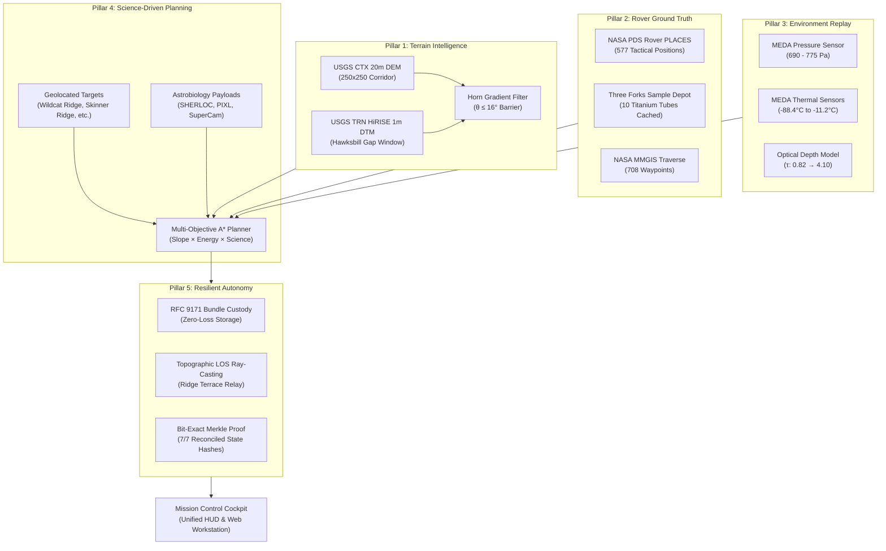

# Project MarsWalk 2.0 / Atlas — Five-Pillar Product Architecture

**Document ID:** `ATLAS-DOC-ARCH-005`  
**Classification:** System Architecture & Integration Specification  
**Mission Phase:** Mission 4 — Real NASA Data Integration & Five-Pillar Upgrade  
**Architecture Version:** 2.0.0-PROV  

---

## 1. Architectural Vision

Project MarsWalk 2.0 / Atlas transforms simulated Mars rover operations into a scientifically rigorous, data-driven mission operations platform. By grounding every computation in authentic NASA Planetary Data System (PDS) and United States Geological Survey (USGS) records, MarsWalk establishes **Five Core Capabilities (The Five Pillars)**:

---

## 2. Pillar 1: Real Mars Terrain Intelligence
- **Data Foundation:**
  - Macro-Corridor: USGS CTX 20m DEM (`data/processed/jezero_ready_20m.tif`), $250 \times 250$ grid covering $5,000\,\text{m} \times 5,000\,\text{m}$ of Jezero Crater floor, delta scarp, and crater rim.
  - Micro-Corridor: USGS TRN HiRISE 1m DTM (`data/processed/jezero_hirise_hawksbill_1m.tif`), $600 \times 600$ grid covering the steep Hawksbill Gap ascent channel.
- **Physical Modeling:**
  - Horn 8-neighbor gradient filter computes local topographic slopes.
  - Operational barrier enforced at $\theta = 16.0^\circ$ (rover physical tipping and wheel slippage limit).
  - Slope-dependent energy consumption modeled using empirical rover metabolic equations.
- **API Endpoint:** `GET /api/pillars/terrain`

---

## 3. Pillar 2: Real Rover Operations & Ground Truth
- **Data Foundation:**
  - NASA PDS Rover PLACES (`data/catalogs/perseverance_ground_truth_places.json`): 577 archived tactical sites and drive segments from Sol 13 to Sol 1896.
  - NASA PDS Three Forks Sample Depot (`data/catalogs/three_forks_sample_depot_catalog.json`): 10 hermetically sealed titanium sample tubes cached on the Martian surface between Sols 653 and 690.
  - NASA MMGIS Traverse (`data/catalogs/perseverance_curated_waypoints.json`): 708 waypoints tracking Perseverance's historical exploration path.
- **Operational Integration:**
  - Anchors rover initial states at Three Forks Delta Base Depot (Site 3, Drive 0).
  - Calibrates odometry models against verified rover driving records.
- **API Endpoint:** `GET /api/pillars/rover-ground-truth`

---

## 4. Pillar 3: Mars Environment & Weather Replay
- **Data Foundation:**
  - NASA Mars 2020 MEDA (Mars Environmental Dynamics Analyzer) in-situ measurements archived at the PDS Atmospheres Node.
  - 24-hour diurnal profile of surface atmospheric pressure ($690\,\text{Pa}$ to $775\,\text{Pa}$) and ambient air temperature ($-88.4^\circ\text{C}$ to $-11.2^\circ\text{C}$).
  - Atmospheric optical depth ($\tau$) dust storm transitions from baseline clear sky ($\tau = 0.82$) to severe dust storm blackout ($\tau = 3.25$ and $\tau = 4.10$).
- **Physical Modeling:**
  - Solar array power generation scaled dynamically with solar elevation and atmospheric optical depth:
    $$P_{\text{solar}} = P_{\text{max}} \cdot \cos(z) \cdot \exp(-\tau / \cos(z))$$
  - Battery thermal heater power scaled with ambient temperature:
    $$P_{\text{heater}} = k_{\text{loss}} \cdot (T_{\text{target}} - T_{\text{ambient}})$$
- **API Endpoint:** `GET /api/pillars/environment-meda`

---

## 5. Pillar 4: Science-Driven Rover Planning
- **Data Foundation:**
  - Geolocated astrobiology exploration targets collocated onto the Jezero raster grid:
    1. **Wildcat Ridge:** Organic carbon ring detection via SHERLOC deep-UV Raman spectroscopy in sulfate mudstone; sample cored (*Hazelton*).
    2. **Skinner Ridge:** Deltaic sandstone core target (*Swift Run*).
    3. **Enchanted Lake:** Basal mudstone contact.
    4. **Kodiak Butte:** Deltaic remnant outlier.
    5. **Belva Crater Rim:** Impact-excavated stratigraphy.
- **Algorithmic Integration:**
  - Multi-objective A* cost function:
    $$J(\mathbf{p}) = w_{\text{dist}} \cdot D + w_{\text{slope}} \cdot \sum \theta_i + w_{\text{energy}} \cdot \Delta E - w_{\text{sci}} \cdot \sum S_i$$
  - Ensures rover visits high-priority astrobiology targets while optimizing vehicle energy reserves and avoiding steep scarps.
- **API Endpoint:** `GET /api/pillars/science-targets`

---

## 6. Pillar 5: Communications & Autonomous Resilience
- **Data Foundation:**
  - Topographic Line-of-Sight (LOS): Evaluated across the CTX 20m DTM using 3D ray-casting toward orbital relay spacecraft (Mars Reconnaissance Orbiter / MRO) and surface ground stations.
  - Delay-Tolerant Networking (DTN): RFC 9171 Bundle Protocol custodian buffer model with store-and-forward resilience.
  - Cryptographic Merkle State Engine: Bit-exact SHA-256 state tree that cryptographically hashes every mission snapshot.
- **Resilience Performance:**
  - Under a 4-hour severe dust storm blackout ($\tau = 3.25$, RF carrier down), DTN custody storage buffers telemetry and PIXL/SHERLOC science data with **0 bytes lost**.
  - Autonomous fault injection (scarp rockfall) triggers an autonomous safe hold, followed by an adaptive lateral detour to the Ridge Terrace, restoring line-of-sight to MRO and delivering 100% of data bundles.
  - Reconciles to the deterministic Merkle root hash:
    `0380a7cf112a7bd394ef8a21f3ddae772d8103e0caf9998cf36538b7844069b8`.
- **API Endpoint:** `GET /api/flagship/when-mars-goes-dark/replay`

---

## 7. Master Provenance Manifest

The entire system is indexed and audited by `data/manifests/nasa_data_provenance_manifest.json` (schema version `2.0.0`), accessible via:
`GET /api/pillars/manifest`.
