# Project MarsWalk — Focused Implementation Roadmap

**Document ID:** `MARSWALK-ROA-001`  
**Date:** 2026-11-14  
**Author:** Principal Software Architect & Systems Engineer  
**Workspace:** `/home/mech_ka_launda/projects/NASA-SpaceApps-2026/MarsWalk-Submission`  
**Target:** Phased Engineering Implementation for NASA Space Apps Submission

---

## 1. Roadmap Strategy & Operating Principles

In accordance with strict Mission 0 engineering protocols, **no application source code has been altered during reconnaissance**. Implementation begins only upon formal engineering authorization.

This roadmap prioritizes a **working, integrated, scientifically credible product over feature count**. It structures remaining hackathon time into five discrete, testable milestones designed to eliminate environment friction, activate regression gates, and package a flawless competition presentation.

```mermaid
gantt
    title MarsWalk Implementation & Qualification Milestones
    dateFormat  X
    axisFormat  Day %d

    section Milestone 1
    Linux Environment & Server Bootstrap :active, m1, 0, 1
    section Milestone 2
    Import Decoupling & Full Regression  :m2, 1, 2
    section Milestone 3
    "When Mars Goes Dark" Flagship UI     :m3, 2, 3
    section Milestone 4
    Headless Browser Acceptance & CDP     :m4, 3, 4
    section Milestone 5
    Evidence Packaging & Final Rehearsal  :m5, 4, 5
```



---

## 2. Detailed Milestone Specifications

### Milestone 1: Linux Environment Hardening & Server Bootstrapping
**Objective:** Establish a repeatable, isolated Linux runtime and launch the Atlas HTTP server on Ubuntu 22.04 LTS without altering system Python.

- **Action 1.1 — Dedicated Local Virtual Environment:**
  - Create `.venv` using `/usr/bin/python3 -m venv .venv`.
  - Install dependencies from `requirements.txt` (`rasterio`, `affine`, `jsonschema`, `scipy`, `numpy`, `requests`, `websockets`, `pytest`).
  - Verify that `rasterio` loads precompiled binary wheels for Linux without native compilation issues.
- **Action 1.2 — Native POSIX Shell Launchers:**
  - Create `scripts/setup_atlas.sh` (POSIX `set -euo pipefail` script creating `.venv` and verifying datasets).
  - Create `scripts/start_atlas.sh` (POSIX launcher parsing `--port`, setting `PYTHONPATH=src`, and starting `run_atlas.py`).
  - Set execution permissions (`chmod +x scripts/*.sh`).
- **Action 1.3 — Default Environment Configuration:**
  - Copy `.env.example` to `.env` with default `ATLAS_PORT=3000` and `ATLAS_HOST=127.0.0.1`.
- **Action 1.4 — Server Startup Verification:**
  - Boot `scripts/run_atlas.py` on port 3000.
  - Query `http://127.0.0.1:3000/api/health` and verify `{"status": "ok", "terrain_loaded": true}`.
- **Acceptance Gate 1:** Atlas HTTP server is running on port 3000, serving static web assets and routing API queries with zero console errors.

---

### Milestone 2: Eager Import Decoupling & Full Regression Quality Gate
**Objective:** Eliminate top-level circular/eager import bottlenecks and execute the complete automated test battery.

- **Action 2.1 — Decouple `marswalk.api.__init__`:**
  - Remove eager `service.py` exports from `src/marswalk/api/__init__.py`.
  - Ensure lightweight subpackages (e.g., `contracts.py`, `workspace.py`, `preflight.py`) can be imported independently without pulling in `rasterio`.
- **Action 2.2 — Normalize Pytest Test Runner Configuration:**
  - In `.venv`, upgrade Pytest to `>= 8.0.0` so that `pyproject.toml`'s `pythonpath = ["src"]` is natively honored.
  - Verify test discovery collects all 94 test files without import errors.
- **Action 2.3 — Execute Full Test Battery:**
  - Run the complete 94-file test suite (`.venv/bin/pytest tests/ -q`).
  - Verify that the full suite of unit, integration, and mathematical audit tests passes without weakening assertions.
- **Action 2.4 — Live Server Integration Closure:**
  - Verify `test_milestone_9o_verification.py` passes against active port 3000.
- **Acceptance Gate 2:** 94 of 94 test suites pass with zero regressions; `scripts/preflight_check.py` reports 12 of 12 checkpoints verified.

---

### Milestone 3: Flagship Showcase Integration ("WHEN MARS GOES DARK")
**Objective:** Unify the 5 core capabilities into an interactive, one-click demonstration narrative inside the web cockpit.

- **Action 3.1 — UI Cockpit Streamlining:**
  - In `web/index.html` and `web/app.js`, configure the default navigation view to highlight the primary **Mission Control Cockpit**, **A* Traverse Planner**, **RelayNet Communications**, **Resilience Center**, and **Strategy Arena**.
  - Move speculative tabs (Foundry, Settlement Consumables, Aerial Corps) into an expandable "Advanced Research" sub-menu to eliminate visual clutter.
- **Action 3.2 — End-to-End Showcase Runner:**
  - Implement a dedicated "When Mars Goes Dark" demonstration sequence in `web/app.js`:
    1. Step 1: Initialize 4-stop Jezero sortie from Octavia Landing.
    2. Step 2: Trigger Sol 15 dust storm anomaly (solar power $-70\%$, direct RF line-of-sight severed).
    3. Step 3: Demonstrate RFC 9171 DTN custody buffer queuing telemetry locally.
    4. Step 4: Trigger autonomous FDIR load shedding and A* bounded detour replanning.
    5. Step 5: Place submodular promontory relay on crater ridge, restoring RF link and flushing DTN buffer.
    6. Step 6: Recalculate SHA-256 Merkle root hash and display bit-exact verification badge.
- **Action 3.3 — API Dispatch Verification:**
  - Ensure all corresponding backend routes (`/api/plan_route`, `/api/contingency/simulate`, `/api/relaynet/optimize`, `/api/mission/replan`) respond in $< 500\text{ ms}$.
- **Acceptance Gate 3:** A reviewer or judge can click "Run Showcase" and watch the entire 5-stage Martian crisis and recovery unfold with live 3D pathlines and HUD telemetry.

---

### Milestone 4: Headless Browser Acceptance & Visual Evidence Pipeline
**Objective:** Automate browser verification on Linux and generate high-resolution visual evidence for presentation slides.

- **Action 4.1 — Dynamic Browser Discovery:**
  - Update `scripts/audit_milestone_13a_browser_acceptance.py` and evidence scripts to dynamically locate Chrome/Chromium:
    ```python
    import shutil, os
    CHROME_PATH = os.environ.get("CHROME_BIN") or shutil.which("google-chrome") or shutil.which("chromium-browser") or shutil.which("chromium")
    ```
- **Action 4.2 — Visual Responsiveness Audit:**
  - Audit UI rendering across Full Desktop ($1920 \times 1080$) and Compact Laptop ($1366 \times 768$).
  - Assert horizontal overflow is strictly `False` (`document.body.scrollWidth <= window.innerWidth`).
- **Action 4.3 — Capture Competition Evidence Screenshots:**
  - Capture high-resolution PNGs of the 3D draped terrain, slope hazard shader, DTN buffer HUD, and contingency comparison table to `outputs/`.
- **Acceptance Gate 4:** Headless browser audit passes 8 of 8 stages; visual screenshots archived in `outputs/`.

---

### Milestone 5: Competition Packaging, Reviewer Dossier & Final Presentation Deck
**Objective:** Compile single-file auditable deliverables and rehearse the competition presentation.

- **Action 5.1 — Single-File Decision Pack ZIP Generation:**
  - Generate the official competition Decision Pack ZIP containing canonical mission briefs, RFC 4180 CSVs, event ledgers, and SHA-256 manifests via `/api/export_decision_pack`.
- **Action 5.2 — Final Preflight Diagnostic Audit:**
  - Run `scripts/preflight_check.py --port 3000` to produce the official 12/12 diagnostic certificate.
- **Action 5.3 — Reviewer Guide & Runbook Synchronization:**
  - Update `docs/SHOWCASE_DEMO_RUNBOOK.md` with exact Ubuntu launch commands.
- **Action 5.4 — Final Rehearsal:**
  - Conduct a timed 5-minute competition presentation walk-through matching the live workstation actions.
- **Acceptance Gate 5:** Complete submission package validated; zero open critical defects; 100% reproducible on clean Linux.

---

## 3. Summary of Implementation Milestones

| Milestone | Primary Focus | Key Deliverable | Est. Hours |
|:---:|:---|:---|:---:|
| **M1** | Linux Hardening & Server Boot | `.venv`, `setup_atlas.sh`, `start_atlas.sh`, port 3000 online | 1.0 h |
| **M2** | Import Decoupling & Regression | Decoupled `api/__init__.py`, 94/94 test suites passing | 1.5 h |
| **M3** | Flagship Showcase ("When Mars Goes Dark") | Streamlined Cockpit UI, 1-click narrative runner | 2.0 h |
| **M4** | Browser Acceptance & Evidence | Headless CDP audit on Linux, high-res PNG outputs | 1.0 h |
| **M5** | Final Packaging & Reviewer Kit | Decision Pack ZIP, 12/12 Preflight certificate, deck sync | 1.0 h |
| **TOTAL**| | **Complete Competition-Ready Product** | **6.5 h** |
