# MarsWalk 2.0 (Project Atlas) — Technical Showcase & Architecture Overview

**Project Repository:** `E:\Python\NASA-Spaceapps\Marswalk`  
**Current Baseline:** V1 Release Candidate (`v1.0.0-rc1`)  
**Target Event:** NASA Space Apps Challenge  
**Target Domain:** Interactive Planetary Surface Traverse Planning, Contingency Simulation & Environmental Intelligence  

---

## 1. Problem Statement & Motivation

Planning surface extravehicular activities (EVA) and robotic rover traverses on Mars presents extreme engineering challenges:
1. **Severe Terrain Energetics:** Martian topography features steep crater walls, escarpments, sand dune slip-faces, and boulder fields. Traverse efficiency and mechanical safety depend directly on fine-scale slope angles and surface traction.
2. **Strict Life-Support & Power Constraints:** Crewed EVAs operate inside an unforgiving portable life support system (PLSS) envelope (typically $\le 8$ hours), while solar and radioisotope-powered rovers face strict single-sol drive durations and battery thermal margins.
3. **Unpredictable Surface Hazards:** Real sorties encounter unexpected corridor closures (rockfalls), mechanical deratings (drive motor failures), and dynamic environmental changes (dust storms, sharp atmospheric pressure drops).
4. **Data Integrity & Scientific Provenance:** Mission tools frequently confuse idealized simulation models with real Martian observations, lack traceable coordinate systems, or fail to produce reproducible, cryptographically verifiable mission dossiers.

**MarsWalk 2.0 (Project Atlas)** addresses these challenges by delivering an interactive, deterministic mission planning workstation grounded in genuine NASA/USGS orbital remote sensing data and Mars 2020 in-situ observations.

---

## 2. System Capabilities & Architecture

MarsWalk integrates eight modular subsystems into a unified planetary mission rehearsal laboratory:

```mermaid
flowchart TD
    subgraph DataLayer["1. Authoritative Planetary Data"]
        D1["USGS CTX Jezero 20m DTM<br/>(ESRI:103885 Planetocentric)"]
        D2["NASA PDS MEDA In-Situ Archives<br/>(Sol 1619 Jezero Archive)"]
        D3["Mars Climate Database (MCD v6.1)<br/>(Regional Atmospheric Models)"]
        D4["IAU Gazetteer & Viking MDIM 2.1<br/>(2,061 Named Features)"]
    end

    subgraph PlanningEngine["2. Kinematic & Spatial Planning"]
        P1["Python A* Cost Surface Planner<br/>(Minetti Metabolic Formulation)"]
        P2["Vehicle Kinematic Envelopes<br/>(Crew EVA 1.11 m/s vs Rover 0.04 m/s)"]
        P3["Multi-Waypoint TSP Optimization<br/>(Exact Permutation & 2-Opt)"]
    end

    subgraph SimulationRehearsal["3. Sortie Rehearsal & Contingency"]
        S1["Continuous Playback Engine<br/>(Temporal Interpolation & HUD)"]
        S2["Contingency Injection Engine<br/>(Corridor Closures & Deratings)"]
        S3["3-Stage Adaptive Replanner<br/>(Nominal vs Disrupted vs Detour)"]
        S4["Sortie Black Box Event Ledger<br/>(Append-Only ISO 8601 Events)"]
    end

    subgraph AssuranceExport["4. Mission Assurance & Dossier Export"]
        A1["Mission Science Report Dashboard<br/>(Responsive HTML & JSON Dossiers)"]
        A2["Mission Readiness Decision Gate<br/>(4-Status Evaluation & Actionable Audit)"]
        A3["Decision Pack Replay & Export<br/>(SHA-256 Bundle, RFC 4180 CSV, Briefing)"]
    end

    DataLayer --> PlanningEngine
    PlanningEngine --> SimulationRehearsal
    SimulationRehearsal --> AssuranceExport
```

### Core Subsystems:
1. **Planetary Cartography & Multi-Scale Exploration:**
   - 3D interactive globe rendered on the IAU 2000 Mars Planetocentric reference sphere ($R = 3,396,190.0\text{ m}$) with USGS Viking MDIM 2.1 color imagery (232 m/pixel).
   - Instant camera transition to high-resolution regional workspaces: Jezero Crater, Olympus Mons, Valles Marineris, and Gale Crater.
2. **High-Resolution Surface Workstation (Jezero Crater):**
   - Surveyed $250 \times 250$ raster grid ($5.0 \times 5.0\text{ km}$) at $20\text{ m/pixel}$ spatial resolution derived from MRO Context Camera (CTX) stereo pairs.
   - Interactive hypsometric elevation tinting, slope hazard shaders ($>15^\circ$ slope ceiling), and 12 pre-configured science waypoints (Octavia E. Butler Landing, Hawksbill Gap, Skinner Ridge, Enchanted Lake, Belva Crater Overlook).
3. **Directional Kinematic Route Planning:**
   - 8-connected grid A* search utilizing the Minetti metabolic walking cost function:
     $$\text{Cost} = \text{Distance} \times \left(280.5 \cdot \text{slope}^5 - 58.7 \cdot \text{slope}^4 - 228.1 \cdot \text{slope}^3 - 10.3 \cdot \text{slope}^2 + 233.5 \cdot \text{slope} + 72.2\right)$$
   - Distinct physical envelopes: Crew EVA ($1.11\text{ m/s}$ walking speed, $15.0^\circ$ critical slope limit, $8.0\text{ h}$ life-support ceiling) versus Robotic Rover ($0.04\text{ m/s}$ drive velocity, $20.0^\circ$ slope ceiling, $4.0\text{ h}$ drive budget).
4. **Interactive Sortie Playback & Disruption Injection:**
   - Real-time kinematic simulation with mid-sortie temporal interpolation ($t = 600\text{ s}$).
   - Interactive placement of compound surface disruptions: rockfall corridor closures ($60\text{ m}$ radius), surface friction degradation, vehicle actuator failure, and operational holds.
5. **Adaptive Mission Replanning:**
   - Evaluates three distinct trajectories simultaneously: *Nominal Remaining*, *Disrupted Remaining*, and *Adaptive Continuation Detour*.
   - Generates automated operational recommendations: `CONTINUE_WITH_DETOUR`, `DROP_STOPS_AND_DETOUR`, `ABORT_TO_DIRECT_BASELINE`, or `ABORT_UNFEASIBLE`.
6. **Sortie Black Box Event Ledger:**
   - Chronological, append-only event stream recording sub-second UTC events (`sortie_started`, `contingency_injected`, `continuation_selected`, `target_reached`, `science_dwell_completed`).
   - Validates strictly against JSON Schema Draft 2020-12 (`mission-event.schema.json`).
7. **Mars Environmental Intelligence:**
   - Regional atmospheric telemetry with explicit provenance: in-situ downlinked sensor telemetry (Perseverance MEDA Sol 1619) versus climatological atmospheric models (Mars Climate Database v6.1).
   - Rigorous physical sensor guards rejecting non-physical values ($P > 2000\text{ Pa}$, $T > 310\text{ K}$, $V_{\text{wind}} > 70\text{ m/s}$) with strict `null` preservation for unmeasured or missing channels.
8. **Mission Science Report & Decision Gate:**
   - Dual-format export of standalone, responsive HTML science reports and machine-readable JSON dossiers.
   - Comprehensive Mission Readiness Decision Gate classifying missions into `READY_FOR_REVIEW`, `CONDITIONAL`, `INCOMPLETE`, or `BLOCKED` with structured actionable findings.
   - Exportable Decision Pack ZIP containing SHA-256 cryptographic manifests, RFC 4180 comparison CSVs, and flight director briefing documents.

---

## 3. Topography & Environmental Data Provenance

MarsWalk strictly enforces data integrity rules and distinguishes measured Martian data, archived observations, climatological models, and simulated mission outputs:

| Data Layer | Primary Source | Spatial / Temporal Resolution | Classification | Provenance & Processing Notes |
| :--- | :--- | :--- | :--- | :--- |
| **Jezero DTM** | NASA MRO Context Camera (CTX) via USGS Astrogeology Science Center | $20\text{ m/pixel}$ ($250 \times 250$ grid, $5.0 \times 5.0\text{ km}$) | **Measured Topography** | Stereophotogrammetrically reconstructed elevation model. Projection: Planetocentric Equirectangular (ESRI:103885). Bounds: [$-2624\text{ m}$, $-2445\text{ m}$]. SHA-256: `875e7e80...` |
| **Global Basemap** | NASA Viking Orbiter via USGS Astrogeology | $232\text{ m/pixel}$ (MDIM 2.1) | **Archived Remote Sensing** | Controlled planetwide orthomosaic on IAU 2000 Mars sphere. Used for planetary global context and regional transitions. |
| **Planetary Gazetteer** | IAU Working Group for Planetary System Nomenclature (WGPSN) | 2,061 verified surface features | **Measured / Cataloged Coordinates** | Planetary coordinates for craters, mons, valles, fossae, and landing sites. |
| **Jezero In-Situ Weather** | Mars 2020 Perseverance Rover MEDA Instrument via NASA PDS | Sol 1619 (PDS4 Archive Tranche) | **Archived In-Situ Observation** | Real measured surface pressure ($589.69\text{ Pa}$) and thermal conditions. Missing sensors (wind velocity) are strictly preserved as `null`. |
| **Regional Weather Models** | Mars Climate Database (MCD v6.1) / LMD | $5.625^\circ \times 3.75^\circ$ Climatological Grid | **Climatological Model** | Calibrated general circulation model (GCM) for regions without surface weather stations (Olympus Mons: $72.4\text{ Pa}$, Valles Marineris: $754.2\text{ Pa}$). |
| **Traverse Geometry & Timeline** | MarsWalk Kinematic Pathfinding Engine | $20\text{ m}$ grid step, $0.1\text{ s}$ time step | **Simulated Model Output** | Derived route coordinates, slope gradients, cumulative distance, and metabolic travel durations. |

---

## 4. Scientific Assumptions & Model Formulations

To ensure transparency for scientific and engineering review, all simulation calculations adhere to documented models:

1. **Planetary Reference Datum:**
   - Reference body: IAU 2000 Mars Triaxial Ellipsoid / Mean Sphere ($R = 3,396,190.0\text{ m}$).
   - Gravity: Martian surface gravity $g = 3.721\text{ m/s}^2$ ($0.38\times$ Earth gravity).
2. **Kinematic Metabolic Cost (Minetti Walking Model):**
   - Ground distance $\Delta d = \sqrt{\Delta x^2 + \Delta y^2 + \Delta z^2}$.
   - Directional slope $\theta = \arctan(\Delta z / \Delta d_{\text{horizontal}})$.
   - Critical slope ceiling for crew walking: $15.0^\circ$ ($26.8\%$ gradient). Slopes above $15^\circ$ impose an infinite cost barrier to prevent unfeasible traversal of cliff faces.
3. **Atmospheric Modeling:**
   - In-situ observations reflect downlinked NASA PDS4 archive records up to Sol 1619. They represent historical archival tranches, not active real-time downlinks from Mars operations.
   - Non-station sites apply hydrostatic barometric adjustment based on local surface elevation relative to the Mars areoid datum.
4. **Life Support Budget (PLSS Envelope):**
   - Nominal sortie envelope: $28,800\text{ s}$ ($8.0\text{ hours}$).
   - Dwell time allocation: Scientific sampling stops reserve $600\text{ s}$ ($10\text{ min}$) to $1800\text{ s}$ ($30\text{ min}$) of stationary life-support consumption.
   - Contingency reserve margin: Sorties consuming $>85\%$ of the total budget trigger `CONDITIONAL` readiness warnings; $>100\%$ triggers immediate `BLOCKED` status.

---

## 5. Implementation Status: Current Baseline vs Future Horizons

| Functional Domain | Implemented in V1 Baseline (`v1.0.0-rc1`) | Future Work / Post-V1 Horizons |
| :--- | :--- | :--- |
| **Surface Topography** | Authentic USGS CTX 20m Jezero Crater DTM ($250 \times 250$ grid). | Dynamic streaming of multi-gigabyte sub-meter HiRISE DTMs (1 m/px). |
| **Pathfinding** | 8-connected grid A* search with Minetti metabolic slope cost. | Continuous vector Dubins curve path smoothing for wheeled chassis mechanics. |
| **Sortie Rehearsal** | Piecewise-linear kinematic playback with mid-sortie state capture. | Multi-agent cooperative rehearsal (paired astronaut EVA + robotic scout rover). |
| **Contingency Management**| 3-way trajectory comparison (Nominal, Disrupted, Detour) with recovery trade-offs. | Real-time sensor slip feedback integration with hardware-in-the-loop (HIL). |
| **Environmental Telemetry**| PDS4 MEDA in-situ archive + MCD v6.1 regional climatological models. | Real-time automated ingestion of newly released PDS4 science archive volumes. |
| **Mission Assurance** | Automated Decision Gate audit with 4-status rubric & actionable findings. | Formal NASA NPR 7120.5 flight certification readiness workflows. |
| **Reporting & Export** | Standalone responsive HTML reports, JSON dossiers, CSV, and ZIP bundles. | Interactive PDF rendering and GIS shapefile/GeoJSON vector stream export. |

---

## 6. Scientific Governance & Operational Disclaimers

> [!CAUTION]
> **Research Prototype Disclaimer:** MarsWalk 2.0 (Project Atlas) is an advanced research and engineering mission planning simulation developed for the NASA Space Apps Challenge. Traversal timelines, metabolic expenditure rates, oxygen consumption models, and contingency trade-offs are mathematical planning approximations. They are **NOT** flight-certified operational safety guarantees for human astronaut extravehicular activities or autonomous rover operations on the surface of Mars.

> [!IMPORTANT]
> **Planetary Boundary Restriction:** Fine-scale surface routing is strictly bounded to the surveyed USGS CTX Jezero Crater extent (Rows: 0–249, Cols: 0–249). Points placed outside this geographic bounding box are rejected with descriptive validation errors.

> [!NOTE]
> **Offline Operational Resilience:** All core computational capabilities (kinematic route planning, 20m CTX DTM elevation lookups, gazetteer search, event ledgers, report dossiers, and local weather caches) are 100% offline and execute without external network connections. External CDN assets (CesiumJS, Google Fonts) gracefully fall back to local Three.js canvas and system fonts.
