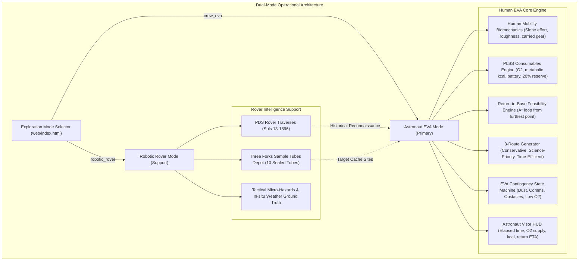
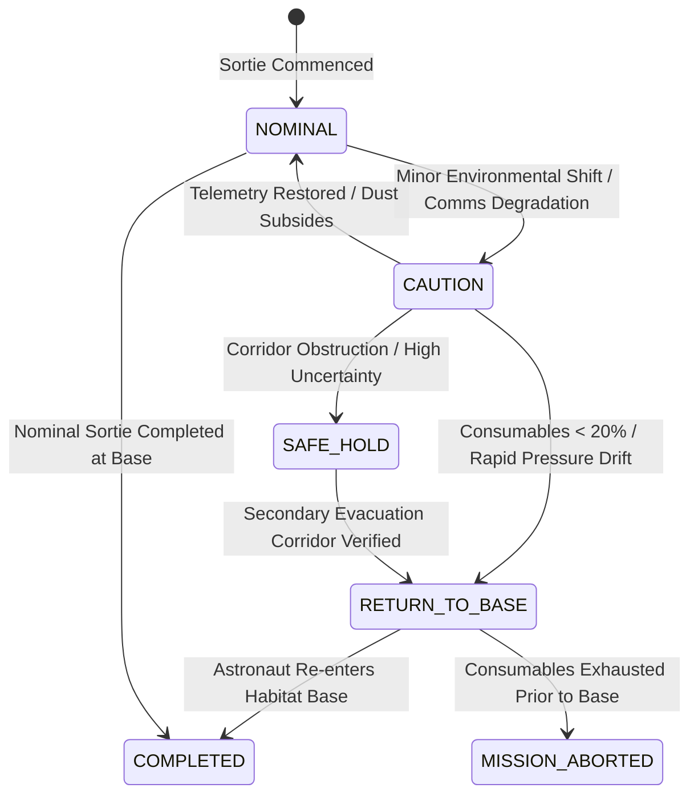

# MISSION 12 — ASTRONAUT EVA ARCHITECTURE SPECIFICATION
## Dual-Mode Human Surface Excursion & Robotic Support Framework

**Document Version:** 1.0.0  
**Project:** MarsWalk 2.0 / Project Atlas  
**Workspace:** `/home/mech_ka_launda/projects/NASA-SpaceApps-2026/MarsWalk-Submission`  
**Classification:** Conceptual Operational Decision-Support System  
**Disclaimers:** Not certified for flight operations, astronaut life-support sizing, or space suit structural design. Enforced under rule `AGENTS.md`.

---

### 1. Architectural Vision: The Human-First Paradigm

In Missions 1 through 11, MarsWalk primarily functioned as an autonomous rover mission demonstrator centered on Mars 2020 *Perseverance* ground truth, sol scheduling, and terramechanics. While `crew_eva` existed as an input parameter, it operated merely as a linear speed multiplier ($2.0\,\text{km/h}$ vs $0.126\,\text{km/h}$) applied over identical rover-oriented cost functions.

**Mission 12 fundamentally transforms MarsWalk into a Dual-Mode Planetary Exploration System:**
1. **Astronaut EVA Mode (Primary Demonstrator):** Centers on human bioenergetics, suit life-support envelopes (oxygen, battery, metabolic heat dissipation), return-to-base walkback safety, multi-target science sorties, and crew contingency decision-support.
2. **Robotic Rover Mode (Supporting Reconnaissance):** Preserved without compromise as an authentic tactical science platform providing prior ground-truth reconnaissance, hazard scouting, and sample caching telemetry.

---

### 2. Module Decomposition

The Astronaut EVA capability is partitioned cleanly into dedicated modules while maintaining backwards-compatible interfaces:

| Module | File Location | Responsibility |
| :--- | :--- | :--- |
| **`astronaut_eva.py`** | [`src/marswalk/core/astronaut_eva.py`](file:///home/mech_ka_launda/projects/NASA-SpaceApps-2026/MarsWalk-Submission/src/marswalk/core/astronaut_eva.py) | Core human biomechanics, dynamic consumable budgeting, 3-route multi-objective solver, state machine transitions, and emergency return pathfinding. |
| **`service.py`** | [`src/marswalk/api/service.py`](file:///home/mech_ka_launda/projects/NASA-SpaceApps-2026/MarsWalk-Submission/src/marswalk/api/service.py) | API endpoints `/api/eva/plan` and `/api/eva/contingency`, JSON request contract validation, and backward-compatible route response enrichment. |
| **`run_atlas.py`** | [`scripts/run_atlas.py`](file:///home/mech_ka_launda/projects/NASA-SpaceApps-2026/MarsWalk-Submission/scripts/run_atlas.py) | HTTP request dispatcher routing `/api/eva/*` POST endpoints on port 3000. |
| **`app.js`** | [`web/app.js`](file:///home/mech_ka_launda/projects/NASA-SpaceApps-2026/MarsWalk-Submission/web/app.js) | Frontend controller: dual-mode switcher, 3-route comparison card selector, live Visor HUD updater, and contingency disruption triggers. |
| **`index.html`** | [`web/index.html`](file:///home/mech_ka_launda/projects/NASA-SpaceApps-2026/MarsWalk-Submission/web/index.html) | Mode selector banner, Astronaut EVA Planning Studio card, 3-Route comparison grid, EVA Contingency drawer, and Visor HUD overlay. |
| **`styles.css`** | [`web/styles.css`](file:///home/mech_ka_launda/projects/NASA-SpaceApps-2026/MarsWalk-Submission/web/styles.css) | Visor HUD styling, pulsing emergency state badges, gold/amber exploration theme, and responsive mobile/compact styles. |

---

### 3. State Machine & Mission Lifecycle

The Astronaut EVA engine enforces a deterministic, six-state operational lifecycle:

1. **`NOMINAL`:** All PLSS telemetry, consumable consumption rates, and route margins are within nominal bounds ($\ge 20\%$ reserve).
2. **`CAUTION`:** Dust optical depth spike ($\tau > 1.5$) or line-of-sight habitat RF blackout. Visor inertial dead reckoning activates.
3. **`SAFE_HOLD`:** Traverse path blocked by newly detected physical hazard; astronaut stops in place while secondary routing is confirmed.
4. **`RETURN_TO_BASE`:** Emergency state triggered by low consumable reserve ($<20\%$) or impassable route closure. Direct emergency return route to habitat is rendered.
5. **`MISSION_ABORTED`:** Critical excursion termination where mission science goals are abandoned in favor of immediate crew recovery.
6. **`COMPLETED`:** Sortie successfully concluded with astronaut safely returned to habitat airlock.

---

### 4. Mode Isolation & Preservation Guarantees

To ensure that elevating Astronaut EVA Mode does not degrade existing robotic rover capabilities:
1. **API Isolation:** Existing endpoint `POST /api/plan_route` with `vehicle_mode: "robotic_rover"` utilizes the unchanged Horn terramechanics model, 4.0h single-sol drive limits, and suppresses human bioenergetic fields.
2. **UI Isolation:** Selecting `Rover Mission Mode` dynamically updates the UI to blue/cyan rover styling, hides human-specific life-support panels, and displays wheel slip and sol drive window metrics.
3. **Automated Regression Verification:** Test suite [`tests/test_astronaut_eva.py::test_rover_mode_isolation`](file:///home/mech_ka_launda/projects/NASA-SpaceApps-2026/MarsWalk-Submission/tests/test_astronaut_eva.py#L235-L255) cryptographically verifies that running identical coordinates in Rover Mode produces 100% bitwise consistent results regardless of EVA parameters.
