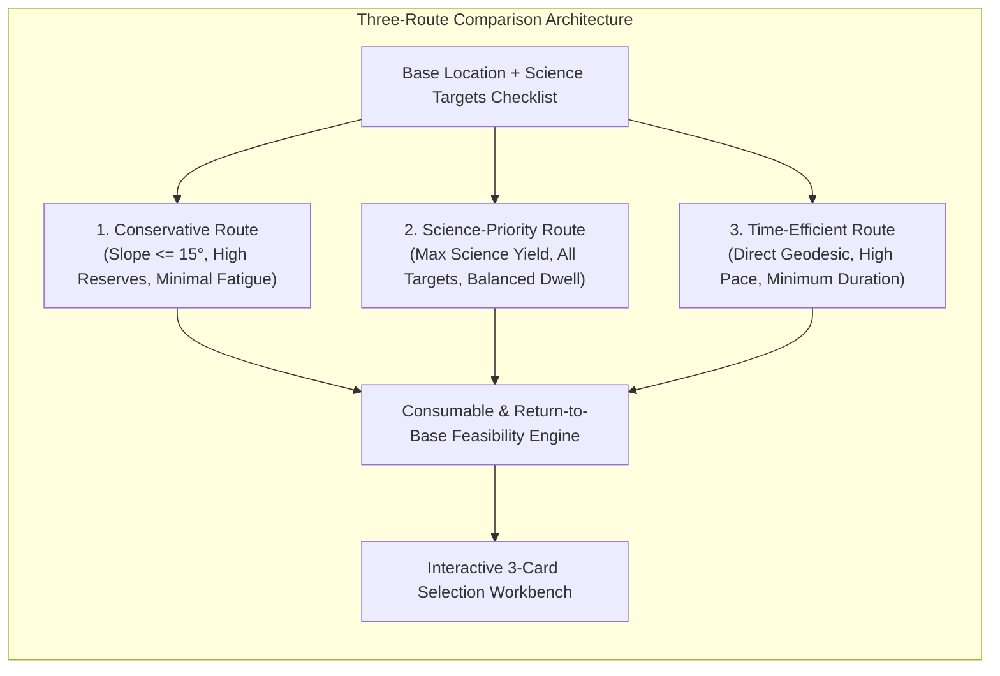

# MISSION 12 — ASTRONAUT EVA ROUTE PLANNING SPECIFICATION
## Three-Route Comparison, Multi-Target Interception & Return-to-Base Validation

**Document Version:** 1.0.0  
**Engine:** [`src/marswalk/core/astronaut_eva.py`](file:///home/mech_ka_launda/projects/NASA-SpaceApps-2026/MarsWalk-Submission/src/marswalk/core/astronaut_eva.py)  
**API Endpoint:** `POST /api/eva/plan`  

---

### 1. Multi-Objective Route Generation Strategy

Astronaut EVA planning requires evaluating competing operational objectives: minimizing physical exertion and slope hazard versus maximizing sample collection and scientific assay time.

To support informed flight director decisions, the MarsWalk EVA engine automatically generates **three distinct route candidates** for any configured sortie:

---

### 2. Specification of the Three Route Options

| Parameter / Profile | Conservative Route | Science-Priority Route | Time-Efficient Route |
| :--- | :--- | :--- | :--- |
| **Operational Philosophy** | Maximum crew safety, minimal terrain strain | Maximum scientific discovery & sampling | Rapid transit, minimum mission exposure |
| **Incline Ceiling ($\theta_{\text{max}}$)** | $\mathbf{15.0^\circ}$ (Strict safety envelope) | $\mathbf{18.0^\circ - 20.0^\circ}$ (Outcrop ridge access) | $\mathbf{20.0^\circ}$ (Standard suited cutoff) |
| **Slope Penalty Weight ($w_s$)** | $3.75$ ($1.5\times$ standard penalty) | $2.50$ (Standard biomechanical weight) | $2.25$ ($0.9\times$ standard weight) |
| **Roughness Weight ($w_r$)** | $2.52$ ($1.4\times$ standard penalty) | $1.80$ (Standard surface penalty) | $1.62$ ($0.9\times$ standard weight) |
| **Nominal Pace ($v_0$)** | $1.8 - 2.0\,\text{km/h}$ | $2.0\,\text{km/h}$ | $2.2 - 2.5\,\text{km/h}$ |
| **Dwell Time per Stop** | $15\,\text{min}$ ($900\,\text{s}$) | $20 - 30\,\text{min}$ ($1200 - 1800\,\text{s}$) | $10\,\text{min}$ ($600\,\text{s}$) |
| **Ideal Operational Context** | Early crew acclimatization, heavy cargo | High astrobiological priority outcrops | Rapid scout sorties, impending weather |

---

### 3. Scientific Target Interception & Multi-Stop Sequencing

#### 3.1 Interception Condition
Unlike arbitrary waypoints, a science target $T_k$ is credited as *intercepted and sampled* if and only if:
1. The planned route contains a leg visiting $T_k$'s designated coordinate cell $(r_k, c_k)$.
2. The terrain slope at $(r_k, c_k)$ is strictly below the suited incline ceiling ($\theta \le \theta_{\text{max}}$).
3. The operational budget allocates sufficient dwell time ($t_{\text{dwell}} \ge 600\,\text{s}$) for instrument placement and sample caching.

#### 3.2 Leg-by-Leg Stitching & Directionality
Because human walking on slopes is asymmetric (uphill climb effort $C(u \to v) \ne C(v \to u)$), each leg is planned as a directed A\* search:
$$\text{Sortie Path} = \mathcal{L}(B \to T_1) \circ \mathcal{L}(T_1 \to T_2) \circ \dots \circ \mathcal{L}(T_N \to B)$$
Endpoints are stitched seamlessly without duplicate adjoining coordinates.

---

### 4. Return-to-Base Feasibility Engine

> [!IMPORTANT]
> **No Euclidean Straight-Line Approximations:**
> A safe return to base is **never calculated using straight-line Euclidean distance**. Real Martian terrain contains impassable craters, rockfields, and steep scarp walls that force detour routes.

The return feasibility engine evaluates return safety as follows:
1. From each planned science waypoint $T_k$ and from the farthest point of the sortie, an actual directed A\* return path $\mathcal{L}_{\text{return}}(T_k \to \text{Base})$ is computed.
2. The return walking duration $t_{\text{return}}$, return metabolic burn $E_{\text{return}}$, and return oxygen volume $V_{O_2\text{, return}}$ are calculated.
3. **Consumable Feasibility Rule:**
   $$\text{Remaining } O_2 \text{ at Base Arrival} = V_{O_2\text{, initial}} - V_{O_2\text{, outbound}} - V_{O_2\text{, dwell}} - V_{O_2\text{, return}} \ge V_{O_2\text{, emergency reserve}}$$
   Where $V_{O_2\text{, emergency reserve}} = 120.0\,\text{L}$ ($20\%$ of 600 L tank).
4. If the reserve at base arrival drops below $20\%$, the route is flagged as `CONSUMABLE LIMIT EXCEEDED` and triggers an advisory warning.

#### 4.1 Apollo-Analogue Walkback Envelope Check
- Standard Apollo lunar rule-of-thumb limit: $4.0\,\text{km}$ ($4,000\,\text{m}$) maximum walking distance from the landing module / base station.
- If total traverse length exceeds $4,000\,\text{m}$, MarsWalk automatically displays:
  > *"Advisory: Traverse length (X m) exceeds the 4.0 km Apollo-analogue walking return envelope from base station."*
