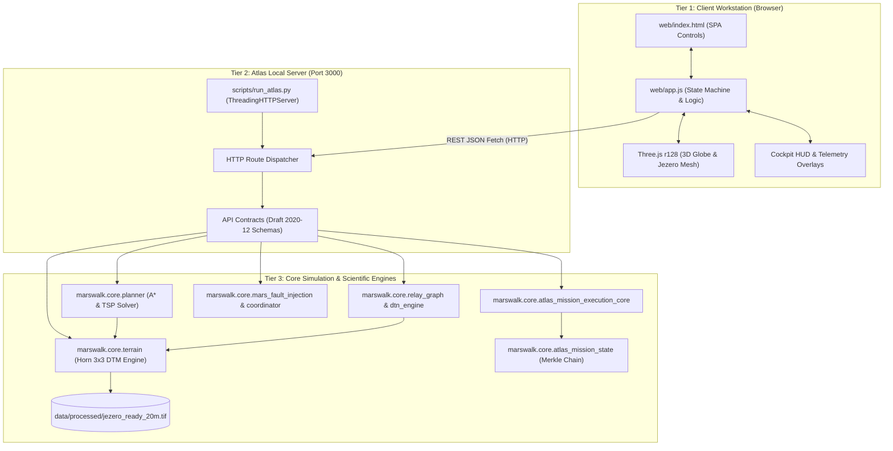

# Project MarsWalk — Mission 0: Full-System Engineering Reconnaissance Report

**Document ID:** `MARSWALK-REC-001`  
**Date:** 2026-11-14  
**Author:** Principal Software Architect, Systems Engineer & Technical Auditor  
**Environment:** Ubuntu 22.04 LTS (Linux x86_64, Python 3.10.12, Node.js v22.23.5)  
**Workspace:** `/home/mech_ka_launda/projects/NASA-SpaceApps-2026/MarsWalk-Submission`  
**Reference Source:** `/home/mech_ka_launda/projects/NASA-SpaceApps-2026/Atlas-Source/MarsWalk` (Not present on disk / untouched)

---

## 1. Executive Summary

Project MarsWalk (internally designated **MarsWalk 2.0 / Project Atlas**) is an end-to-end planetary mission planning and rehearsal workstation designed for the NASA Space Apps Challenge. The system grounds surface route optimization, environmental stress-testing, and communications modeling in authentic NASA/USGS remote-sensing datasets, specifically the USGS MRO Context Camera (CTX) 20 m/pixel Digital Terrain Model (DTM) of Jezero Crater.

This technical reconnaissance report delivers an exhaustive audit of the codebase following transition to Ubuntu 22.04 LTS. In accordance with strict Mission 0 engineering protocols:
- No application source code has been altered.
- No files have been deleted.
- No packages have been installed globally or into the system Python.
- All findings, test outcomes, and limitations are empirically verified and distinguished from theoretical claims.

### High-Level Repository Vital Statistics
- **Total Repository Footprint:** 823 MB across 16 top-level directories.
- **Source Code Assets:** 188 Python modules (`src/`), 64 web assets (`web/`), 110 automation/audit scripts (`scripts/`), 94 test suites (`tests/`), 87 data contract schemas (`schemas/`), and 457 technical documentation documents (`docs/`).
- **Data Footprint:** 5,237 persistent files in `data/` (~80 MB) including raw and calibrated USGS CTX GeoTIFFs, IAU gazetteers, PDS atmospheric archives, and cached mission workspaces.
- **Frontend Footprint:** Vendored Three.js r128 (`web/libs/three.min.js`), custom OrbitControls, a 1.2 MB client controller (`web/app.js`), 652 KB HTML markup (`web/index.html`), and 200 KB CSS design system (`web/styles.css`).
- **Build / Packaging:** Pure Python backend serving static web assets via a multi-threaded HTTP server (`scripts/run_atlas.py`), plus an auxiliary Streamlit workstation (`src/marswalk/app.py`).

---

## 2. Complete Repository Inventory

### 2.1 Backend Entry Points
1. **`scripts/run_atlas.py` (Primary Competition Server):**
   - **Type:** Multi-threaded HTTP server (`ThreadingHTTPServer` / `SimpleHTTPRequestHandler`).
   - **Port:** Default `3000` (configurable via `--port`).
   - **Role:** Serves both static frontend assets (`web/`) and 50+ HTTP REST API routes (`/api/...`).
   - **Execution Status on Ubuntu 22.04:** **BLOCKED at startup.** Fails immediately with `ModuleNotFoundError: No module named 'rasterio'` on line 16.
2. **`src/marswalk/app.py` (Tactical Control Companion):**
   - **Type:** Streamlit interactive analytical dashboard.
   - **Port:** Default `8501`.
   - **Role:** Alternative multi-profile traverse trade-off analyzer using Plotly subplots.
   - **Execution Status on Ubuntu 22.04:** **BLOCKED.** Missing dependencies: `streamlit`, `plotly`, `rasterio`.
3. **`scripts/run_flagship_mission.py` (Deterministic Research Reproduction):**
   - **Type:** Offline command-line reproduction tool.
   - **Role:** Executes 12 operational phases of the 60-Sol Autonomous Campaign (`ATLAS-MARS-BASE-ALPHA-001`), verifies input SHA-256 hashes, and generates Merkle root hash `f9d124...bd14`.
   - **Execution Status on Ubuntu 22.04:** **VERIFIED FULLY OPERATIONAL.** Successfully runs to completion in 1.2 seconds with bit-exact hash verification using standard Python 3.10 libraries.
4. **`scripts/preflight_check.py` (12-Point Readiness Diagnostics):**
   - **Type:** Automated system audit CLI.
   - **Role:** Verifies HTTP daemon, basemaps, gazetteer, DTM, A* engine, and workspaces.
   - **Execution Status on Ubuntu 22.04:** **BLOCKED.** Eager import cascade via `src/marswalk/api/__init__.py` imports `service.py`, failing on `rasterio`.

### 2.2 Frontend Entry Points & Web Architecture
1. **`web/index.html` (652 KB):**
   - Monolithic Single Page Application (SPA).
   - Contains 24 distinct inspector tab panels, navigation headers, mission telemetry HUD overlays, modal dialogs (Preflight, Help, Export, Replay), and elevation/slope color ramp legends.
2. **`web/app.js` (1.2 MB, 8,500+ lines):**
   - Validated via `node --check web/app.js` (Syntax 100% compliant under Node.js v22.23.5).
   - Orchestrates Three.js rendering loops, IAU globe coordinate mapping, Jezero 3D DTM elevation mesh creation, slope shader overlays, dynamic camera follow modes, and REST API communication with port 3000.
3. **`web/styles.css` (200 KB):**
   - High-density dark-mode aerospace cockpit styling, responsive grid layouts, SVG icons, and tab switching state machines.
4. **`web/libs/` (Bundled Dependencies):**
   - `three.min.js` (603 KB, Three.js r128).
   - `OrbitControls.js` (26 KB).
   - **Zero npm runtime dependencies required:** All client-side libraries are locally vendored.

### 2.3 Python Subsystems Breakdown (`src/marswalk/`)
The `src/` directory contains 188 Python source files structured into three primary packages:

| Subsystem Package | File Count | Core Modules & Responsibilities |
|:---|:---:|:---|
| `marswalk.data` | 4 | `imagery_registry.py`, `tile_cache.py`, `ingest.py`. Handles USGS DTM cropping, planetocentric coordinate conversion (`ESRI:103885` Equirectangular to IAU 2000), and imagery manifest validation. |
| `marswalk.api` | 6 | `service.py`, `contracts.py`, `workspace.py`, `decision_pack.py`, `preflight.py`. Exposes REST API handlers, enforces Draft 2020-12 JSON Schema validation, manages persistent JSON workspaces, and packages single-file ZIP Decision Packs. |
| `marswalk.core` | 178 | Core simulation stack. Subdivided into 8 functional capability domains (detailed below). |

#### Core Simulation Domains in `marswalk.core`:
1. **Topography & Physics Core:** `terrain.py`, `terrain_visibility.py`, `terrain_intelligence.py`. Horn 3x3 finite-difference slope, decameter roughness proxy, line-of-sight elevation raymarching.
2. **Routing & Traverse Optimization:** `planner.py`, `mission_optimizer.py`, `adaptive_replanner.py`, `joint_mission_planner.py`. Priority-queue $A^*$, exact permutation TSP ($\le 7$ stops), 2-Opt local search ($> 7$ stops), bounded beam search.
3. **Communications & RelayNet:** `relay_graph.py`, `relay_planner.py`, `atlas_dtn_engine.py`, `atlas_contact_scheduler.py`, `atlas_orbital_contact_planner.py`, `atlas_network_resilience.py`. BFS reachability, Tarjan bridge/cut-vertex detection, Fiedler algebraic connectivity ($\lambda_2$), submodular greedy relay placement, RFC 9171 (BPv7) bundle protocol with 6 priority classes.
4. **Fault Injection & Resilience:** `mars_fault_injection_engine.py`, `mars_failure_propagation.py`, `mars_failure_taxonomy.py`, `mars_fault_diagnosis.py`, `atlas_mission_resilience_coordinator.py`, `stress_test.py`, `contingency.py`. Causal propagation DAGs (AND/OR/Threshold logic gates), automated FDIR diagnosis, load-shedding to baseload power, 3-way contingency replanning.
5. **Atmosphere, Weather & Environment:** `weather.py`, `mars_atmospheric_environment.py`, `mars_dust_environment.py`, `mars_thermal_environment.py`, `environmental_hazard_model.py`. PDS4 MEDA/REMS archives, barometric hypsometric curves, solar irradiance dust extinction ($\tau \in [0.4, 3.0]$).
6. **Campaign & Discrete-Event Core:** `atlas_mission_execution_core.py`, `atlas_mission_event_coordinator.py`, `atlas_campaign_compiler.py`, `atlas_integrated_mission_scenario.py`. Min-heap discrete event priority scheduler, 7-phase mission DAG compiler, multi-sol progress tracking.
7. **Resource & Energy Operations:** `atlas_resource_operations.py`, `mission_resource_model.py`, `mars_isru_engine.py`. Mass/energy conservation ledgers ($dM \le 10^{-4}\text{ kg}$), Kilopower 10 kWe nuclear fission reactor, MOXIE $O_2$ extraction, Sabatier methanation, regolith microwave sintering.
8. **Reproducibility & Digital Twin:** `atlas_mission_state.py`, `atlas_mission_replay.py`, `mission_data_ledger.py`. 4-tier state twin (Physical, Earth-Reported, Predicted, Planned), SHA-256 Merkle chain verification, bit-exact replay audit.

### 2.4 Data Directory Inventory (`data/`)
- `data/raw/JEZ_ctx_B_soc_008_DTM_MOLAtopography_DeltaGeoid_20m_Eqc_latTs0_lon0.tif` (9.3 MB, authentic USGS CTX DTM).
- `data/processed/jezero_ready_20m.tif` (247 KB, calibrated 250x250 elevation raster, SHA-256: `875e7e80c170b84e4b2a3dd650b12abbee289e6d3fae5664e4d3cb93e9a1f5b3`).
- `data/waypoints_jezero.json`: 6 curated science targets with verified planetocentric coordinates and elevations.
- `web/data/mars_places.json`: 2,061 USGS/IAU nomenclature features.
- `data/weather/`: 5 baseline weather archives (Jezero MEDA, Gale REMS, InSight, Olympus MCD).
- `data/workspaces/`: Over 5,000 JSON run records across historical milestone executions (`campaigns/`, `experiments/`, `events/`, `recommendations/`, `rehearsals/`).

---

## 3. Subsystem Communication Architecture

The system operates across three communicating computational tiers:

---

## 4. Subsystem Audit: Unused, Duplicated, or Obsolete Components

1. **One-Off Patch Scripts in `scripts/` (20+ files):**
   - Files such as `patch_app_js_11h.py`, `patch_foundry_routes.py`, `patch_index_html_11h.py`, `update_app_for_rehearsal.py`, `update_runbook_12e.py` were interim build patches created during incremental milestone development.
   - *Status:* Obsolete for runtime. They must remain untouched per Mission 0 rules but should not be executed.
2. **Hardcoded Windows-Only Browser Audit Scripts (30+ files):**
   - Files including `scripts/audit_milestone_13a_browser_acceptance.py`, `scripts/verify_environment_validation_browser.py`, `scripts/capture_milestone_10d_evidence.py` contain hardcoded paths:
     - `CHROME_PATH = r"C:\Program Files\Google\Chrome\Application\chrome.exe"`
     - `ARTIFACT_DIR = r"C:\Users\dhwan\.gemini\antigravity\brain\..."`
   - *Status:* Completely non-functional on Linux without dynamic browser path resolution.
3. **Backup Artifacts in Web Directory:**
   - `web/app.js.bak13d_orig` (841 KB) is an unreferenced historical backup left in the web root.
   - *Status:* Inert, but consumes disk space and should not be served.
4. **Orphan Workspace Event Records:**
   - `data/workspaces/events/` and `data/workspaces/recommendations/` contain over 5,000 tiny JSON files generated during Milestone 11 test runs.
   - *Status:* Clutters repository file count; strictly protected by data safety rules.
5. **Speculative Subsystems vs Core Planetary Planning:**
   - Subsystems such as `Planetary Foundry` (autonomous block sintering), `Settlement Architecture`, and `Aerial Corps` (rotorcraft flight dynamics) represent substantial codebases but diverge from the primary NASA challenge objective of surface rover route planning and science preservation. They add UI complexity (24 tabs) without enhancing core demonstration reliability.

---

## 5. Verification Status Summary

| Subsystem Component | Verified Working | Blocked / Defective | Primary Root Cause |
|:---|:---:|:---:|:---|
| **Flagship 60-Sol Mission CLI** | **YES** | No | Runs standalone; bit-exact root hash match. |
| **Mathematical Physics Core** | **YES** | No | Horn slope kernel, hypsometric barometric equations verified. |
| **RelayNet Graph Engine** | **YES** | No | BFS reachability, Tarjan articulation points verified. |
| **DTN Bundle Protocol Engine** | **YES** | No | RFC 9171 priority queue, custody transfer verified. |
| **Fault Injection & Resilience** | **YES** | No | Causal DAG propagation and FDIR recovery verified. |
| **Frontend Web Syntax** | **YES** | No | `node --check` passed on all JS files. |
| **USGS DTM Dataset** | **YES** | No | File exists and SHA-256 hash verified. |
| **Atlas HTTP Server (run_atlas.py)**| No | **YES** | `ModuleNotFoundError: No module named 'rasterio'` on line 16. |
| **Preflight Verification CLI** | No | **YES** | Eager import cascade in `marswalk.api.__init__`. |
| **Automated Test Battery (94 files)**| Partial (129 passed) | **YES** (76 suites) | Pytest 6.2.5 pythonpath issue + missing rasterio/affine/jsonschema. |
| **Browser Acceptance Automation**| No | **YES** | Hardcoded Windows Chrome path; no Chrome in PATH. |
| **Shell Launchers** | No | **YES** | Zero `.sh` scripts; only `.ps1` and `.bat` present. |
