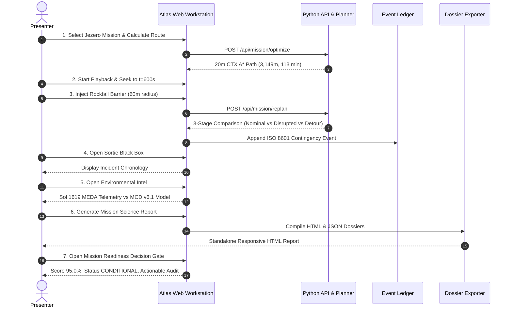

# MarsWalk 2.0 (Project Atlas) — Showcase Demonstration Runbook

**Audience:** Judges, Technical Evaluators, Teammates, and Mission Operators  
**Demonstration Duration:** 3 to 5 minutes  
**Target Environment:** Local Workstation (Windows / Linux / macOS)  
**Server Endpoint:** `http://127.0.0.1:3000`  
**Automated Runner:** `python scripts/run_demonstration.py`  

---

## 1. Demonstration Setup & Pre-Flight (60 Seconds)

### Step 1: Launch Application Server
Open a terminal in the project root (`E:\Python\NASA-Spaceapps\Marswalk`):

```powershell
# Option A: PowerShell Launcher
.\scripts\start_marswalk.ps1

# Option B: Batch Launcher (Command Prompt)
scripts\start_marswalk.bat

# Option C: Direct Python Server Daemon
$env:PYTHONPATH="src"; .\.venv\Scripts\python.exe scripts/run_atlas.py --port 3000
```
*Expected Result:* Server starts on port 3000, detects any port collision, verifies health, and opens default web browser at `http://127.0.0.1:3000`.

### Step 2: Run Pre-Flight Diagnostics
In a second terminal window, verify the 12 system checkpoints:

```powershell
$env:PYTHONPATH="src"; .\.venv\Scripts\python.exe scripts/preflight_check.py --port 3000
```
*Expected Result:* 12 / 12 checkpoints pass in $<600$ms (GeoTIFF raster, DTM bounds, gazetteer, workspaces, HTTP endpoints, WebSocket).

---

## 2. Live Narrative Demonstration (3–5 Minutes)



---

### Stage 1: Jezero Topography & Baseline Route (Minute 0:00 – 1:00)
- **Talking Point:** *"MarsWalk 2.0 uses authentic NASA Context Camera 20-meter digital elevation models from the USGS Astrogeology Science Center, not procedural noise or synthetic terrain."*
- **Action:**
  1. In the **Saved Missions** dropdown, select:  
     `m_jezero_delta_scarp_surve_090607` (*Jezero Delta Scarp Survey*).
  2. Start coordinates `(117, 157)` and Goal coordinates `(194, 131)` automatically load on the Jezero delta.
  3. Click **"Calculate Route"** (`#btnCalculateRoute`).
- **Visible Outcome:**
  - Optimal green traversal path drawn along the delta scarp.
  - Metrics Panel: Distance: **$3,149\text{ m}$**, Traverse Duration: **$\approx 113\text{ min}$**, Maximum Slope: **$4.6^\circ$**, Energy: **$1,563.8\text{ kJ}$**.
  - Life-support margin confirms feasibility within the 8-hour EVA window.

---

### Stage 2: Mission Targets & Route Constraints (Minute 1:00 – 1:45)
- **Talking Point:** *"The mission planner balances science priority against physiological walking limits using Minetti's metabolic equation. Notice how the path hugs passable slopes below our 15-degree safety ceiling."*
- **Action:**
  1. Toggle the **Slope Heatmap** overlay from the viewport toolbar.
  2. Highlight the 2 intermediate science stops: *Hawksbill Gap* and *Skinner Ridge*.
  3. Point out that steep delta cliffs ($>15^\circ$) are colored red and avoided by the A* search surface.
- **Visible Outcome:**
  - Clear visual demarcation showing that the path negotiates natural rampways and passes through verified geological targets.

---

### Stage 3: Mid-Sortie Disruption & 3-Stage Trade-Off (Minute 1:45 – 2:30)
- **Talking Point:** *"Field exploration is unpredictable. In MarsWalk, we can stress-test our mission against dynamic contingencies during active playback without double-counting past life-support expenditure."*
- **Action:**
  1. Open the **Playback Drawer**, click **Play**, and advance playback to $t = 600\text{ s}$.
  2. Click **"Inject Contingency"** (`#btnEmergencyInjection`).
  3. Select **"Rockfall / Corridor Closure"** ($60\text{ m}$ radius) and confirm.
  4. Click **"Calculate Continuation"** (`#btnCalcContinuation`).
- **Visible Outcome:**
  - Red hazard circle appears directly across the forward path.
  - Three-stage trade-off table displays:
    - **Nominal Remaining:** $1,737\text{ m}$ (unaltered baseline).
    - **Disrupted Remaining:** Blocked ($0.0\text{ m}$, infinite cost).
    - **Adaptive Continuation Detour:** $1,737\text{ m}$ with $0\text{ m}$ distance penalty.
  - System recommendation: `CONTINUE_WITH_DETOUR`.

---

### Stage 4: Sortie Black Box Event Ledger (Minute 2:30 – 3:00)
- **Talking Point:** *"Every event is immutably recorded in an append-only JSON ledger, creating a traceable black-box record for mission control debriefings."*
- **Action:**
  1. Click **"Sortie Black Box"** (`#btnHeaderBlackBox`) in the top navigation bar.
- **Visible Outcome:**
  - Chronological event timeline opens showing:
    - `00:00:00 UTC`: `sortie_started` at start coordinates.
    - `00:10:00 UTC`: `contingency_injected` (rockfall hazard placed).
    - `00:10:04 UTC`: `continuation_selected` (adaptive detour accepted).
  - Demonstrates full situational auditability.

---

### Stage 5: Mars Environmental Intelligence (Minute 3:00 – 3:45)
- **Talking Point:** *"MarsWalk integrates real surface environmental data. We clearly distinguish authentic archived in-situ rover observations from global climatological models."*
- **Action:**
  1. Open the **Environmental Intelligence** dashboard.
  2. Inspect the **Jezero Crater** telemetry card:
     - Badge: `IN_SITU_OBSERVATION`
     - Source: Mars 2020 Perseverance MEDA instrument.
     - Timestamp: Sol 1619 (PDS4 Archive Tranche).
     - Surface Pressure: $589.69\text{ Pa}$. Wind Speed: `null` (preserved as unmeasured, not zero-filled).
  3. Switch to **Olympus Mons** or **Valles Marineris**:
     - Badge: `CLIMATOLOGICAL_MODEL`
     - Source: Mars Climate Database (MCD v6.1).
     - Surface Pressure: $72.4\text{ Pa}$ (reflecting high altitude caldera).
- **Visible Outcome:**
  - Strict provenance labels visible on every metric card.

---

### Stage 6: Mission Science Report Dossier (Minute 3:45 – 4:15)
- **Talking Point:** *"With one click, MarsWalk compiles a reproducible, self-contained mission science report containing mobility metrics, incident history, and dataset checksums."*
- **Action:**
  1. Click **"Generate Report"** in the top navigation bar.
  2. Scroll through the generated executive summary, mobility metrics, and provenance manifest.
  3. Click **"Download HTML"** and **"Download JSON"**.
- **Visible Outcome:**
  - Responsive HTML report opens immediately. It embeds all CSS internally, requires zero external internet access, and includes the exact SHA-256 hash of the USGS CTX DTM.

---

### Stage 7: Mission Readiness Decision Gate & Export (Minute 4:15 – 5:00)
- **Talking Point:** *"Finally, the Mission Readiness Decision Gate evaluates whether the sortie is ready for review or blocked, providing flight directors with actionable findings."*
- **Action:**
  1. Click **"Mission Readiness"** (`#btnHeaderReadiness`).
  2. Point out:
     - Overall Score: **$95.0\%$**
     - Status: **`CONDITIONAL`**
     - 4 category cards: Terrain ($100\%$), Kinematics ($95\%$), Contingency ($90\%$), Environment ($95\%$).
     - Actionable findings list explaining the conditional notice.
  3. Click **"Export Decision Pack"** (`#btnExportDecisionPack`).
- **Visible Outcome:**
  - Generates verified Decision Pack bundle containing canonical run JSON, RFC 4180 comparison CSV, and Markdown flight briefing.

---

## 3. Headless Fast Demonstration Alternative (30 Seconds)

If a live interactive browser demonstration is not possible, execute the automated 10-stage runner:

```powershell
$env:PYTHONPATH="src"
.\.venv\Scripts\python.exe scripts/run_demonstration.py
```

*Terminal Output:*
```
[1/10] Verifying Project Atlas server & Jezero 20m CTX DTM... PASSED
[2/10] Loading saved mission workspace... PASSED
[3/10] Planning optimal A* kinematic route... PASSED
[4/10] Initializing kinematic playback simulation at t=600s... PASSED
[5/10] Injecting rockfall corridor closure contingency... PASSED
[6/10] Recording sortie black-box event ledger... PASSED
[7/10] Querying Mars Environmental Intelligence telemetry... PASSED
[8/10] Compiling Mission Science Report (HTML & JSON)... PASSED
[9/10] Evaluating Mission Readiness Decision Gate... PASSED
[10/10] Exporting cryptographically verified Decision Pack... PASSED
Completed in 1.92s. Deliverables written to outputs/demonstration/
```

Open the generated deliverables directly:
- HTML Report: `outputs/demonstration/jezero_mission_science_report.html`
- Comparison CSV: `outputs/demonstration/decision_pack_comparison.csv`
- Flight Briefing: `outputs/demonstration/mission_decision_briefing.md`

---

## 4. Offline Fallback & Edge Recovery

| Issue / Failure Point | Root Cause | Operator Recovery Step |
| :--- | :--- | :--- |
| **No Internet Connection** | Presentation venue lacks WiFi. | **No action required.** Core A* routing, DTM elevation, gazetteer, preflight, reports, and weather telemetry are 100% offline. Cesium globe and Google Fonts gracefully fall back to local Three.js canvas and system typography. |
| **Port 3000 Occupied** | Previous server instance did not release port. | Run `Invoke-RestMethod http://127.0.0.1:3000/api/health`. If it returns `"status": "ok"`, open the browser directly. If another process owns it, run `scripts\start_marswalk.ps1` which handles detection automatically. |
| **3D Canvas is Blank** | Browser hardware acceleration disabled. | Check `chrome://gpu` or use another browser (Edge, Chrome, Firefox). Ensure WebGL 2.0 is supported. |
| **Route Planning Stalls** | Point placed outside surveyed CTX area. | Ensure coordinates are within Jezero bounds ($X \in [0, 249], Y \in [0, 249]$). Click the saved mission preset to reset valid coordinates. |
| **Download Popup Blocked** | Browser blocks automated file download. | Click the URL displayed in the modal or open `outputs/demonstration/` directly from the file explorer. |
