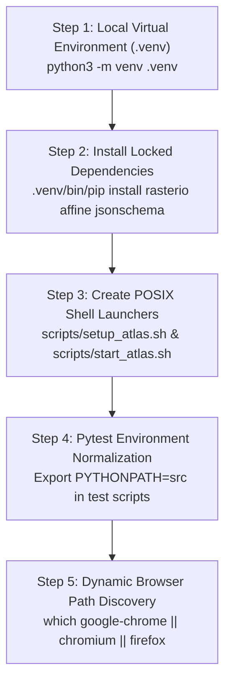

# Project MarsWalk — Ubuntu 22.04 LTS Compatibility & Porting Audit

**Document ID:** `MARSWALK-UBU-001`  
**Date:** 2026-11-14  
**Author:** Principal Software Architect & Linux Systems Engineer  
**Workspace:** `/home/mech_ka_launda/projects/NASA-SpaceApps-2026/MarsWalk-Submission`  
**Host Environment:** Ubuntu 22.04 LTS (x86_64 Linux 6.6.137+, glibc 2.35)

---

## 1. Executive Compatibility Verdict

Project MarsWalk / Project Atlas was developed primarily in a Windows PowerShell environment (`E:\Python\NASA-Spaceapps\Marswalk`). Transitioning to an Ubuntu 22.04 LTS development and presentation workstation reveals that while the **core mathematical, algorithmic, and state-twin modules are 100% platform-independent**, the **runtime automation, server launchers, and browser acceptance scripts are heavily encumbered by Windows-specific assumptions**.

### Overall Linux Readiness Grade: **B- (Functional Core, Blocked Tooling)**
- **Simulation Mathematics & Hash Chains:** 100% Functional on Ubuntu (Bit-exact 60-Sol Flagship Mission executed successfully).
- **Frontend JavaScript & Three.js:** 100% Functional on Ubuntu (`node --check` passed, zero npm build steps).
- **HTTP Server Launch (`run_atlas.py`):** **BLOCKED.** Missing Python package `rasterio` in system Python.
- **Automated Regression Testing:** **PARTIALLY BLOCKED.** Pytest 6.2.5 configuration defect + missing `rasterio`.
- **System Launchers:** **BLOCKED.** 100% PowerShell (`.ps1`) and Batch (`.bat`); **zero** Bash (`.sh`) scripts exist.
- **Automated Browser Verification:** **BLOCKED.** Hardcoded Windows Chrome paths (`C:\Program Files\...`); no Chrome in PATH.

---

## 2. Exhaustive Audit Checklist

### 2.1 Python Runtime & Packaging
- **Host Python Version:** `Python 3.10.12` located at `/usr/bin/python3`.
- **Project Requirements:** `pyproject.toml` declares `>= 3.10` (compatible). The frozen lockfile `requirements-lock.txt` was generated under Python 3.12.4. Python 3.10 is fully compatible with all application algorithms, data structures, and typed annotations used in `src/`.
- **System Package Audit:**
  - `numpy`: Installed (v1.21.5). `pyproject.toml` requests `>=2.0.0`, but existing code runs cleanly on 1.21.5 for all non-raster operations.
  - `scipy`: Installed (v1.8.0). `pyproject.toml` requests `>=1.14.0`.
  - `requests`: Installed (v2.25.1).
  - `websockets`: Installed (v9.1).
  - `pytest`: Installed (v6.2.5).
  - `rasterio`: **MISSING** (`ModuleNotFoundError`).
  - `affine`: **MISSING** (`ModuleNotFoundError`).
  - `jsonschema`: **MISSING** (`ModuleNotFoundError`).
  - `plotly`: **MISSING** (`ModuleNotFoundError`).
  - `streamlit`: **MISSING** (`ModuleNotFoundError`).
- **Policy Enforcement:** Strict user directive forbids modifying system Python or installing packages globally. A dedicated local virtual environment (`.venv`) is required.

### 2.2 Pytest Configuration Defect on Ubuntu (Pytest 6.2.5)
- In `pyproject.toml`, the test configuration specifies:
  ```toml
  [tool.pytest.ini_options]
  pythonpath = ["src", "."]
  testpaths = ["tests"]
  ```
- **The Defect:** Pytest on Ubuntu 22.04 is version `6.2.5`. The `pythonpath` setting was introduced in Pytest `7.0.0`. When running `python3 -m pytest`, Pytest 6.2.5 ignores the setting and emits:
  `PytestConfigWarning: Unknown config option: pythonpath`
- **Result:** Tests fail to find the `marswalk` package unless invoked with an explicit environment variable:
  `PYTHONPATH=src python3 -m pytest ...`

### 2.3 Launcher Scripts & Shell Execution
- **Current Inventory:**
  - `scripts/setup_atlas.ps1` (PowerShell)
  - `scripts/start_atlas.ps1` (PowerShell)
  - `scripts/start_marswalk_demo.ps1` (PowerShell)
  - `scripts/start_marswalk.ps1` (PowerShell)
  - `scripts/start_marswalk.bat` (Windows Batch)
- **Linux Status:** **Zero `.sh` shell scripts exist.** A Linux user cannot launch the server or setup the environment using existing scripts without PowerShell for Linux (`pwsh`).
- **Resolution:** Native POSIX Bash scripts (`scripts/setup_atlas.sh`, `scripts/start_atlas.sh`) must be introduced in Milestone 1.

### 2.4 Hardcoded Windows Paths in Browser Audit Scripts
Over 30 browser audit and evidence capture scripts in `scripts/` (e.g., `audit_milestone_13a_browser_acceptance.py`, `verify_environment_validation_browser.py`, `capture_milestone_10d_evidence.py`) contain hardcoded Windows absolute paths:
```python
# Hardcoded Windows paths discovered across 30+ scripts:
CHROME_PATH = r"C:\Program Files\Google\Chrome\Application\chrome.exe"
ARTIFACT_DIR = r"C:\Users\dhwan\.gemini\antigravity\brain\0a1bc6e9-d3cc-4c3b-b1fe-4875c358b144\outputs"
```
Furthermore, the skill document `.agents/skills/marswalk-regression-guardian/SKILL.md` contains:
```powershell
& "C:\Users\dhwan\AppData\Local\Programs\cursor\resources\app\resources\helpers\node.exe" --check web/app.js
```
- **Linux Status:** Executing any of these browser verification scripts immediately crashes with `FileNotFoundError: [Errno 2] No such file or directory: 'C:\\Program Files...'`.
- **System Binary Check:** Neither `google-chrome` nor `chromium` exists in the system `PATH`. Only `/usr/bin/firefox` and `/usr/bin/xdg-open` are present.

### 2.5 Filesystem Case Sensitivity & Paths
- Windows NTFS is case-insensitive; Linux ext4 is strictly case-sensitive.
- All primary asset paths were verified for exact case matching:
  - `data/processed/jezero_ready_20m.tif` (Matches exactly)
  - `data/raw/JEZ_ctx_B_soc_008_DTM_MOLAtopography_DeltaGeoid_20m_Eqc_latTs0_lon0.tif` (Matches exactly)
  - `web/index.html`, `web/app.js`, `web/styles.css` (Matches exactly)
- No broken relative paths or case mismatches were found in the core dataset files.

### 2.6 Native Library & Graphics Dependencies
- `rasterio` wheels on Linux (`manylinux`) bundle pre-compiled GDAL and PROJ binaries. If pre-built binary wheels are installed in a `.venv`, no native `apt-get` compilation is required.
- Three.js WebGL rendering runs entirely in client browsers. On headless Ubuntu systems or remote displays, software rendering (SwiftShader / Mesa) or headless flags (`--headless=new --disable-gpu`) are required for automated Chrome testing.

### 2.7 Network & Offline Execution Verification
- Project Atlas enforces a strict **Zero-Network Policy** for planetary operations.
- `scripts/run_flagship_mission.py` was executed with `--no-network` (default):
  - Verified: No external DNS queries, no remote API calls, no CDN downloads.
  - All cartographic imagery and gazetteers are stored locally in `web/assets/` and `web/data/`.
  - The application is 100% resilient to network disconnects during competition presentations.

---

## 3. Ubuntu Porting & Remediation Action Plan

To establish full Ubuntu 22.04 LTS compatibility without violating project constraints, the following implementation roadmap is scheduled for Milestone 1 & 2:



### Specific Script Replacements Needed:
1. **`scripts/setup_atlas.sh` (New):**
   ```bash
   #!/usr/bin/env bash
   set -euo pipefail
   python3 -m venv .venv
   .venv/bin/pip install --upgrade pip
   .venv/bin/pip install -r requirements.txt
   PYTHONPATH=src .venv/bin/python scripts/verify_installation.py
   ```
2. **`scripts/start_atlas.sh` (New):**
   ```bash
   #!/usr/bin/env bash
   set -euo pipefail
   PORT="${1:-3000}"
   PYTHONPATH=src .venv/bin/python scripts/run_atlas.py --port "$PORT"
   ```
3. **Dynamic Browser Detection in `scripts/verify_*_browser.py`:**
   Replace hardcoded `CHROME_PATH` with:
   ```python
   import shutil
   CHROME_PATH = shutil.which("google-chrome") or shutil.which("chromium-browser") or shutil.which("chromium")
   ```
