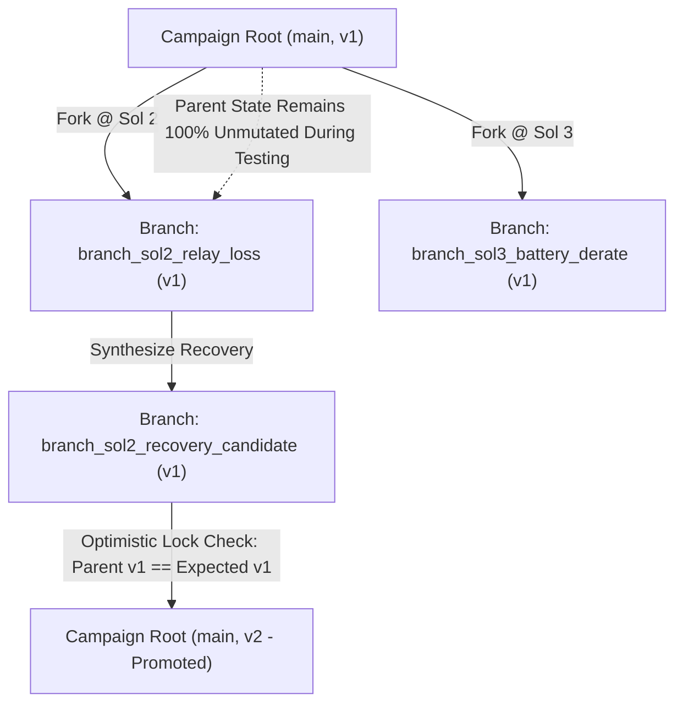

# Campaign Branching, Isolation & Concurrency Control

## 1. The Need for Sandboxed Campaign Exploration

In operational mission planning, mission directors and tactical replanners frequently need to test speculative interventions:
- What if an orbiter pass is lost on Sol 2?
- What if a battery cell fails during an uphill traverse?
- What if a science target yields higher-than-expected utility, justifying an extended dwell?

Directly modifying the operational campaign to answer these questions is unacceptable because:
1. It risks corrupting active flight schedules.
2. It destroys the historical audit trail.
3. Concurrent evaluations by multiple operators can cause race conditions and lost updates.

The **Campaign Branch Manager** (`CampaignBranchManager`) solves this by treating campaigns like Git repositories, providing deep-copy branching, parent immutability, and optimistic concurrency locks.



---

## 2. Deep-Copy Isolation Mechanics

When `create_branch(name, parent_branch_id, fork_sol, purpose)` is called:
1. **Parent State Snapshot**: The manager performs an unlinked deep copy of the parent director's data structures:
   - `active_plan`: multi-sol schedules, waypoints, timing limits.
   - `events_log`: sequence of events up to `fork_sol`.
   - `resource_state`: battery capacity, energy balance, flash memory, communications status.
2. **Dedicated Workspace**: Branch state is serialized into an isolated subdirectory:
   ```
   data/workspaces/branches/{branch_id}/
   ├── branch_meta.json
   ├── campaign_plan.json
   ├── events_log.jsonl
   └── assurance_snapshot.json
   ```
3. **Zero Reference Leakage**: All mutating operations on the branch (fault injection, schedule optimization, target pruning) modify exclusively the branch's local structures. The parent campaign remains bit-for-bit unchanged.
4. **Invariant ISO-001**: Verified by hashing parent workspace files before and after child branch execution.

---

## 3. Optimistic Concurrency & Safe Promotion

When an operator or autonomous recovery algorithm wishes to promote a candidate branch into the active operational campaign (`main`), the system enforces optimistic concurrency locking:

### Protocol Steps:
1. **Lock Verification**: The promotion request must provide `expected_parent_version` (e.g. `v1`).
2. **Version Check**:
   $$\text{live\_parent.version} \stackrel{?}{=} \text{expected\_parent\_version}$$
3. **Conflict Resolution**:
   - If equal: The candidate branch plan, sol schedules, and events are integrated into `main`. The parent version is incremented ($v_{k+1} = v_k + 1$). An immutable audit event (`BRANCH_PROMOTED`) is recorded.
   - If unequal: The promotion request is rejected with `StaleVersionConflictError` ($HTTP\ 409$). The caller must re-base their candidate branch against the newly updated parent before re-submitting.
