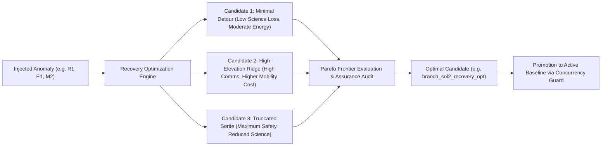

# Multi-Objective Campaign Recovery Optimization

## 1. Multi-Objective Decision Space

When an anomaly or disturbance occurs during a Martian campaign, selecting a recovery plan is not a single-objective problem. A flight operations director must balance competing trade-offs:
- **Safety Margin**: Preserving minimum battery state-of-charge ($SOC \ge 20\%$) and slope limits ($\le 25^\circ$).
- **Science Return**: Maximizing the cumulative scientific utility of completed observations.
- **Mission Duration**: Keeping each sol's operational timeline within safe communication and thermal windows ($T_{\text{sol}} \le 8.0\text{ h}$).
- **Data Logistics**: Preventing buffer overflows and minimizing un-downlinked telemetry backlog.

---

## 2. 3-Way Comparative Analysis Formulation

Atlas quantifies the efficacy of an automated recovery candidate by evaluating three distinct operational states across a 6-metric delta comparison matrix:
1. **Baseline State ($\mathbf{S}_{\text{base}}$)**: The nominal campaign plan before any disturbance occurs.
2. **Disturbed State ($\mathbf{S}_{\text{dist}}$)**: The campaign state following the anomaly if no corrective action is taken (unmitigated failure cascade).
3. **Recovery Candidate ($\mathbf{S}_{\text{rec}}$)**: The synthesized corrective branch incorporating rerouting, relay reassignment, or observation rescheduling.

### Net Recovery Delta Equation:
$$\Delta_{\text{recovery}} = \mathbf{S}_{\text{rec}} - \mathbf{S}_{\text{dist}}$$
$$\Delta_{\text{cost}} = \mathbf{S}_{\text{rec}} - \mathbf{S}_{\text{base}}$$

A valid recovery candidate must satisfy:
1. Invariant Violations: $\text{Violations}(\mathbf{S}_{\text{rec}}) == 0$ (all 20 rules pass).
2. Energy Feasibility: $\text{SOC}_{\text{min}}(\mathbf{S}_{\text{rec}}) \ge 20.0\%$.
3. Net Utility Retention: $\frac{\text{Utility}(\mathbf{S}_{\text{rec}})}{\text{Utility}(\mathbf{S}_{\text{base}})} \ge 0.85$.
