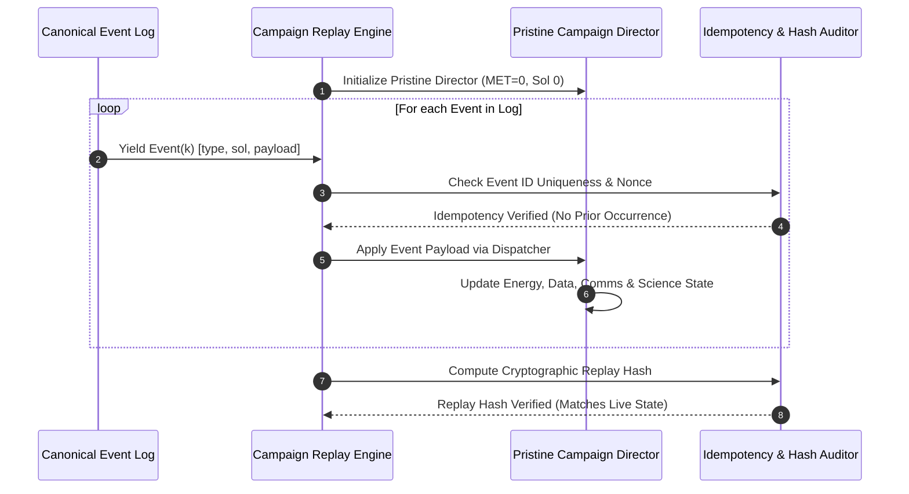

# Deterministic Campaign Replay & State Reconstruction

## 1. Principles of Deterministic Playback

In long-duration multi-sol Martian surface missions, autonomous decisions and plan modifications accumulate over time. To verify mission integrity, flight software simulators must be able to reconstruct the exact system state at any point in Mission Elapsed Time (MET) from the canonical event log alone.

The **Campaign Replay Engine** (`CampaignReplayEngine`) provides:
1. **Event Sequence Ingestion**: Reads immutable, strictly ordered `CampaignOperationsEvent` records from the campaign event stream (`events_log.jsonl`).
2. **Clean State Genesis**: Instantiates a pristine, unmutated `CampaignOperationsDirector` at $MET=0$.
3. **Discrete Event Application**: Sequentially dispatches each event through the director's transition function:
   $$\mathbf{S}_{k+1} = \mathcal{T}(\mathbf{S}_k, \mathbf{e}_{k+1})$$
4. **Target Cutoff**: Halts replay upon reaching a specified `target_sol` or `target_met`, returning an exact historical snapshot.



---

## 2. Idempotency & Double-Deduction Prevention

A critical failure mode in simulation replays is accidental duplicate execution of events (e.g., deducting mobility battery energy twice for the same traverse, or counting science points multiple times).

The Replay Engine enforces strict event idempotency:
- **Unique Event Nonces**: Every event possesses a unique `event_id` and a monotonically increasing `sequence_number`.
- **Processed Event Registry**: The replay executor maintains a hash set of processed `event_id`s. Any incoming event with a known `event_id` is silently bypassed without modifying state registers.
- **State Monotonicity Audit**:
  - Battery capacity remaining: $SOC_{k+1} \le SOC_k$ during drive segments; $SOC_{k+1} \ge SOC_k$ during recharge periods.
  - Science utility: $U_{k+1} \ge U_k$. Total utility is strictly monotonic non-decreasing.
  - Data transfer volume: Accumulated downlink bytes are strictly monotonic non-decreasing.

---

## 3. Cryptographic State Verification

Upon completing replay up to event $N$, the engine computes a deterministic SHA-256 state digest across all reconstructed fields:
```python
state_fingerprint = {
    "sol_index": director.current_sol_index,
    "current_energy_wh": round(director.current_energy_wh, 4),
    "used_storage_mb": round(director.used_storage_mb, 4),
    "completed_targets": sorted(list(director.completed_target_ids)),
    "active_relays": sorted(list(director.active_relay_ids)),
    "events_count": len(director.events_log)
}
digest = hashlib.sha256(json.dumps(state_fingerprint, sort_keys=True).encode()).hexdigest()
```

If `digest == live_director_digest`, rule `REP-001` evaluates to `PASS` with `CONFIRMED` evidence. Any divergence flags a state mutation bug or unauthorized external tampering.
