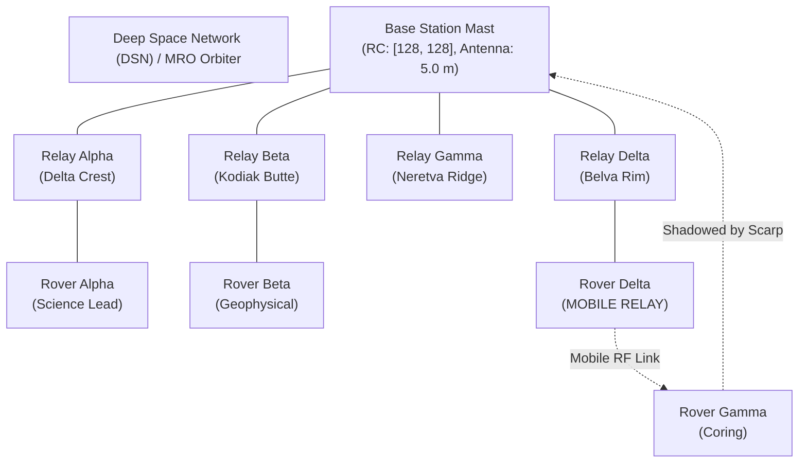

# Fleet Communications Network & Shared RelayNet Mesh
## Multi-Rover Line-of-Sight Visibility & Dynamic Mobile Relay Orchestration

**Component:** `src/marswalk/core/fleet_communications_network.py`  
**JSON Contract:** `schemas/api/v1/fleet-network.schema.json`  
**Network Architecture:** Multi-Node Graph (Base Station + Surface Relays + Mobile Rover Nodes)

---

## 1. Network Topology & Problem Context

Jezero Crater presents severe topographical communication challenges:
- The delta fan drops steeply into the crater floor (elevation changes from $-2447\text{ m}$ to $-2623\text{ m}$).
- Deep canyons (Neretva Vallis) and scarp faces create geometric line-of-sight (LOS) shadow zones.
- Single rovers frequently experience RF blackouts when descending into scientific sampling trenches.

In Milestone 13J, Atlas creates a **collaborative fleet communications mesh**. Every rover is an RF transceiver, and specialized rovers (specifically **Rover Delta**) can act as autonomous **Mobile Relay Nodes**, repositioning themselves to bridge communication gaps for rovers operating deep in signal-shadowed terrain.

---

## 2. Geometric Line-of-Sight (LOS) Ray Tracing

Geometric visibility is evaluated using Bresenham 3D ray marching over the authentic 20m Jezero elevation grid:

$$z_{\text{ray}}(t) = (1 - t)(z_A + h_{\text{ant}, A}) + t(z_B + h_{\text{ant}, B})$$

For all intermediate terrain nodes $(r, c)$ sampled along the ray, the clearance margin is computed:
$$\text{Clearance}(t) = z_{\text{ray}}(t) - z_{\text{terrain}}(r, c)$$

A link is considered geometrically visible if $\min_t \text{Clearance}(t) \ge 0.5\text{ m}$ (Fresnel clearance zone).

---

## 3. Link Budget & Signal Margin Formulation

Signal-to-Noise Ratio (SNR) and link margins are modeled using the Friis transmission equation adapted for Martian X-band and UHF bands:

$$P_{\text{rx}} = P_{\text{tx}} + G_{\text{tx}} + G_{\text{rx}} - 20\log_{10}\left(\frac{4\pi d}{\lambda}\right) - L_{\text{atm}} - L_{\text{dust}}$$

Where:
- $d$: 3D slant range distance ($\text{m}$).
- $\lambda$: Wavelength ($\lambda = 0.035\text{ m}$ for $8.4\text{ GHz}$ X-band).
- $L_{\text{dust}}$: Atmospheric dust scattering attenuation modeled from Mars Climate Database / MEDA optical depth $\tau$.
- $\text{Margin}_{\text{RF}} = P_{\text{rx}} - P_{\text{threshold}}$. A link is operational if $\text{Margin}_{\text{RF}} \ge 3.0\text{ dB}$.

---

## 4. Breadth-First Search (BFS) Reachability & Hop Counting

The communications network is modeled as an undirected graph $G = (V, E)$, where:
- $V = \{ \text{Base Station} \} \cup \mathcal{R} \cup \mathcal{R}_{\text{relays}}$
- $E = \{ (u, v) \mid \text{LOS}(u, v) = \text{TRUE} \land \text{Margin}_{\text{RF}}(u, v) \ge 3.0\text{ dB} \}$

The Fleet Communications Manager computes:
1. **Direct Visibility to Base Station:** Direct single-hop link.
2. **Minimum-Hop Reachability:** Shortest path via static surface relays or peer rovers.
3. **RF Blackout Isolation:** Nodes where no path to Base Station exists ($d(v, \text{Base}) = \infty$).

---

## 5. Mobile Relay Role Assignment

Rover Delta carries a high-gain $3.5\text{ m}$ mast antenna and $30\text{ W}$ X-band transponder. The fleet manager monitors overall fleet reachability:
- If a high-priority science target investigated by Rover C or Rover A loses direct and relayed connectivity to the base station, Rover Delta is automatically assigned the role of **ACTIVE MOBILE RELAY**.
- Rover Delta routes to a high-elevation ridgeline (e.g. Pinecrest Summit or Solitary Butte) to establish simultaneous line-of-sight to the isolated rover and the nearest surface relay.
- This restores communication with $100\%$ fleet reachability and zero science data loss.
