# Fleet Mission Scheduling & Synchronized Multi-Sol Timelines
## Multi-Agent Activity Orchestration Across Sols 1–5 in Jezero Crater

**Component:** `src/marswalk/core/fleet_mission_scheduler.py`  
**JSON Contract:** `schemas/api/v1/fleet-schedule.schema.json`  
**Temporal Domain:** Sols 1 to 5 (Martian solar day: $88,775.244\text{ s} \approx 24.66\text{ h}$)

---

## 1. Overview & Architecture

Orchestrating four autonomous rovers across five consecutive Martian sols requires strict temporal synchronization. Unlike single-rover operations where activities are strictly sequential, fleet mission scheduling manages **parallel activity lanes** with inter-agent dependencies, shared communication passes, and diurnal environmental cycles.

```mermaid
gantt
    title Jezero Multi-Rover Fleet Master Schedule (Sol 1)
    dateFormat HH:mm
    axisFormat %H:%M

    section Rover Alpha
    Traverse to Hawksbill Gap       :a1, 08:00, 3h
    PIXL Elemental Investigation    :a2, after a1, 2h
    RelayNet Downlink               :a3, after a2, 1h
    Diurnal Recharge & Sleep        :a4, after a3, 4h

    section Rover Beta
    Traverse to Skinner Ridge       :b1, 08:30, 2.5h
    RIMFAX Subsurface Sounding      :b2, after b1, 2h
    RelayNet Downlink               :b3, after b2, 1h
    Diurnal Recharge & Sleep        :b4, after b3, 4h

    section Rover Gamma
    Traverse to Enchanted Lake      :c1, 08:00, 3.5h
    SHERLOC Astrobiology Coring     :c2, after c1, 3h
    RelayNet Downlink               :c3, after c2, 1h
    Diurnal Recharge & Sleep        :c4, after c3, 3h

    section Rover Delta
    Scout Traversal to Neretva      :d1, 08:00, 2h
    Mobile Relay Beacon Hold        :d2, after d1, 4h
    Downlink Aggregation Pass       :d3, after d2, 1.5h
    Diurnal Recharge & Sleep        :d4, after d3, 3.5h
```

---

## 2. Activity Types & Precedence Constraints

Each activity $A_k$ in a rover's sol lane is defined by:
- `activity_type`: One of `TRAVERSE`, `OBSERVATION`, `MOBILE_RELAY_HOLD`, `DOWNLINK`, `RECHARGE_REST`.
- `start_met_s`: Start time (seconds from Sol Start).
- `duration_s`: Activity duration.
- `energy_wh`: Projected electrical consumption.
- `data_mb`: Projected science data generated or downlinked.

### Hard Precedence Invariants:
1. **Traverse-Before-Observation:** A target cannot be investigated until the rover has completed the traverse leg to the target's coordinates.
2. **Observation-Before-Downlink:** Downlink activities for a specific science product must follow completion of the instrument observation.
3. **No Night Driving:** Rover mobility is restricted to daylight hours ($07:30–17:00$ Local True Solar Time LTST) due to optical Hazcam guidance requirements.
4. **Relay Alignment:** A rover cannot execute high-bandwidth downlink unless a direct line-of-sight to the base station or an active surface/mobile relay is established during that timeslot.

---

## 3. Inter-Sol Carryover & Continuity

Between sol transitions (e.g. Sol 1 $\rightarrow$ Sol 2), the scheduler enforces continuity:
- **Location Carryover:** The starting position of Rover $i$ on Sol $s+1$ equals its final waypoint at the close of Sol $s$.
- **Battery Carryover:**
  $$SOC_{\text{initial}}(s+1) = \min\left(100.0, SOC_{\text{final}}(s) + \frac{E_{\text{diurnal\_recharge}} - E_{\text{night\_heaters}}}{E_{\text{capacity}}} \times 100\right)$$
- **Data Backlog Carryover:** Any science data generated during Sol $s$ that could not be downlinked during the scheduled passes is carried over to Sol $s+1$'s memory buffer.
