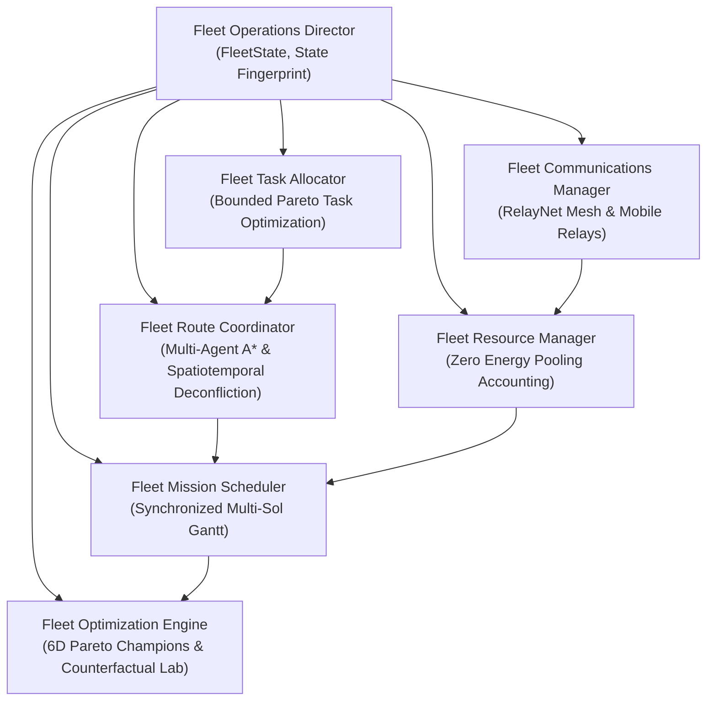

# Atlas Fleet Intelligence: Multi-Rover Operations Architecture
## MarsWalk 2.0 / Project Atlas — Milestone 13J Architecture Specification

**System Classification:** Autonomous Planetary Exploration Fleet Orchestration System  
**Planetary Body:** Mars (IAU 2000 Spheroid, $R = 3,396,190\text{ m}$)  
**Operational Area:** Jezero Crater Western Delta ($5.0 \times 5.0\text{ km}$, USGS CTX 20m DTM, DOI: `10.5066/P906QQT8`)  
**Primary Engine:** `src/marswalk/core/fleet_operations_director.py`  
**API Service Contract:** `schemas/api/v1/fleet-configuration.schema.json`, `fleet-state.schema.json`

---

## 1. Executive Summary & Purpose

Single-rover planetary missions (such as Mars 2020 *Perseverance* or MSL *Curiosity*) face fundamental physics and logistics constraints:
1. **Mobility Bottlenecks:** A single vehicle traverses slowly ($0.08–0.14\text{ m/s}$), limiting total campaign distance to ~15–25 km over multiple Earth years.
2. **Payload Capacity Limits:** A single chassis cannot carry specialized instruments for deep sub-surface sounding, high-energy X-ray spectrometry, Raman luminescence, deep mechanical coring, and long-range high-gain orbital relay dishes without exceeding mass and power margins.
3. **Single Point of Failure (SPOF):** An inoperable wheel actuator or damaged spectrometer permanently halts science return for the entire campaign.
4. **Geometric Line-of-Sight Blockages:** High crater rims and delta scarps frequently obscure direct line-of-sight (LOS) communications to surface base stations or Earth direct-to-Earth (DTE) passes.

Milestone 13J transforms Project Atlas into **cooperative multi-rover planetary exploration**. A fleet of heterogeneous robotic rovers works in concert across Jezero Crater to accomplish distributed science surveys, deconflicted traversal, dynamic mobile relay networking, and autonomous recovery from mission disturbances.

---

## 2. Fleet Architecture & Exploration Units

The baseline Atlas Jezero fleet comprises four specialized exploration rovers deployed from an initial landing cluster at the western Jezero Delta fan:

| Rover ID | Callsign / Name | Class | Mass | Usable Battery | Instruments Onboard | Primary Role |
| :--- | :--- | :--- | :--- | :--- | :--- | :--- |
| `ATLAS_ROVER_A` | **Rover Alpha** (*Science Lead*) | Robotic Rover | $1,025\text{ kg}$ | $5,000\text{ Wh}$ | PIXL, SHERLOC, MASTCAM-Z, MEDA | Petrologic & Astrobiological Contact Investigation |
| `ATLAS_ROVER_B` | **Rover Beta** (*Geophysical Surveyor*) | Robotic Rover | $1,025\text{ kg}$ | $4,800\text{ Wh}$ | RIMFAX, MASTCAM-Z, MEDA | Subsurface Ground Penetrating Radar Survey |
| `ATLAS_ROVER_C` | **Rover Gamma** (*Coring Specialist*) | Robotic Rover | $1,025\text{ kg}$ | $5,200\text{ Wh}$ | SHERLOC, CORING_TOOL, MASTCAM-Z | High-Priority Astrobiological Sample Caching |
| `ATLAS_ROVER_D` | **Rover Delta** (*Relay & Sentinel*) | Scout Rover | $720\text{ kg}$ | $4,400\text{ Wh}$ | MASTCAM-Z, MEDA, High-Gain X-Band Relay | Mobile Comms Node & Environmental Sentinel |

---

## 3. Strict Zero Energy Pooling Invariant

A central engineering principle of MarsWalk 2.0 is scientific integrity and physical rigor. In real space robotics, rovers on the surface of Mars cannot wirelessly beam electricity to one another or draw from a shared "energy reservoir".

$$\forall i, j \in \text{FleetRovers}, \quad i \neq j \implies \frac{\partial SOC_i}{\partial E_j} = 0$$

Under no circumstances does Atlas treat fleet energy as an aggregate pool where Rover A's deficit is covered by Rover B's battery surplus. Each rover maintains:
- An independent State of Charge ($SOC_{\text{rover}}$).
- Dedicated solar recharge calculations based on regional optical depth ($\tau$) and sol-specific insolation profiles.
- Individual reserve safety thresholds ($20–25\%$).
- Autonomous power shedding policies for science payloads when $SOC < SOC_{\text{reserve}}$.

Fleet energy metrics are reported strictly as diagnostic aggregate sums for mission directors.

---

## 4. Multi-Agent Coordination Pipeline

1. **Science Target Allocation:** Targets are distributed using bounded Pareto optimization, strictly matching scientific objectives to onboard instrument capabilities (`INSTRUMENT_CATALOG`).
2. **Terrain-Aware Traversal:** Per-rover routes are calculated on the authentic USGS CTX 20m DTM, factoring elevation, gradient, terrain roughness, and solar aspect angle.
3. **Spatiotemporal Occupancy & Deconfliction:** Traverses are discretized into 4D space-time occupancy intervals $(r, c, t_{\text{start}}, t_{\text{end}})$. Proximity conflicts ($<40\text{ m}$) are automatically resolved via scheduling holds or ridge detours.
4. **RelayNet Mesh Optimization:** Geometric Line-of-Sight is evaluated between all rovers, deployed surface relays, and the Base Station. Rover Delta dynamically assumes mobile relay duty when rovers descend into deep canyons or delta valleys.
5. **Synchronized Multi-Sol Execution:** Sols 1–5 are orchestrated with parallel rover activity lanes, respecting diurnal cycles, observation dwell periods, and downlink passes.
6. **Counterfactual Resilience:** When an exploration unit encounters an anomaly (e.g. F1 hardware failure, F2 relay outage), the fleet autonomously synthesizes an alternative plan reassigning orphaned objectives and re-optimizing traverse networks.

---

## 5. State Machine & Cryptographic Verification

The Fleet Operations Director maintains a deterministic state machine:
- `PROPOSED` $\rightarrow$ `ALLOCATED` $\rightarrow$ `ROUTED` $\rightarrow$ `SCHEDULED` $\rightarrow$ `AVAILABLE` $\rightarrow$ `EXECUTING` $\rightarrow$ `CONTINGENCY_RECOVERY`
- Each state transition is logged in an append-only event stream.
- The state is cryptographically fingerprinted using a SHA-256 Merkle digest:

$$\text{RootDigest} = \text{SHA256}(\text{FleetID} \parallel \text{Version} \parallel \text{RoversHash} \parallel \text{AllocationsHash} \parallel \text{RoutesHash})$$

This guarantees auditability and prevents concurrent state overwrites during critical mission planning.
