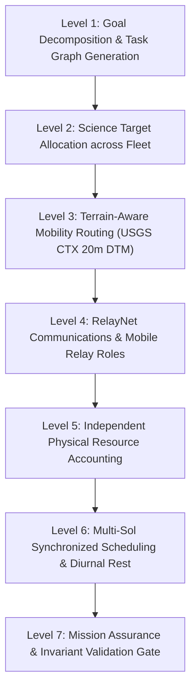

# MarsWalk 2.0 / Project Atlas — Hierarchical Fleet Planning Solver Methods

## 1. Multi-Level Hierarchical Synthesis

Rather than attempting an intractable monolithic mixed-integer non-linear program (MINLP), the solver decomposes the planning problem into seven specialized hierarchical stages:

---

## 2. Eight Strategic Operational Postures

The compiler synthesizes a portfolio of 8 structurally distinct candidate plans representing different mission design philosophies:

1. **`BALANCED`:** Harmonic trade-off across science, energy, time, and communications.
2. **`SCIENCE_MAXIMIZING`:** Aggressive target visitation, deeper battery discharge, multi-instrument passes.
3. **`ENERGY_EFFICIENT`:** Conservative traverse speeds, short paths, high battery reserve ($\ge 35\%$).
4. **`COMMUNICATIONS_FOCUSED`:** Maximizes line-of-sight reachability, prioritizes ridge relay deployment and mobile relay peering.
5. **`MINIMUM_DURATION`:** High-speed sortie compressing full campaign into fewest sols.
6. **`ROBUSTNESS_FOCUSED`:** Wide safety buffers, terrain slope margin, and redundant observations.
7. **`MINIMUM_INFRASTRUCTURE`:** Zero stationary relays deployed; relies on direct base line-of-sight and ad-hoc rover mesh.
8. **`DATA_RETURN_FOCUSED`:** Aggressive downlink scheduling, clearing onboard flash buffers to zero backlog.

---

## 3. Structural Deduplication & Non-Dominated Pareto Frontier

### Structural Deduplication
Each synthesized candidate is fingerprinted using a deterministic SHA-256 digest of its active rovers, target assignments, relay placements, and schedule topology. Exact duplicates are eliminated before evaluation.

### Non-Dominated Pareto Frontier ($\mathcal{P}^*$)
A candidate $\mathbf{x}_1$ dominates $\mathbf{x}_2$ ($\mathbf{x}_1 \succ \mathbf{x}_2$) iff:
$$\forall k \in \mathcal{K}, \quad f_k(\mathbf{x}_1) \ge f_k(\mathbf{x}_2) \quad \text{and} \quad \exists k' \in \mathcal{K}: f_{k'}(\mathbf{x}_1) > f_{k'}(\mathbf{x}_2)$$
where objectives include Science Utility, Battery Reserve Margin, Comms Reachability, and Energy Minimization. Candidates on $\mathcal{P}^*$ are designated as **Pareto Champions**.
