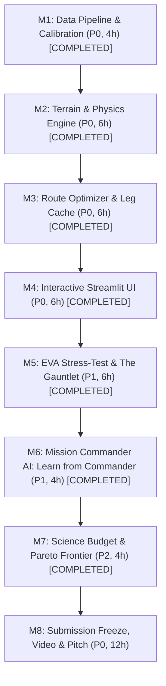

# MarsWalk — Mission Rehearsal: Implementation Roadmap

**Project:** MarsWalk — Mission Rehearsal  
**Document Status:** Approved Roadmap & Milestone Backlog  
**Workspace:** `E:\Python\NASA-Spaceapps\Marswalk`  
**Developer Track:** Solo Intermediate-Python Developer (Phased for Teammate Integration)

---

## 1. Development Principles & Phasing Strategy

To ensure a robust, high-scoring NASA Space Apps submission within tight hackathon timelines, development follows four strict engineering principles:
1. **Zero Hallucinated Data:** Only authentic, verified USGS/NASA planetary datasets with explicit coordinate reference systems, provenance citations, and physical units are used.
2. **Deterministic Physics Before Visuals:** Algorithms and geodetic math are tested and verified via `pytest` before user-interface elements are built.
3. **Graceful Degradation & Explicit Fallbacks:** Every external data service (e.g., online WMTS tile streams) has an offline, self-contained fallback (pre-rendered local hillshade).
4. **Hard Feature Freeze:** All code changes cease 12 hours prior to the final submission deadline, dedicating the remaining time entirely to presentation recording, slide design, and repository documentation.

---

## 2. Milestone Architecture & Master Schedule

---

## 3. Milestone Specifications & Acceptance Criteria

### Milestone 1: Environment Setup, Data Ingestion & Spatial Calibration
* **Priority:** P0 (Core Foundation)
* **Estimated Effort:** 4.0 Hours
* **Owner:** Solo Developer
* **Dependencies:** None
* **Scope & Tasks:**
  1. Inspect the local workspace and initialize a project-local virtual environment (`.venv`).
  2. Identify minimum required packages (`rasterio`, `numpy`, `scipy`, `pytest`).
  3. Obtain user approval and fetch the verified 9.21 MB USGS CTX GeoTIFF from the verified S3 CDN repository.
  4. Create `src/marswalk/data/ingest.py` to inspect the raster's CRS, affine transform, dimensions, NoData value, and elevation distribution.
  5. Derive the calibrated $250 \times 250$ pixel ($5.0\text{ km} \times 5.0\text{ km}$) study-area crop centered on the Western Delta Front and save it to `data/processed/jezero_ready_20m.tif`.
  6. Create `data/waypoints_jezero.json` with primary PDS metadata for 6 core exploration targets.
  7. Write automated tests for coordinate transforms and ground truth benchmarks.
* **Concrete Acceptance Criteria:**
  - `data/processed/jezero_ready_20m.tif` loads in Python with shape `(250, 250)` and valid 32-bit floating point elevations.
  - TC-08 passes: Planetocentric coordinates convert to grid pixel $(r, c)$ and invert back with $<0.0002^\circ$ ($<12\text{ m}$) error.
  - TC-09 passes: Octavia E. Butler Landing elevation resolves within $-2570 \pm 25\text{ m}$.

---

### Milestone 2: Terrain Physics Engine & Geodetic Math
* **Priority:** P0 (Core Foundation)
* **Estimated Effort:** 6.0 Hours
* **Owner:** Solo Developer
* **Dependencies:** Milestone 1
* **Scope & Tasks:**
  1. Implement `src/marswalk/core/terrain.py`.
  2. Implement local ground-distance metric scaling taking into account latitude compression ($\Delta x_{\text{ground}} = \Delta c \cdot 20.0 \cdot \cos(18.44^\circ) \approx 18.973\text{ m}$).
  3. Implement Horn's 3×3 weighted finite-difference slope kernel.
  4. Implement moving-window decameter roughness proxy $\sigma_r$ ($3\times3$ standard deviation).
  5. Implement NoData mask with 1-pixel morphological dilation using `scipy.ndimage.binary_dilation`.
  6. Calculate directed edge cost $C(u \to v)$ in equivalent flat-terrain meters.
* **Concrete Acceptance Criteria:**
  - TC-01 passes: Flat plane geodesic distance over 10 diagonal steps equals $282.84 \pm 0.01\text{ m}$.
  - TC-02 passes: Analytical $15^\circ$ inclined ramp yields $15.00^\circ \pm 0.05^\circ$ slope across interior pixels.
  - TC-04 passes: NoData sentinel ($\le -32768$) and 1-px dilated buffer are assigned infinite traversal cost ($C = \infty$).

---

### Milestone 3: Route Optimizer & Pairwise Leg Cache
* **Priority:** P0 (Core Foundation)
* **Estimated Effort:** 6.0 Hours
* **Owner:** Solo Developer
* **Dependencies:** Milestone 2
* **Scope & Tasks:**
  1. Implement `src/marswalk/core/planner.py`.
  2. Implement 8-connected grid A* pathfinding using the admissible octile distance heuristic.
  3. Implement startup multi-source Dijkstra leg cache for $(K+2) \times (K+2)$ pairwise routes between Start, Goal, and $K=6$ science waypoints.
  4. Implement 3-profile solver:
     - **Conservative:** Direct minimum-cost path from Start to Goal.
     - **Science-First:** Least-cost TSP ordering visiting all active waypoints.
     - **Balanced:** Exact subset enumeration maximizing utility $E_{\text{eff}}(W_{\text{sub}})$.
* **Concrete Acceptance Criteria:**
  - TC-03 passes: Impassable $32^\circ$ cliff barrier ($\ge 25^\circ$) is never crossed; path cleanly routes through the available gap.
  - TC-05 passes: Unreachable goal surrounded by $35^\circ$ cliff returns empty path and `cost = inf`.
  - TC-06 (Corrected) passes: Evaluated under the baseline metric, $J(Cons) \le J(Bal) \le J(Sci)$ and $S(Cons) \le S(Bal) \le S(Sci)$.
  - TC-07 passes: Setting $\alpha_s = \alpha_r = \alpha_{up} = 0$ collapses the route to the shortest octile Euclidean distance.
  - TC-10 passes: Startup cache + 3-profile solve completes in $<1.50\text{ s}$ on a single CPU thread.

---

### Milestone 4: Baseline Interactive Streamlit Workstation
* **Priority:** P0 (Core Foundation)
* **Estimated Effort:** 6.0 Hours
* **Owner:** Solo Developer
* **Dependencies:** Milestone 3
* **Scope & Tasks:**
  1. Build `src/marswalk/app.py` utilizing Streamlit, Plotly, and Folium.
  2. Construct the dark-mode layout (`#0B0F19` obsidian canvas, `#FF5722` accents).
  3. Render the local 2D terrain canvas: hillshade background, semi-transparent slope hazard heatmaps ($>15^\circ$ amber, $\ge 25^\circ$ red), clickable waypoint markers, and color-coded route polylines.
  4. Build dual-axis Plotly Elevation & Slope profile chart along the active route.
  5. Build side-by-side KPI comparison cards (Distance, Terrain Effort, Science Harvested).
* **Concrete Acceptance Criteria:**
  - Application launches cleanly with `streamlit run src/marswalk/app.py`.
  - Selecting Conservative, Balanced, or Science-First updates the map polyline and telemetry deck in $<200\text{ ms}$.
  - Plotly profile dynamically tracks the active path with synchronized hover tooltips.

---

### Milestone 5: EVA Stress-Test & Dynamic Scenario Engine
* **Priority:** P1 (Signature Differentiator)
* **Estimated Effort:** 6.0 Hours
* **Owner:** Solo Developer
* **Dependencies:** Milestone 4
* **Scope & Tasks:**
  1. Implement `src/marswalk/core/stress_test.py`.
  2. Add scenario injection controls to the sidebar:
     - Blocked corridor toggle (Hawksbill Gap rockfall anomaly).
     - Walking distance budget slider ($20\%\text{ to }50\%$ reduction).
     - Target dropout toggle (e.g., Kodiak Butte inaccessible).
  3. Replan traverse using the cached leg network and evaluate feasibility.
  4. Render Baseline vs. Stress-Tested overlay comparison (Original: faded dashed; Modified: bright solid).
  5. Implement `src/marswalk/core/explainer.py` to generate deterministic, plain-language explanations of route adaptations.
* **Concrete Acceptance Criteria:**
  - Blocking Hawksbill Gap immediately shifts the route through the southern pass and flags the added distance.
  - Reducing budget below the full science requirement automatically sheds the lowest-efficiency waypoint and reports the dropped target.
  - Explainer card outputs clear, mathematically accurate rationale for why the route changed.

---

---

### Milestone 6: Mission Commander AI: Learn from the Commander [COMPLETED]
* **Priority:** P1 (Adaptive AI & Personalization)
* **Estimated Effort:** 4.0 Hours
* **Status:** Verified & Complete (15 new unit & integration tests, 67 total tests passing)
* **Owner:** Solo Developer
* **Dependencies:** Milestone 5 (The Gauntlet & Scenario Engine)
* **Scope & Tasks:**
  1. Implement `src/marswalk/core/preferences.py`:
     - Dataclasses: `RouteFeatures`, `CandidateOption`, `PreferenceObservation`, `RankedRoute`.
     - Enum: `LearningState` (`untrained`, `collecting_initial`, `personalized`, `reset`).
     - Feature extraction: normalized distance ($10\text{ km}$), modeled terrain cost ($20\text{k}$), science points ($250\text{ pts}$), and elevation climb ($500\text{ m}$), clamped to $[0, 2]$.
     - Convex Bradley-Terry model with L2 regularization ($\lambda = 1.0$), optimized via `scipy.optimize.minimize` (L-BFGS-B).
     - Strict hard constraint enforcement: unreachable, budget-exceeded, or invalid paths excluded from ranking.
     - Dual-voice preference narrative generator (*Professional* vs. *Dry Humour*).
     - Local JSON persistence at `data/preferences/commander_preferences.json` (git-ignored) with atomic writes and deterministic SHA-256 deduplication hashing.
  2. Implement unit and integration test suite `tests/test_preferences.py` (15 passing tests: TC-01 through TC-16).
  3. Integrate Mission Commander AI into `src/marswalk/app.py`:
     - Sidebar Section 6: toggle, learning state badge, preference history dataframe, download JSON button, reset button.
     - Main Analytics Card: commander status narrative, top utility recommendation callout, ranking table of feasible candidate routes, and explicit choice recording widget.
     - Gauntlet scenario integration: evaluates and ranks surviving candidates across disrupted scenarios.
  4. Update `tests/test_app.py` to verify preferences storage path and directory structure integrity.
* **Concrete Acceptance Criteria:**
  - **AC-09 Verified:** Model transitions cleanly through `untrained` $\to$ `collecting_initial` $\to$ `personalized` ($\ge 3$ choices) $\to$ `reset`.
  - Impassable/unfeasible routes are never recommended regardless of score.
  - Zero network telemetry leakage; data stored exclusively in local JSON.
  - All 67 project tests pass with zero warnings/regressions.

---

### Milestone 7: The Science Budget & Interactive Pareto Analysis [COMPLETED]
* **Priority:** P2 (Extended Science Analysis & Trade-Off Intelligence)
* **Estimated Effort:** 4.0 Hours
* **Status:** Verified & Complete (15 new unit & integration tests, 84 total tests passing)
* **Owner:** Solo Developer
* **Dependencies:** Milestone 6
* **Scope & Tasks:**
  1. Implement `src/marswalk/core/science_budget.py`:
     - Dataclasses: `CandidatePlan`, `FrontierResult`.
     - Exact evaluation of all $2^K \le 64$ waypoint subsets and TSP orderings via precomputed pairwise leg cache.
     - Strict distinction of physical distance [m], modeled terrain cost [flat-m], scientific priority points [pts], feasibility, and Commander AI utility.
     - Mathematical Pareto dominance: 2D minimum viable frontier ($d, S$) and 3D full frontier ($d, J, S$).
     - Sensitivity analysis and Gauntlet stress-test comparison (`compare_frontiers`).
     - Dual-voice narrative generator (`generate_science_budget_narrative`).
     - Telemetry export: `export_mission_brief_csv` and `export_mission_brief_json`.
  2. Implement comprehensive test suite `tests/test_science_budget.py` (15 passing tests: TC-01 through TC-16).
  3. Integrate into `src/marswalk/app.py`:
     - Section: `🔬 SCIENCE BUDGET — EXPLORATION TRADE-OFFS & PARETO FRONTIER`.
     - Interactive Plotly chart with 2D / 3D dimensionality toggle, Pareto frontier connecting lines, and distinct profile markers.
     - Candidate plan inspector with live tactical map overlay in Cyan (`#00E5FF`).
     - Gauntlet disruption comparison cards (severed plans, retained frontier, lost science ceiling).
     - Dual recommendations comparison (Science Budget policy vs Commander AI learned utility).
     - One-click CSV and JSON download buttons.
  4. Update `tests/test_app.py` with 2D/3D chart rendering and inspected candidate overlay tests.
* **Concrete Acceptance Criteria:**
  - **AC-10 Verified:** Evaluates all candidate plans in $<0.05\text{ s}$ via cached leg network; correctly distinguishes 2D and 3D non-dominated sets; enforces hard feasibility constraints; exports valid CSV/JSON briefs; all 84 project tests pass.

---

### Milestone 8: Hard Feature Freeze, Pitch Deck, Video & Attribution
* **Priority:** P0 (Submission Requirement)
* **Estimated Effort:** 12.0 Hours (Window: Final 12 Hours before deadline)
* **Lead:** Teammate (Member B) + Solo Developer (Member A)
* **Dependencies:** Milestones 1–5 complete
* **Scope & Tasks:**
  1. **Enforce Hard Feature Freeze:** Zero functional code edits allowed; only bug fixes and documentation.
  2. Complete `README.md` with installation commands, architectural diagram, and formal NASA/USGS citations.
  3. Design 7-slide Space Apps presentation deck following the 3-minute script in Section 17 of the research blueprint.
  4. Record 30-second summary video and 3-minute comprehensive demonstration video showcasing the Streamlit UI.
  5. Submit repository link, presentation, and video before the Sunday 11:59 PM deadline.
* **Concrete Acceptance Criteria:**
  - 100% of test suite passes cleanly with `pytest`.
  - Presentation and video clearly demonstrate the signature EVA Stress-Test feature.
  - Submitted 4 hours ahead of deadline.

---

## 4. Explicit Go / No-Go Verification Gates

| Checkpoint Hour | Go / No-Go Verification Gate | Mandatory Fallback Action if Gate Fails |
|:---|:---|:---|
| **Hour 4 Gate (Data Ingestion)** | Does the 9.2 MB CTX GeoTIFF download cleanly and load with valid elevations in Python? | Run offline synthetic ramp generator (`tests/generate_synthetic_jezero.py`) to keep core engine development moving unblocked. |
| **Hour 10 Gate (Physics & Slope)** | Do Horn's slope and NoData dilation pass unit tests TC-01..04 within strict numerical tolerances? | Revert to standard 2nd-order central differences with explicit edge padding. |
| **Hour 16 Gate (Solve Benchmark)** | Does the pairwise leg cache and 3-profile solver execute in $<1.5\text{ s}$ on single CPU core? | Reduce active science waypoints from $K=6$ to $K=5$ ($32$ subsets) or downsample analysis grid to $125 \times 125$ ($40\text{ m/px}$). |
| **Hour 26 Gate (Map Rendering)** | Does the Streamlit map render without CRS shift or Leaflet projection distortion? | Switch entirely to rendering the local GeoTIFF hillshade array via Plotly/Matplotlib image overlay. |
| **Hour 36 Gate (Feature Freeze)** | Are the 3 profiles and EVA Stress-Test working reliably end-to-end? | **Hard Freeze.** Drop all remaining P2 stretch goals (Milestone 7) and spend the remaining 12 hours on video, slides, and documentation. |

---

## 5. Teammate Hand-Off & Modular Task Division

When your teammate (Member B) joins the project, assign these self-contained tasks that run in parallel without blocking algorithm development:

1. **Science Waypoint Catalog Enrichment (`data/waypoints_jezero.json`):**
   - Research and add detailed geological descriptions for Three Forks, Hawksbill Gap, and Belva Crater from published Mars 2020 literature (Farley et al., 2022; Stack et al., 2020).
   - Document CRISM spectral absorption bands (smectite clays, Mg-carbonates).
2. **Authored Humour & Narrative Voice Bank:**
   - Expand the deterministic message templates for both *Professional* and *Dry Humour* voices in `src/marswalk/core/explainer.py`.
3. **Pitch Deck & Visual Assets:**
   - Create the 7-slide Space Apps deck in Google Slides / PowerPoint.
   - Design custom mission-control badge graphic and icon set for the UI header.
4. **Demonstration Video Production:**
   - Script, screen-record, and edit the 30-second teaser and 3-minute detailed walkthrough video.
5. **NASA / USGS Data Provenance Audit:**
   - Ensure every dataset citation, DOI, and NASA mission acknowledgment complies with Space Apps rules.
