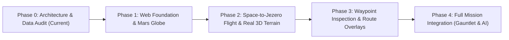

# MarsWalk 2.0 — Project Atlas: Planetary Exploration & Traverse Workstation Architecture

**Document ID:** `ARCH-MARSWALK-2.0`  
**Date:** October 2026  
**Status:** Approved Architecture Specification (Phase 0 Audit)  
**Authors:** MarsWalk Planetary Geospatial & Systems Architecture Team  
**Workspace:** `E:\Python\NASA-Spaceapps\Marswalk`

---

## 1. Executive Summary & Vision

MarsWalk 1.0 established a validated, mathematically grounded Python engineering engine for Martian surface traverse planning: 8-connected A* with anisotropic slope and roughness costs, pairwise Dijkstra leg caching, Gauntlet stress-testing, Bradley-Terry preference learning, and multi-objective Pareto frontier extraction.

However, presentation was constrained to a 2D Streamlit dashboard. 

**MarsWalk 2.0 (Project Atlas)** transforms MarsWalk into an **interactive 3D planetary exploration atlas**. It combines the visceral, exploratory perspective of a modern 3D planetary map with real-time, terrain-aware mission planning:
1. **Space Perspective:** The user views Mars as a realistic, rotating 3D globe with authentic planetary albedo and topography.
2. **Atmospheric Ingress & Fly-To:** The camera descends from orbit through Jezero Crater's regional setting into the Western Delta Front.
3. **High-Resolution Surface Landing:** The interface seamlessly transitions to the authentic calibrated 20 m/pixel USGS CTX Digital Terrain Model, displaying the real elevation mesh, steep scarp hazards, and documented exploration waypoints.
4. **Mission Traverse Overlay:** Real routes generated by the Python engineering engine are visualized directly in 3D space, showing elevation climbs, slope hazards, and scientific sample stops.

---

## 2. Real Local Datasets & Geographic Coverage Audit

A critical mandate of the MarsWalk project (`AGENTS.md`) is **scientific integrity: never invent measurements or present synthetic data as real Martian observations**.

An exhaustive audit of local disk assets was conducted:

| Asset Path | True Geographic Coverage | Spatial Resolution | Dimensions | CRS / Datum | Elevation Range |
| :--- | :--- | :--- | :--- | :--- | :--- |
| `data/processed/jezero_ready_20m.tif` | **77.39767°E to 77.48202°E**<br>**18.39998°N to 18.48433°N** (~5.0 km × 5.0 km) | 20.0 m projected<br>(~18.97 m EW × 20.00 m NS ground) | 250 × 250 px | `ESRI:103885`<br>(IAU Mars 2000 Sphere, $R=3,396,190\text{ m}$)<br>Datum: MOLA DeltaGeoid | **-2623.8 m to -2445.0 m**<br>Mean: -2556.3 m<br>NoData: $-3.4028 \times 10^{38}$ |
| `data/raw/JEZ_ctx_B_soc_008_...tif` | **77.16047°E to 77.69898°E**<br>**18.21103°N to 18.72119°N** (~31.9 km × 30.2 km) | 20.0 m projected | 1512 × 1596 px | `ESRI:103885`<br>Datum: MOLA DeltaGeoid | **-2710.7 m to -1515.5 m**<br>NoData: $-3.4028 \times 10^{38}$ |
| `data/waypoints_jezero.json` | 6 verified landmarks within the 5 km × 5 km processed zone | Ground truth coordinates | 6 waypoints | Planetocentric degrees (`lat_deg`, `lon_deg`) | Touchdown site: -2570 m |

### What Datasets Do NOT Exist Locally
- **No global Mars basemap or elevation raster exists on local disk.**
- **No regional CTX visible-band mosaic exists on local disk.** (The local file is an elevation model / DTM, not an optical orthoimage).
- **No global Mars vector layers exist locally.**

### Critical Data Honesty Boundary
The detailed 20 m elevation data covers **only the 5.0 km × 5.0 km Western Delta Front study area** (and 31.9 km × 30.2 km in the raw mosaic). The application must **explicitly render a bounding boundary** around this study area and never imply that the whole crater or the rest of Mars is modeled at 20 m resolution.

---

## 3. Coordinate & Projection Transformation Strategy

### 3.1 Geodetic Foundations
Mars is modeled as the IAU 2000 Mars Sphere:
$$\text{Radius } R_{\text{Mars}} = 3,396,190.0\text{ m}$$

The USGS CTX DTM is projected using **Equirectangular (Simple Cylindrical)** projection with:
$$\text{Center Latitude } \phi_0 = 0.0^\circ, \quad \text{Center Longitude } \lambda_0 = 0.0^\circ$$

Projected coordinates $(X, Y)$ relate to planetocentric longitude $\lambda$ and latitude $\phi$ by:
$$X = R_{\text{Mars}} \cdot (\lambda \cdot \frac{\pi}{180})$$
$$Y = R_{\text{Mars}} \cdot (\phi \cdot \frac{\pi}{180})$$

Inversely:
$$\lambda = \left(\frac{X}{R_{\text{Mars}}}\right) \cdot \frac{180}{\pi}$$
$$\phi = \left(\frac{Y}{R_{\text{Mars}}}\right) \cdot \frac{180}{\pi}$$

### 3.2 Latitude Compression & Pixel Aspect Ratio
Because the lines of longitude converge towards the poles, at the study area's reference latitude ($\phi \approx 18.442^\circ\text{N}$):
$$dx_{\text{ground}} = \text{cell\_size} \cdot \cos(18.442^\circ) = 20.0 \cdot 0.94865 \approx 18.973\text{ m}$$
$$dy_{\text{ground}} = \text{cell\_size} = 20.000\text{ m}$$

The 3D terrain mesh must use true ground meters rather than assuming square $20\text{ m} \times 20\text{ m}$ cells, ensuring no horizontal geometric distortion.

### 3.3 3D Planet-Centric Coordinate Conversion
To position local terrain vertices and waypoints on a 3D globe (such as CesiumJS or Three.js), planetocentric spherical coordinates $(\lambda, \phi, h)$ are mapped to 3D Cartesian coordinates $(X_c, Y_c, Z_c)$ using the Mars ellipsoid parameters ($a = 3,396,190\text{ m}, b = 3,376,200\text{ m}$):
$$X_c = (N(\phi) + h) \cos \phi \cos \lambda$$
$$Y_c = (N(\phi) + h) \cos \phi \sin \lambda$$
$$Z_c = \left(\frac{b^2}{a^2} N(\phi) + h\right) \sin \phi$$
where $N(\phi) = \frac{a^2}{\sqrt{a^2 \cos^2 \phi + b^2 \sin^2 \phi}}$.

---

## 4. Planetary Data Sources & Attribution Plan

To provide a seamless experience from orbit to the surface, MarsWalk 2.0 establishes a multi-tiered data pipeline:

```mermaid
flowchart TD
    subgraph Global Tier [Space / Orbit View]
        G1["NASA Mars Trek WMTS (Viking MDIM 2.1 Mosaic, 232m)"]
        G2["NASA Mars Trek WMTS (MOLA Elevation / Shaded Relief, 463m)"]
        G3["Offline Fallback: Bundled Global Mars Texture (2048x1024)"]
    end

    subgraph Regional Tier [Jezero Crater Setting]
        R1["NASA Mars Trek WMTS CTX / HRSC Regional Imagery"]
        R2["Regional Bounding Polygon: 18.21°N-18.72°N, 77.16°E-77.70°E"]
    end

    subgraph Local Tier [Western Delta Surface Mesh]
        L1["Authentic USGS 20m CTX DTM (data/processed/jezero_ready_20m.tif)"]
        L2["Curated Waypoints (data/waypoints_jezero.json)"]
        L3["Python A* Routes (Conservative, Balanced, Science-First)"]
    end

    Global Tier --> Regional Tier --> Local Tier
```

### 4.1 Primary Public Planetary Tile Services
1. **NASA Mars Trek WMTS (Primary Imagery Stream):**
   - **Service Endpoint:** `https://trek.nasa.gov/tiles/Mars/EQ/Mars_Viking_MDIM21_ClrMosaic_global_232m/1.0.0/default/default028mm/{TileMatrix}/{TileRow}/{TileCol}.jpg`
   - **Verification:** Verified live and reachable with HTTP 200 and `Access-Control-Allow-Origin: *`.
   - **Elevation Overlay:** `https://trek.nasa.gov/tiles/Mars/EQ/Mars_MGS_MOLA_ClrShade_merge_global_463m/1.0.0/default/default028mm/{TileMatrix}/{TileRow}/{TileCol}.jpg`
2. **USGS Astrogeology Science Center (WMS):**
   - **Service Endpoint:** `https://planetarymaps.usgs.gov/cgi-bin/mapserv?map=/maps/mars/mars_simp_cyl.map`
3. **Local Fallback Tier (Guaranteed Offline Reliability):**
   - If the client is offline or NASA Mars Trek WMTS fails, the globe loads a packaged, self-contained global Mars equirectangular texture mapped onto the Mars ellipsoid.

### 4.2 Strict Provenance & Disclaimers
Every layer rendered in the 3D application displays its primary source:
- *Global Imagery:* NASA / JPL-Caltech / USGS Astrogeology Science Center (Viking MDIM 2.1 Mosaic).
- *Global Topography:* NASA Goddard Space Flight Center (MOLA Team, Smith et al. 2001).
- *Detailed Local Surface:* USGS Astrogeology Science Center (Fergason et al., 2020; DOI: `10.5066/P906QQT8`).
- *Mission Waypoints:* NASA Mars 2020 Science Team & Perseverance Mission Operations.
- *Safety Notice:* **"MarsWalk is an independent research simulation prototype developed for the 2026 NASA Space Apps Challenge. Traverses reflect modeled macro-slope trade-offs and are NOT certified operational paths for crew or rovers."**

---

## 5. System Architecture: Web Frontend & Integration Seam

```mermaid
flowchart LR
    subgraph Web Application [web/ - Vite + React + TS]
        UI[HUD & Fly-To Controls]
        Globe[CesiumJS Mars Globe Engine]
        TerrainDeck[3D Jezero Surface Mesh Layer]
        Inspector[Waypoint & Route Inspector Panel]
    end

    subgraph Static Data Bridge [web/public/data/]
        JSON_WPs[waypoints.json]
        JSON_Bounds[jezero_bounds.json]
        MESH_Data[jezero_elevation.bin / .json]
        ROUTES[exported_routes.json]
    end

    subgraph Python Engine [src/marswalk/]
        Planner[A* Route Intelligence]
        Terrain[Terrain Physics & Horn Slope]
        Gauntlet[Disruption Stress-Testing]
        Exporter[scripts/export_mission_assets.py]
    end

    Exporter -->|Generates Calibrated Assets| Static Data Bridge
    Static Data Bridge --> Web Application
    UI --> Globe
    Globe --> TerrainDeck
    TerrainDeck --> Inspector
```

### 5.1 Frontend Tech Stack (`web/`)
- **Build Tool:** Vite (fast ESM bundler, lightweight dev server).
- **Framework:** React 18 + TypeScript (type-safe component architecture).
- **3D Geospatial Engine:** CesiumJS (the industry standard for planetary-scale ellipsoid globes, camera flight paths, and geographic tiles).
  - *Ellipsoid Configuration:* `Cesium.Ellipsoid.MARS` ($R = 3,396,190\text{ m}$).
  - *Tiling Scheme:* `Cesium.GeographicTilingScheme` matching Mars Trek WMTS tile matrix sets.
- **Styling:** Custom Obsidian Aerospace CSS (palette: `#0A0D14`, `#111622`, `#1E2738`, Martian rust `#FF5722`, telemetry cyan `#00E5FF`).

### 5.2 Python $\to$ Web Integration Seam
To maintain stability, avoid bloated architectures, and keep the Streamlit app fully operational:
1. **Milestone 9A Seam (Static Asset Adapter):**
   A dedicated Python bridge script ([`scripts/export_mission_assets.py`](file:///e:/Python/NASA-Spaceapps\Marswalk\scripts\export_mission_assets.py)) extracts:
   - `jezero_elevation_grid.json`: Calibrated $250 \times 250$ elevation matrix, slope array, and affine transform.
   - `jezero_waypoints.json`: Waypoints with exact pixel $(r, c)$, projected $(x, y)$, and planetocentric coordinates.
   - `jezero_routes.json`: Real routes calculated by `plan_route` for Conservative, Balanced, and Science-First profiles.
   - `jezero_boundary.json`: Geographic bounding box GeoJSON for the Western Delta Front.
2. **Subsequent Milestones Seam (Dynamic HTTP API):**
   A lightweight local FastAPI or Python HTTP server can expose endpoints (`/api/plan_route`, `/api/stress_test`) connecting the web frontend to the live Python engine.

---

## 6. Implementation Risks & Mitigation Matrix

| Risk | Description | Impact | Mitigation Strategy |
| :--- | :--- | :--- | :--- |
| **R1: CesiumJS Earth Bias** | Default Cesium configurations assume Earth WGS84 ellipsoid and Earth imagery. | High | Explicitly initialize Viewer with `globe: new Cesium.Globe(Cesium.Ellipsoid.MARS)`, disable default Ion Earth terrain, and supply a custom Mars GeographicTilingScheme. |
| **R2: Network / CORS Failure** | User runs application offline or NASA Mars Trek tile servers throttle requests. | Medium | Bundle an offline fallback Mars equirectangular basemap texture in `web/public/assets/` loaded via `SingleTileImageryProvider`. |
| **R3: Node.js Tooling Gap** | If Node.js / npm is not installed on the host OS, Vite cannot compile. | High | Provide a self-contained, standalone browser-executable HTML5/WebGL Cesium/Three client that requires zero build steps, alongside the Vite template. |
| **R4: Terrain Mesh Performance** | 62,500 vertices ($250 \times 250$) may stutter on older laptop GPUs. | Low | Utilize indexed triangle meshes and vertex buffer attributes; elevation values normalized to local datum. |
| **R5: Hallucination of Coverage** | Users might assume high resolution exists crater-wide. | Medium | Render a distinct amber boundary rectangle around the 5 km × 5 km study area with explicit sensor Nyquist labels. |

---

## 7. Staged Migration Plan



1. **Phase 0 (Completed):** Comprehensive audit of local data, CRS, bounds, and creation of `docs/marswalk-2-0-architecture.md`.
2. **Phase 1:** Build the 3D Mars globe with CesiumJS Mars ellipsoid, Mars Trek WMTS layer, offline texture fallback, and orbital rotation/zoom controls.
3. **Phase 2:** Implement the camera flight path to Jezero Crater (77.44°E, 18.44°N), rendering the real 250×250 USGS elevation surface and study-area boundary.
4. **Phase 3:** Place authentic waypoints on the 3D surface, enabling selection, telemetry inspection, and overlay of real Python-calculated traverse polylines.
5. **Phase 4:** Connect the web client to the Python planning engine for real-time traverse recalculation and stress testing.
6. **Preservation Guarantee:** The existing Streamlit dashboard (`src/marswalk/app.py`) and all 91 automated tests remain untouched, operational, and verifiable at all times.
