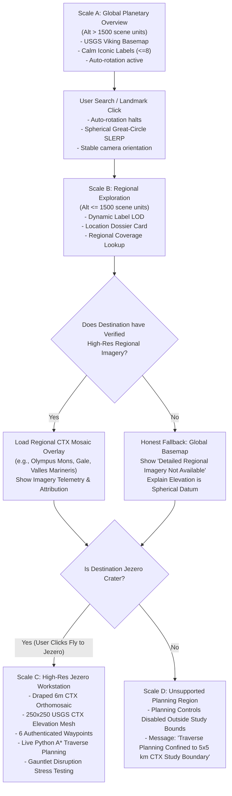

# MarsWalk 2.0 — Multi-Scale Planetary Map Architecture
**Document Version:** 1.0.0  
**Target Body:** Mars (IAU 2000 Planetocentric Sphere, $R = 3,396,190\text{ m}$)  
**Milestone:** 9E — Multi-Scale Planetary Exploration  

---

## 1. Executive Summary

MarsWalk Project Atlas combines global planetary exploration with meter-scale surface mission planning. To make Mars feel like a unified, continuous planetary map (analogous to Google Maps for Mars), the system transitions across four distinct geographic and cartographic scales:

1. **Scale A — Planetary Orbit Overview:** Global context utilizing authentic USGS Viking MDIM 2.1 color basemap with curated iconic planetary landmarks.
2. **Scale B — Regional Exploration:** Deliberate search and camera navigation to named planetary features (e.g., Olympus Mons, Gale Crater, Valles Marineris) with progressive cartographic label LOD, regional imagery layer selection, and location dossier cards.
3. **Scale C — Detailed Terrain Workstation (Jezero Crater):** Sub-meter surface planning utilizing high-resolution USGS CTX DTM elevation (20 m) and draped NASA Mars Trek CTX orthomosaic (6 m), with authentic A* traverse routing, slope hazards, and Gauntlet stress testing.
4. **Scale D — Unsupported High-Resolution Regions:** Clear, honest boundary reporting when a location lacks high-resolution DEM or regional orthomosaics, preventing synthetic data or false claims of rover path safety.

---

## 2. Audit of Existing Data & Rendering Systems

### 2.1 Global Basemap Imagery
- **Product Name:** USGS Viking Mars Digital Image Model (MDIM 2.1) Color Mosaic
- **Asset Path:** `web/assets/mars_viking_color_fallback.jpg`
- **Pixel Dimensions:** $2048 \times 1024$ (2:1 equirectangular aspect ratio)
- **Coordinate Reference System:** IAU 2000 Mars Planetocentric Equirectangular (EPSG:104905 / ESRI:103885)
- **Geographic Coverage:** Full Global Sphere ($-180.0^\circ$ to $+180.0^\circ\text{ E}$, $-90.0^\circ$ to $+90.0^\circ\text{ N}$)
- **Nominal Resolution:** $\sim 10.42\text{ km/pixel}$ at equator ($2\pi \times 3396.19\text{ km} / 2048$)
- **Memory Footprint:** 381.9 KB on disk, $\sim 8.4\text{ MB}$ uncompressed GPU texture memory ($2048 \times 1024 \times 4\text{ bytes}$).
- **Rendering Method:** Draped as standard diffuse texture onto Three.js `SphereGeometry(GLOBE_RADIUS=1000, 64, 64)`.

### 2.2 Jezero Crater High-Resolution Elevation (DTM)
- **Product Name:** USGS Astrogeology Science Center / MRO CTX DTM (Fergason et al., 2020; DOI: `10.5066/P906QQT8`)
- **Dataset Path:** `data/processed/jezero_ready_20m.tif` (cropped from raw `JEZ_ctx_B_soc_008_DTM_MOLAtopography_DeltaGeoid_20m_Eqc_latTs0_lon0.tif`)
- **Pixel Grid Dimensions:** $250 \times 250$ cells
- **Projected Coordinate Reference System:** Equirectangular Mars 2000 Sphere (`ESRI:103885`, Central Meridian $0.0^\circ$, Standard Parallel $0.0^\circ$)
- **Projected Bounding Box:**
  - Left ($X_{\min}$): $4,587,723.25\text{ m}$
  - Right ($X_{\max}$): $4,592,723.25\text{ m}$
  - Bottom ($Y_{\min}$): $1,090,653.14\text{ m}$
  - Top ($Y_{\max}$): $1,095,653.14\text{ m}$
  - Dimensions: $5,000.0\text{ m} \times 5,000.0\text{ m}$ ($5.0 \times 5.0\text{ km}$)
- **Geographic Bounding Box:**
  - Longitude: $77.397666^\circ\text{ E}$ to $77.482019^\circ\text{ E}$
  - Latitude: $18.399978^\circ\text{ N}$ to $18.484331^\circ\text{ N}$
  - Center: $77.439843^\circ\text{ E}, 18.442155^\circ\text{ N}$
- **Cell Spacing:** $20.0\text{ m}$ projected ($\Delta x_{\text{ground}} \approx 18.973\text{ m}, \Delta y_{\text{ground}} = 20.0\text{ m}$)
- **Elevation Statistics (MOLA DeltaGeoid Datum):**
  - Minimum Elevation: $-2,623.84\text{ m}$
  - Maximum Elevation: $-2,445.02\text{ m}$
  - Mean Elevation: $-2,556.33\text{ m}$
  - Relief: $178.82\text{ m}$
- **Valid Data Mask:** 100% valid cells inside $250 \times 250$ footprint ($0$ NoData cells).

### 2.3 Jezero Draped CTX Orthomosaic
- **Product Name:** MRO CTX Jezero Controlled Mosaic (`JEZ_ctx_B_soc_008_orthoMosaic_6m_Eqc_latTs0_lon0`)
- **Asset Path:** `web/assets/jezero_ctx_orthomosaic.jpg`
- **Pixel Dimensions:** $1024 \times 1024$ (RGB JPEG, 148.4 KB)
- **Bounding Box:** Exactly aligned to $250 \times 250$ DTM footprint ($77.3977^\circ\text{ E}$ to $77.4820^\circ\text{ E}$, $18.4000^\circ\text{ N}$ to $18.4843^\circ\text{ N}$)
- **Nominal Resolution:** $\sim 4.88\text{ m/pixel}$ ($5000\text{ m} / 1024\text{ px}$)
- **UV Georeferencing:** 1:1 affine correspondence between mesh vertices and orthomosaic texture bounds.

### 2.4 Search, Camera Navigation & Label Lifecycle
- **Search System:**
  - Prefix matching over 2,061 IAU / USGS nomenclature and landing-site records.
  - Interactive selection halts auto-rotation, initializes spherical great-circle camera transition, lands stationary, and highlights feature with gold marker ring.
  - Opens persistent Location Dossier Card showing IAU feature type, coordinates, diameter, and PDS / USGS citations.
- **Label Projection & Decluttering:**
  - 32-element DOM object pool.
  - Backside occlusion culling ($\mathbf{n} \cdot \mathbf{v}_{\text{cam}} \le 0.12$).
  - Frustum clipping (NDC range $[-1.05, 1.05]$) and HUD boundary collision avoidance.
  - Distance LOD: $\le 8$ iconic landmarks in global space view ($alt > 1500$ units), expanding to regional Tier 1 and Tier 2 landmarks below 1500 units.
  - 2D screen-space collision detection ($120 \times 26\text{ px}$ collision boxes).

---

## 3. Honest Imagery Coverage Registry

An essential rule of MarsWalk is scientific provenance: **never present synthetic textures as real planetary observations, and never imply high-resolution elevation or imagery exists where it does not.**

### 3.1 Registry Data Schema
Each registered imagery product maintains the following verified attributes:
```typescript
export interface ImageryProductRecord {
  id: string;
  title: string;
  category: 'global_basemap' | 'regional_mosaic' | 'local_mesh_ortho';
  source: string;
  attribution: string;
  crs: string;
  bounds: {
    min_lon_deg: number;
    max_lon_deg: number;
    min_lat_deg: number;
    max_lat_deg: number;
  };
  nominal_resolution_m: number;
  zoom_range: [number, number];
  wmts_endpoint?: string;
  local_cached_asset?: string;
  has_elevation_data: boolean;
  elevation_resolution_m?: number;
  elevation_bounds?: {
    min_lon_deg: number;
    max_lon_deg: number;
    min_lat_deg: number;
    max_lat_deg: number;
  };
  disclaimer?: string;
}
```

### 3.2 Verified Registered Layers

| Product ID | Region | Geographic Bounds (Lon, Lat) | Nominal Imagery Res | Valid DEM Available? | Source / Provider |
| :--- | :--- | :--- | :--- | :--- | :--- |
| `mars_viking_mdim21_global` | Global Mars | $[-180^\circ, 180^\circ]$, $[-90^\circ, 90^\circ]$ | $232\text{ m}$ (global fallback $10.4\text{ km}$) | No (Spherical datum) | USGS Astrogeology / NASA PDS |
| `mars_mola_shade_global` | Global Mars | $[-180^\circ, 180^\circ]$, $[-90^\circ, 90^\circ]$ | $463\text{ m}$ | Global 128 ppd ($463\text{ m}$) | NASA MGS MOLA Science Team |
| `jezero_ctx_local_mesh` | Jezero Crater Study Area | $[77.40^\circ, 77.48^\circ\text{ E}]$, $[18.40^\circ, 18.48^\circ\text{ N}]$ | $4.88\text{ m}$ (from 6m WMTS) | **YES: 20 m CTX DTM** | USGS ASC (Fergason et al., 2020) |
| `jezero_ctx_regional_context` | Greater Jezero Region | $[77.16^\circ, 77.70^\circ\text{ E}]$, $[18.21^\circ, 18.72^\circ\text{ N}]$ | $6.0\text{ m}$ | Limited to $5\times 5\text{ km}$ study area | NASA Mars Trek / MRO CTX |
| `olympus_mons_ctx_regional` | Olympus Mons Shield & Caldera | $[-136.0^\circ, -124.0^\circ\text{ E}]$, $[12.0^\circ, 24.0^\circ\text{ N}]$ | $6.0\text{ m}$ | No (Imagery only) | NASA Mars Trek / MRO CTX (`olympus_mons.eq`) |
| `gale_crater_ctx_regional` | Gale Crater & Mount Sharp | $[135.18^\circ, 139.24^\circ\text{ E}]$, $[-6.57^\circ, -2.81^\circ\text{ N}]$ | $6.0\text{ m}$ | No (Imagery only) | NASA Mars Trek / MRO CTX (`Gale_CTX_BlockAdj_dd`) |
| `valles_marineris_ctx_regional` | Coprates / Melas Chasma | $[-50.99^\circ, -47.41^\circ\text{ E}]$, $[-20.49^\circ, -17.11^\circ\text{ N}]$ | $6.0\text{ m}$ | No (Imagery only) | NASA Mars Trek / MRO CTX (`SE_Marineris_CTX_BlockAdj_dd`) |
| `gusev_crater_ctx_regional` | Gusev Crater / Columbia Hills | $[173.25^\circ, 178.46^\circ\text{ E}]$, $[-16.22^\circ, -10.99^\circ\text{ N}]$ | $6.0\text{ m}$ | No (Imagery only) | NASA Mars Trek / MRO CTX (`Gusev_CTX_BlockAdj_dd`) |

---

## 4. Multi-Scale Transition Architecture



### 4.1 Transition Contracts
1. **Single Principal Render Loop:** No destroying or rebuilding the WebGL context. Planetary globe and Jezero local surface exist within managed scene groups (`marsGlobeGroup` and `jezeroSurfaceGroup`) with visibility toggling and camera matrix restoration.
2. **Geodetic Coordinate Mapping:**
   - Longitudes stored planetocentric $-180^\circ$ to $+180^\circ\text{ E}$ and $0^\circ$ to $360^\circ\text{ E}$.
   - 3D Cartesian spherical coordinates:
     $$x = R \cos(\text{lat}) \sin(\text{lon}), \quad y = R \sin(\text{lat}), \quad z = R \cos(\text{lat}) \cos(\text{lon})$$
3. **Regional CTX Draping & Patch Alignment:**
   - Verified regional mosaics are projected onto equirectangular mesh patches or sub-textures matching exact bounding box extents.
   - Crossfading occurs smoothly with opacity transitions once textures decode, avoiding visual popping.
4. **Jezero Regional-to-Local Handoff:**
   - The wider regional CTX mosaic provides orbital geographic context up to $30 \times 30\text{ km}$.
   - As the camera zooms into sub-kilometer altitude, the gold study boundary line ($5.0 \times 5.0\text{ km}$) clearly demarcates the extent of genuine 20 m elevation data.
   - The system explicitly reports: *"High-resolution 20 m CTX terrain analysis and live A* route planning are strictly confined to the surveyed Jezero Crater Study Boundary (5.0 × 5.0 km)."*

---

## 5. Performance & Caching Strategy

1. **LRU Texture Cache:**
   - In-memory texture cache (`regionalTextureCache`) indexed by product ID and zoom level.
   - Re-visiting a landmark (e.g., Olympus Mons -> Gale -> Olympus Mons) reuses cached textures with 0 ms network latency.
2. **Progressive Fetching:**
   - Low-resolution regional thumbnails/previews decode first before multi-tile requests.
3. **Resource Disposal:**
   - Textures not accessed within active session limits or upon major mode changes are disposed cleanly (`texture.dispose()`) to maintain GPU memory consumption $< 150\text{ MB}$.
4. **Developer Diagnostics:**
   - Real-time diagnostic overlay (toggleable with `D` key or gear icon) displays:
     - Active Imagery Layer ID
     - Active Imagery Source & Nominal Resolution
     - Elevation Availability Status
     - Cache Hit / Network Latency indicator
     - FPS & WebGL Draw Call Latency

---

## 6. Scientific Integrity & Operational Disclaimer

MarsWalk strictly adheres to NASA planetary data standards:
- All datasets retain traceable provenance (USGS Astrogeology, MRO CTX, NASA Mars Trek, MGS MOLA).
- Model-derived calculations (A* cost, slope hazard classification, Gauntlet disruptions) are explicitly distinguished from empirical measurements.
- Operational safety disclaimer is prominently displayed across all views:
  > **DISCLAIMER:** MarsWalk is an independent research simulation prototype developed for the NASA Space Apps Challenge. Traverses reflect modeled macro-slope trade-offs and are NOT certified operational paths for crew or rovers.
