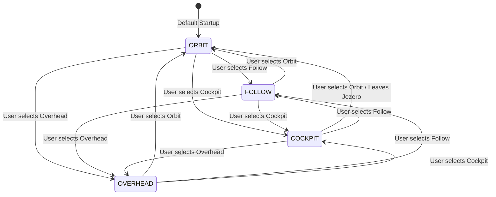

# MarsWalk 2.0 — Milestone 10A Architectural Design Document

**Milestone:** 10A — Mission Camera Director, Rover Follow Modes & Synchronized Telemetry Cues  
**Status:** Implemented & Verified  
**Date:** 2026-10-19  
**Workspace:** `E:\Python\NASA-Spaceapps\Marswalk`  

---

## 1. Executive Summary

Milestone 10A transforms MarsWalk's mission playback from a static scene observation into a fully controllable, multi-perspective **Mission Camera Director** equipped with:
1. **Four Specialized Camera Modes:**
   - **ORBIT:** Free orbital manipulation via `OrbitControls` with manual pan, tilt, and zoom without camera fighting.
   - **ROVER FOLLOW:** Smooth third-person chase camera aligned with the computed route heading vector.
   - **ROVER COCKPIT:** Forward-facing first-person rover perspective mounted atop the sensor mast with an explicit HUD flight envelope disclaimer and reticle.
   - **OVERHEAD:** Stabilized top-down nadir tracking centered on the rover marker.
2. **Route-Aware Heading & Stationary Latching:**
   - Smooth look-ahead heading calculation with $[-\pi, \pi]$ angular normalization and low-pass filtering.
   - Strict **heading latching** during stationary dwell and delay periods, completely eliminating camera and marker jitter.
3. **Synchronized Telemetry & In-Memory Audio Synthesizer:**
   - Web Audio API pure synthesizer (sine/triangle waves) operating entirely in browser memory with zero network dependencies.
   - Strictly **MUTED by default**; enabled only via explicit user interaction.
   - Scrubbing suppression to prevent auditory avalanche during rapid slider interaction.
   - Synchronized visual telemetry badge pulses (`[🔔 CUE]`) and real-time distance-to-next-stop readouts.

---

## 2. Mathematical & Coordinate Architecture

### 2.1 Coordinate System & Heading Yaw Derivation
Terrain coordinates in the Jezero Surface Workstation map grid rows $r$ and columns $c$ to local Three.js coordinates $(x, y, z)$ via `rcToLocalPos`:
$$x = c \cdot \Delta x_{\text{ground}} - \frac{W_{\text{grid}}}{2}$$
$$z = r \cdot \Delta y_{\text{ground}} - \frac{H_{\text{grid}}}{2}$$
$$y = (z_{\text{elev}} - z_{\text{min}}) \cdot k_{\text{exag}} + 6.0\,\text{m}$$
where $+x$ points East, $+z$ points South, and $+y$ points Upward.

Given the current interpolated rover position $\mathbf{p}(t) = (x_t, y_t, z_t)$ and a look-ahead position sampled along the route at $t + \Delta t$ ($1.2\,\text{s}$ forward), the horizontal displacement vector is:
$$\Delta x = x_{t + \Delta t} - x_t,\quad \Delta z = z_{t + \Delta t} - z_t$$
$$\Delta d_H = \sqrt{\Delta x^2 + \Delta z^2}$$

When $\Delta d_H > 0.02\,\text{m}$, the instantaneous target heading yaw angle $\theta_{\text{target}}$ is:
$$\theta_{\text{target}} = \operatorname{atan2}(\Delta x, \Delta z)$$

### 2.2 Angular Wrap-Around & Exponential Smoothing
Direct linear interpolation between angles can produce jarring 350-degree flips across the $\pm \pi$ branch cut. MarsWalk normalizes angular error into $[-\pi, \pi]$:
$$\Delta \theta = (\theta_{\text{target}} - \theta_{\text{smooth}} + 3\pi) \pmod{2\pi} - \pi$$

The smoothed heading is updated per frame using an exponential low-pass filter:
$$\theta_{\text{smooth}} \leftarrow \theta_{\text{smooth}} + \alpha \cdot \Delta \theta,\quad \alpha = 0.18$$

The compass heading in degrees displayed on the telemetry HUD is:
$$\text{Heading}_{\text{deg}} = (\lfloor \theta_{\text{smooth}} \cdot \frac{180}{\pi} \rceil + 360) \pmod{360}$$

### 2.3 Pitch Calculation
Terrain-aware pitch $\phi$ is calculated from vertical climb over horizontal distance:
$$\phi_{\text{target}} = \operatorname{atan2}(y_{t + \Delta t} - y_t, \Delta d_H)$$
$$\phi_{\text{smooth}} \leftarrow \phi_{\text{smooth}} + \alpha \cdot (\phi_{\text{target}} - \phi_{\text{smooth}})$$

Vehicle orientation is applied via Euler order `'YXZ'`:
$$\mathbf{R}_{\text{vehicle}} = \mathbf{R}_y(\theta_{\text{smooth}}) \cdot \mathbf{R}_x(-\phi_{\text{smooth}} \cdot 0.4)$$

### 2.4 Stationary Latching Guarantee
During science dwell periods (`event_type == "science_dwell"`) or contingency delays (`event_type == "scenario_delay"`), $\Delta d_H = 0$.
If unhandled, floating-point noise or discrete state boundary transitions would cause the camera or marker to jitter.

Milestone 10A implements strict stationary latching:
$$\text{If } \text{is\_stationary} = \text{True} \implies \theta_{\text{smooth}} \equiv \theta_{\text{latched}},\quad \phi_{\text{smooth}} \equiv \phi_{\text{latched}}$$
The vehicle rotation and camera director completely freeze rotational adjustment, guaranteeing zero jitter.

---

## 3. Camera Director Modes

### 3.1 Mode Specifications

| Camera Mode | Offset Behind ($D$) | Height Above ($H$) | Look-Ahead ($L$) | HUD Indicator / Overlay | Controls Status |
|:---|:---:|:---:|:---:|:---|:---:|
| **ORBIT** | User-controlled | User-controlled | Center of Interest | Standard HUD | `controls.enabled = true` |
| **ROVER FOLLOW** | $68.0\,\text{m}$ | $34.0\,\text{m}$ | $18.0\,\text{m}$ ahead | Follow pill active | `controls.target` lerped |
| **ROVER COCKPIT** | $-4.0\,\text{m}$ (forward) | $8.5\,\text{m}$ (mast) | $140.0\,\text{m}$ ahead | Banner, Reticle, Disclaimer | Look-at lerped directly |
| **OVERHEAD** | $0.0\,\text{m}$ | $460.0\,\text{m}$ (nadir) | $0.0\,\text{m}$ (down) | Overhead pill active | Nadir down-vector |

### 3.2 Smooth Non-Disorienting Transition
Switching modes never triggers a jump-cut or viewport disorientation. Camera coordinates and look-at targets are smoothly blended toward target poses using spherical/exponential decay (`lerp(target, alpha)` with $\alpha \in [0.08, 0.18]$), producing a cinematic camera dolly motion between viewpoints.

---

## 4. Web Audio Synthesizer & Telemetry Cues

### 4.1 In-Memory Synthesis Architecture
- Implemented via `window.AudioContext`.
- **Zero Network Assets:** No MP3, WAV, or external audio libraries.
- **Strict Default:** `audioCuesEnabled = false`. Audio is completely silent unless the user explicitly clicks the audio toggle.
- **Fail-Safe:** Automatically catches errors and suppresses playback if the browser blocks audio autoplay.

### 4.2 Harmonic Cue Frequencies & Profiles

| Event Cue | Harmonic Profile | Waveform | Duration | Purpose |
|:---|:---|:---:|:---:|:---|
| **`start`** | $523.25\,\text{Hz} \to 659.25\,\text{Hz}$ ($C_5 \to E_5$) | Sine | $230\,\text{ms}$ | Mission departure chime |
| **`science_dwell`** | $587.33 \to 739.99 \to 880.0\,\text{Hz}$ ($D_5 \to F\sharp_5 \to A_5$) | Triangle | $280\,\text{ms}$ | Science target arrival tri-tone |
| **`scenario_delay`** | $349.23\,\text{Hz}$ ($F_4$) double-pulse | Triangle | $220\,\text{ms}$ | Cautionary hold alert |
| **`arrival`** | $523.25 + 659.25 + 783.99\,\text{Hz}$ ($C_5+E_5+G_5$) | Sine chord | $450\,\text{ms}$ | Mission complete major triad |
| **`speed`** | $987.77\,\text{Hz}$ ($B_5$) | Triangle | $35\,\text{ms}$ | Subtle speed change tick |

### 4.3 Scrubbing Suppression
When the user scrubs the timeline slider (`mousedown` or `touchstart`), `isUserScrubbing` is set to `true`. Event triggers are edge-detected and suppressed during manual high-speed scrubbing, preventing audio clutter.

---

## 5. Visual HUD & Telemetry Synchronization

1. **Cockpit HUD Overlay (`#cockpitHudOverlay`):**
   - Active strictly in Cockpit view.
   - Includes crosshair, pitch ladder markings, and telemetry readout.
   - Includes mandatory aerospace disclaimer:
     `ILLUSTRATIVE VISUALIZATION • NOT A CERTIFIED ASTRONAUT FLIGHT ENVELOPE`.
2. **Telemetry Cue Badge (`#playbackEventCueBadge`):**
   - Pulses with an amber glow (`.event-cue-pulse`) for 1.8 seconds when transitioning into an event.
3. **Distance-to-Next-Stop Readout (`#playbackDistToNext`):**
   - Dynamically scans `model.events` for the next stop and displays real-time remaining distance (e.g., `412 m (Three Forks)`).
