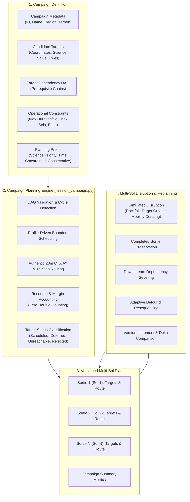

# MarsWalk 2.0 (Project Atlas) — Milestone 11A Design Specification
## Mission Campaign Orchestrator: Multi-Sol Planning & Resource-Aware Scheduling

**Milestone:** 11A  
**Status:** In Progress / Implementation  
**Target Version:** `v2.0.0`  
**Architecture Layer:** Core Planning, API Contracts, Persistent Workspaces, and UI Visualization  

---

## 1. Problem Statement & Motivation

Prior to Milestone 11A, MarsWalk operated strictly as an **individual-sortie planner**. A mission designer specified a single start point, single goal, and an ordered or unordered set of waypoints for a single traverse window ($\le 8\text{ h}$ for crew EVA, $\le 4\text{ h}$ for robotic rovers).

However, real planetary surface operations—such as the Mars 2020 *Perseverance* exploration of the Jezero delta or future Artemis/Mars human expeditions—do not operate in single isolated bursts. They execute **multi-sol mission campaigns** spanning multiple operational days:
1. **Scientific Dependency Sequences:** High-value research targets often have strict geological prerequisites (e.g., initial orbital spectral validation at *Octavia Landing* must precede sample caching at *Three Forks Depot*, which in turn must precede core drilling at *Artuby Ridge*).
2. **Resource & Duration Partitioning:** A comprehensive science campaign exceeds what can be physically traversed in a single sol's life-support or drive window. Targets must be intelligently partitioned across multiple distinct sorties without exceeding daily operational ceilings.
3. **Compound Downstream Disruptions:** In a multi-sol campaign, an unforeseen disruption on Sol 1 (e.g., rockfall corridor closure, actuator degradation, or uncollected sample) directly affects the feasibility, order, and scientific value of subsequent sorties on Sol 2, Sol 3, and beyond.
4. **Campaign Governance & Provenance:** Planners require versioned campaign records where prior plans, executed sorties, and replanned contingencies are preserved without mutational data loss.

**Milestone 11A introduces the Mission Campaign Orchestrator**, evolving MarsWalk into a multi-sol campaign planning system while strictly preserving the validated V1 single-sortie routing baseline.

---

## 2. Campaign Architecture & Entity Relationships

---

## 3. Data Model & Contract Specification

### 3.1 Candidate Target (`CampaignTarget`)
Each candidate target defines:
- `id`: Unique identifier (e.g., `t_three_forks`).
- `name`: Human-readable label (e.g., "Three Forks Sample Depot").
- `row`, `col`: Grid coordinates on the Jezero 20m DTM ($250 \times 250$).
- `priority_score`: Scalar scientific value ($0.0$ to $100.0$).
- `priority_label`: Explicit provenance indicator (`"user_defined"` or `"default"`).
- `dwell_time_s`: Required science investigation duration (default $900\text{ s}$).
- `prerequisites`: List of prerequisite target IDs that must be completed before this target can be scheduled.
- `geological_context`: Brief description of geological significance.
- `status`: Current planning state:
  - `SCHEDULED`: Successfully assigned to a feasible sortie.
  - `COMPLETED`: Already executed during in-progress campaign.
  - `DEFERRED`: Omitted due to `max_sols` or campaign duration limits.
  - `UNREACHABLE`: Exceeds terrain reachability or single-sortie duration limit from base.
  - `REJECTED_PREREQUISITE_FAILED`: Required prerequisite target was omitted, unvisited, or blocked.
  - `REJECTED_BUDGET_EXCEEDED`: Exceeds operational parameters.

### 3.2 Campaign Configuration (`CampaignConfig`)
- `planning_profile`: One of `"science_priority"`, `"time_constrained"`, `"conservative"`.
- `vehicle_mode`: `"crew_eva"` (default) or `"robotic_rover"`.
- `speed_multiplier`: Float multiplier (default $1.0$).
- `max_duration_per_sortie_s`: Operational limit per sol (default $28,800\text{ s}$ for crew EVA, $14,400\text{ s}$ for rover).
- `max_sols`: Maximum number of operational sorties allowed in the campaign (e.g. $3$, $5$, $7$).
- `base_start_rc`: Departure grid coordinate (default Octavia Landing: `(117, 157)`).
- `base_end_rc`: Return grid coordinate (optional; defaults to `base_start_rc` if return-to-base enabled).
- `return_to_base_each_sol`: Boolean flag. If `True`, each sortie begins and ends at the base station; if `False`, daisy-chained sorties begin where the prior sortie terminated.

### 3.3 Multi-Sol Sortie (`CampaignSortie`)
- `sortie_id`: Unique identifier (e.g. `sortie_sol_1`).
- `sol_index`: 1-based integer representing operational sol.
- `start_rc`, `goal_rc`: Specific departure and destination coordinates for this sortie.
- `target_ids`: Sequenced list of targets visited.
- `path_rc`: Continuous 8-connected grid coordinates planned by the authentic Python A* engine.
- `distance_m`: Cumulative ground traversal distance in meters.
- `travel_time_s`: Active kinematic walking or driving time in seconds.
- `dwell_time_s`: Cumulative stationary observation time in seconds.
- `total_duration_s`: $\text{travel\_time\_s} + \text{dwell\_time\_s}$.
- `remaining_margin_s`: $\text{max\_duration\_per\_sortie\_s} - \text{total\_duration\_s}$.
- `is_feasible`: Boolean indicating both reachability and budget compliance.
- `status`: `"PLANNED"`, `"COMPLETED"`, `"DISRUPTED"`, `"BLOCKED"`.

---

## 4. Multi-Sol Scheduling Algorithms & Planning Profiles

### 4.1 Dependency Graph Resolution
Before scheduling, the engine constructs an in-degree adjacency matrix across candidate targets:
1. **Cycle Detection:** Performs Tarjan's or Kahn's topological sort. If a cycle is detected (e.g. $A \rightarrow B \rightarrow A$), planning halts immediately with an explicit error detailing the cyclic dependency chain.
2. **Readiness Evaluation:** At any step, a candidate target is deemed *ready* if and only if all its prerequisite targets have been assigned to an earlier sortie or earlier in the current sortie sequence.

### 4.2 Planning Profiles & Distinct Trade-Offs

The engine implements three distinct heuristic strategies to satisfy the requirement for genuinely different trade-offs:

| Profile | Primary Objective | Target Selection Heuristic | Operational Margin Buffer | Expected Schedule Characteristics |
| :--- | :--- | :--- | :--- | :--- |
| **`science_priority`** | Maximize cumulative scientific value ($\sum \text{Score}$) | Highest priority score first among ready targets | Standard ceiling ($100\%$ of $\text{Duration}_{\max}$) | Packs maximum number of high-value targets into fewer sorties; accepts longer traverses and lower margins. |
| **`time_constrained`** | Maximize scientific yield per unit time ($\text{Score} / \Delta t$) | Highest scientific efficiency ($\text{Score} / (\Delta \text{Travel} + \text{Dwell})$) | Standard ceiling ($100\%$ of $\text{Duration}_{\max}$) | Prioritizes spatial clusters of targets requiring minimal detour overhead; discards distant or inefficient targets. |
| **`conservative`** | Maximize operational safety & feasibility buffer | Lowest slope gradient and elevation climb penalty | Tightened ceiling ($80\%$ of $\text{Duration}_{\max}$) | Spreads targets across more sols; enforces larger time margins ($\ge 20\%$); strictly rejects steep terrain passages. |

---

## 5. Multi-Sol Disruption & Adaptive Replanning

When an operational contingency occurs:
1. **Hazard Injection:** The operator defines a disruption (e.g., Rockfall barrier with radius $R$, target sensor failure, vehicle speed derating, or operational hold).
2. **Impact Auditing:** The engine checks which sorties intersect the hazard or are affected by changed parameters. Completed sorties (e.g., Sol 1 already executed) are marked immutable.
3. **Dependency Cascading:** If Target $T_i$ on Sol $k$ becomes unreachable or is dropped, any downstream targets $\{T_j\}$ that depend on $T_i$ are automatically marked `REJECTED_PREREQUISITE_FAILED` across all subsequent sols.
4. **Resequencing & Detour Synthesis:** For uncompleted sorties, the engine attempts to route around the hazard or repartition remaining valid targets.
5. **Version Immutability:** The original campaign remains unchanged at Version 1; the new plan is saved as Version 2 with a distinct revision ID, linking back to the parent campaign ID and embedding the triggering disruption and comparison deltas.

---

## 6. Scientific Governance & Operational Disclaimers

> [!CAUTION]
> **Research Simulation Disclaimer:** Multi-sol campaign schedules, sortie durations, metabolic energy expenditures, and contingency trade-offs modeled by the MarsWalk 2.0 Campaign Orchestrator are mathematical approximations designed for mission architecture trade studies. They are **NOT** flight-certified operational safety guarantees for human planetary EVAs or autonomous rover surface operations.

> [!IMPORTANT]
> **Planetary Boundary Restriction:** All campaign waypoints and sortie trajectories are strictly bounded to the surveyed USGS CTX Jezero Crater extent (Rows: 0–249, Cols: 0–249). Points outside this boundary are rejected with descriptive validation errors.

> [!NOTE]
> **Zero Double-Counting Guarantee:** Campaign summaries strictly sum distinct non-overlapping sortie ground distances, travel times, and dwell times. Reused base departure and return segments are explicitly accounted per sortie and never duplicated in campaign-level totals.
