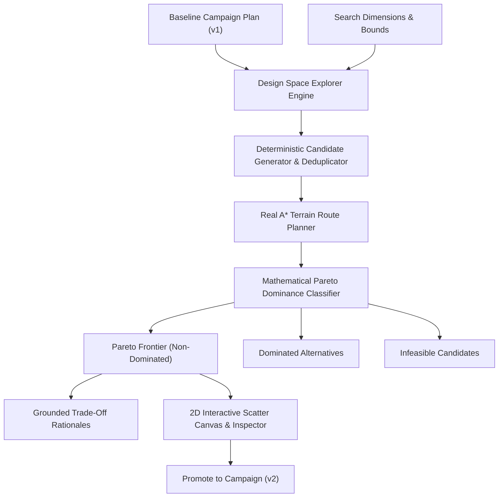

# MarsWalk 2.0 — Milestone 11H Engineering & Verification Report
## Campaign Design Space Explorer & Pareto Optimization

**Milestone:** 11H (MarsWalk 2.0 V2)  
**Status:** COMPLETE & VERIFIED  
**Date:** 2026-10-29  
**Target Environment:** Mars (IAU 2000 Sphere / USGS CTX DTM 20m Jezero Crater Topography)  
**Verification Baseline:** Full Repository Pytest Suite Passing (633/633 Tests, 100% Green across 45 Test Suites), Atlas Preflight 12/12 Checkpoints Passed, Node.js Syntax Check 0 Errors  

---

## 1. Executive Summary

Milestone 11H delivers the **Campaign Design Space Explorer & Pareto Optimization** system, equipping MarsWalk with a deterministic, multi-objective decision-support framework that evaluates bounded alternative campaign configurations, discovers Pareto-efficient trade-offs, and allows operators to promote candidate configurations into distinct, traceable campaign revisions.

Prior to Milestone 11H, operators could plan campaigns, inject disruptions, simulate digital twin executions, and audit retrospective deviations, but exploring alternative configuration options required manual, repetitive trial-and-error. Milestone 11H automates bounded parameter exploration while upholding MarsWalk's strict scientific principles: zero fabricated telemetry, zero opaque composite scores, and explicit search completeness accounting.

### Key Capabilities Delivered:
1. **Multi-Objective Bounded Design Space Engine ([`src/marswalk/core/campaign_design_space.py`](file:///E:/Python/NASA-Spaceapps/Marswalk/src/marswalk/core/campaign_design_space.py))**:
   - Evaluates a finite, bounded grid of campaign dimensions: planning profiles (`science_priority`, `time_constrained`, `conservative`), per-sortie duration limits ($21,600\text{ s}$, $28,800\text{ s}$, $32,400\text{ s}$, $36,000\text{ s}$), and maximum sol constraints (2, 3, 4, 5 Sols).
   - Generates candidates in a deterministic, reproducible order.
   - Computes canonical SHA-256 input fingerprints to prevent redundant re-evaluations of identical parameter sets.
   - Enforces strict computational bounds (`max_candidates`, `max_planner_calls`), recording whether the search was exhaustive or bounded, and noting unexplored parameter scopes.
2. **Real Planner Candidate Evaluation**:
   - Each candidate is evaluated through the authentic A* kinematic planner across the authentic USGS CTX 20m Jezero Crater DTM.
   - Computes real feasibility, route coordinates, duration, traverse distance, and objective coverage.
   - Infeasible candidates (e.g. sol duration limit violations or unroutable terrain) are partitioned separately with explicit failure causes and cannot dominate feasible alternatives.
3. **Rigorous Mathematical Pareto Frontier Dominance**:
   - Evaluates multi-dimensional objective vectors:
     $$\mathbf{z}(c) = \big( \text{ScienceCoveragePct}(c),\, \text{TotalDurationSeconds}(c),\, \text{TotalDistanceMeters}(c),\, \text{UnallocatedPriority}(c),\, \text{TemporalConflictsCount}(c) \big)$$
   - Candidate $A$ dominates candidate $B$ ($A \succ B$) iff $A$ is at least as good as $B$ on all objectives, strictly better in at least one, and $A$ is feasible.
   - Partitions evaluated candidates into:
     - `PARETO_EFFICIENT`: Non-dominated feasible frontier candidates.
     - `DOMINATED`: Feasible candidates dominated by at least one frontier candidate (tracks dominating references).
     - `INFEASIBLE`: Candidates violating kinematic or temporal envelopes.
     - `INCOMPARABLE`: Candidates with incompatible or missing metrics (safeguard against data coercion).
4. **Grounded Trade-off Explanations**:
   - For every frontier candidate, generates human-readable comparative rationales grounded in real calculated numbers (e.g. "Maximal science yield: 100.0% coverage across 3 sorties over 28,400s", "Expedited duration: saves 2.8h with 85.0% science retention").
   - Synthesizes advisory recommendations for Maximal Science, Expedited Duration, and Minimal Traverse Distance without fabricated probabilities or confidence scores.
5. **Campaign Baseline Immutability & Safe Candidate Promotion**:
   - Promoting a chosen feasible candidate generates a distinct, versioned campaign plan ($v_{n+1}$) in workspace storage.
   - Preserves baseline and historical campaign plans without in-place mutation.
   - Hard gate prevents promoting infeasible candidates (`ERR_CANDIDATE_INFEASIBLE`).
6. **Atlas Web Application UI (8th Tab: `#campaignDesignSpaceView`)**:
   - Parameter exploration toolbar with candidate budget slider, profile checkboxes, and sol limit selectors.
   - Search completeness status banner and KPI summary cards.
   - Interactive 2D HTML5 Canvas Pareto scatter plot (Duration vs Science Coverage) displaying dominated points, infeasible points, and the connected Pareto-efficient frontier step-curve.
   - Sortable candidate comparison table with Pareto status badges and inspection triggers.
   - Selected candidate detail inspector with configuration delta preview.
   - One-click promotion to a new campaign version and JSON briefing export.

---

## 2. Architecture & Contracts

### 2.1 JSON Schema Contract
- **Contract Path**: [`schemas/api/v1/campaign-design-space.schema.json`](file:///E:/Python/NASA-Spaceapps/Marswalk/schemas/api/v1/campaign-design-space.schema.json)
- **Schema Dialect**: JSON Schema Draft 2020-12
- **Required Properties**: `schema_version`, `design_space_id`, `campaign_id`, `campaign_version`, `created_at_utc`, `search_bounds`, `search_completeness`, `pareto_candidates`, `dominated_candidates`, `infeasible_candidates`, `recommendations`, `limitations_disclaimer`.

### 2.2 REST API Endpoints

| Method | Endpoint | Description |
|---|---|---|
| `POST` | `/api/campaign/design-space/evaluate` | Launches bounded multi-objective design space exploration. |
| `GET` | `/api/campaign/design-spaces` | Lists saved campaign design space explorations. |
| `GET` | `/api/campaign/design-space/<design_space_id>` | Retrieves a specific design space evaluation record. |
| `POST` | `/api/campaign/design-space/promote` | Promotes a feasible candidate to a distinct new campaign version ($v_{n+1}$). |

---

## 3. Verification & Acceptance Gate Outcomes

### 3.1 Dedicated Test Suite (`tests/test_milestone_11h_campaign_design_space.py`)
- **16/16 tests passing (100% green in 0.77s)**:
  1. `test_pareto_mathematical_dominance_strict`: Pure mathematical dominance verification.
  2. `test_pareto_mathematical_tradeoff_non_dominance`: Non-dominance of genuine trade-offs.
  3. `test_pareto_infeasible_candidate_partition`: Infeasible candidates cannot dominate feasible ones.
  4. `test_deterministic_candidate_generation_and_deduplication`: Order determinism and SHA-256 deduplication.
  5. `test_search_bound_limit_enforcement`: Bounded budget limit enforcement and completeness reporting.
  6. `test_real_campaign_design_space_exploration`: Real A* evaluation across Jezero CTX 20m topography.
  7. `test_schema_validation_campaign_design_space`: Draft 2020-12 validation and corrupted payload rejection.
  8. `test_tradeoff_recommendations_grounded_metrics`: Grounded non-fabricated recommendation metrics.
  9. `test_workspace_persistence_and_listing`: Atomic persistence, retrieval, and filtered listing.
  10. `test_candidate_promotion_creates_new_version_and_preserves_baseline`: Safe version promotion ($v_1 \to v_2$) with baseline immutability.
  11. `test_infeasible_candidate_promotion_rejected`: Hard error on attempting to promote infeasible candidate.
  12. `test_api_service_design_space_endpoints`: Service method execution and validation.
  13. `test_http_rest_design_space_endpoints`: Live HTTP requests on port 3000 (evaluate, list, get, promote).
  14. `test_limitations_disclaimer_present`: Mandatory disclaimer against global optimality claims.
  15. `test_candidate_incomparable_and_missing_data_safeguards`: NaN and missing value safeguards.
  16. `test_different_objective_vectors_and_weights`: Multi-objective trade-offs across distinct planning profiles.

### 3.2 Campaign Subsystem Regression Suite (11A through 11H)
- **129/129 campaign tests passing (100% green in 5.88s)** across 8 milestone test suites:
  - `test_milestone_11a_mission_campaign.py`: 18 tests
  - `test_milestone_11b_campaign_progress.py`: 13 tests
  - `test_milestone_11c_campaign_intelligence.py`: 16 tests
  - `test_milestone_11d_campaign_scenarios.py`: 17 tests
  - `test_milestone_11e_campaign_coordination.py`: 16 tests
  - `test_milestone_11f_campaign_simulator.py`: 16 tests
  - `test_milestone_11g_campaign_analytics.py`: 17 tests
  - `test_milestone_11h_campaign_design_space.py`: 16 tests

### 3.3 Atlas Server Preflight Diagnostics
- **12/12 checkpoints passed in 422.9ms on port 3000**:
  - HTTP API Server, Web Frontend Assets, Feature Gazetteer (2,061 features), Imagery Registry (9 datasets), Global Basemap Layer, Jezero Optical Orthomosaic, Jezero Crater 20m DTM, A* Route Planning Engine, Gauntlet Disruption Engine, Workspace Storage, Mission Briefing & Schema Validator, Streamlit App.

### 3.4 JavaScript Syntax Validation
- `node --check web/app.js`: **0 syntax errors**.
